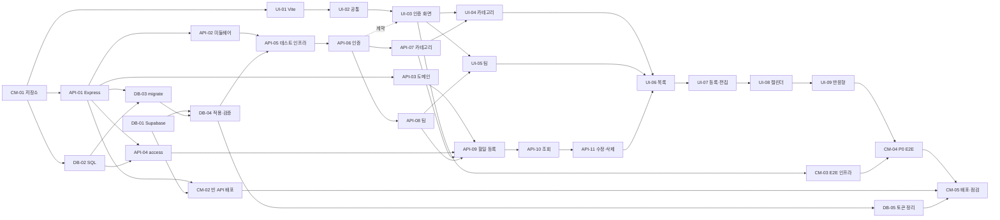

 ✅ 완료 |✅ 완료 |# TodoList 풀스택 실행 계획 (WBS)

| 항목 | 내용 |
|------|------|
| 작성일 | 2026-11-04 |
| 작성자 | hjining |
| 기준 문서 | `docs/1-domain-definition.md` v0.13, `docs/2-prd.md` v0.15, `docs/3-user-scenario.md` v0.14, `docs/4-wireframe.md` v0.12, `docs/5-project-principle.md` v0.13, `docs/6-arch-diagram.md` v0.8, `docs/7-erd.md` v0.6, `docs/8-swagger.yaml` v0.5(API 경로·필드·상태 코드는 이 명세를 따른다) |
| 목표일 | P0·P1 모두 2026-11-05(목) (PRD Q3) |
| 초안 DDL | `docs-local/schema.sql` (ERD v0.3 기준, `refresh_tokens` 포함) |
| 개정 | 2026-11-04 인증 방식 변경: 리프레시 토큰 추가, JWT 서명 알고리즘 HS384 (W-06, W-07). 기준 문서에 반영 완료(PRD A25–A28, 6.1) |
| 개정 | 2026-11-04 API 명세(`docs/8-swagger.yaml` v0.3) 결정 반영: `GET /api/health` 공개·응답 고정(SEC-04), 날짜만 보낸 일시 허용(SEC-11, S-06), 대리 등록 `sharedTeamIds` 거부(S-07), 캘린더 42일을 달력 날짜로 판정(S-03), 쿠키 항상 `Secure`, API-08 검사 순서 |
| 개정 | 2026-11-05 백엔드(API-01–API-14) 구현 결과를 기준 문서에 반영(`sync-docs`): 마이그레이션 적용 기록 `schema_migrations`(W-02, OPS-18, ERD 1장), 비밀번호 변경 시 리프레시 토큰 삭제(W-06, SEC-02, ERD 3.6, swagger `PATCH /api/me`), `offset` 최대 999,999,999(swagger). 구현 중 정한 것과 알아 둘 점은 6.2 |
| 개정 | 2026-11-05 백엔드 완료 뒤 추가 변경: `GET /api/health`를 서버·DB 상태 분리 응답으로 변경(SEC-04 v0.13, swagger v0.5 S-16, CM-02·API-01 반영), 개발 모드 전용 Swagger UI `/swagger` 추가(프로젝트 원칙 1.2·6.3). 6.2 BD-10·BD-11 |
| 개정 | 2026-11-05 프론트·API 연결을 Vite 프록시·동일 출처에서 **CORS**로 변경(사용자 결정): 백엔드 `middleware/cors.js`, 환경변수 `CORS_ORIGINS`·`COOKIE_SAMESITE`, 프론트 `VITE_API_BASE_URL`·`credentials: 'include'`. PRD v0.15, SEC-07, G-14 반영. CM-02·CM-05·UI-01·UI-02 수정. 6.2 BD-12, 6장 W-09(미결) |

> 표기
> - Task ID: 데이터베이스 `DB-nn`, 백엔드 `API-nn`, 프론트엔드 `UI-nn`, 세 영역에 걸친 공통 작업 `CM-nn`. 프로젝트 원칙의 규칙 ID(`BE-xx`, `FE-xx`)와 겹치지 않도록 다른 접두사를 썼다.
> - 근거는 기준 문서의 ID로만 적는다(FR, R, S, F, US, EX, SC, DLG, ST, P-, BE-, FE-, N-, Q-, SEC-, OPS-, E-).
> - 이 계획서가 정하는 ID: 확인 필요 사항 `W-nn`(6장), 백엔드 구현 중 결정 `BD-nn`, 알아 둘 위험 `BK-nn`(6.2). 사용자 시나리오 6.4의 불일치 `D-nn`, PRD 리스크 `Kn`과 구분한다.
> - `[P1]`이 붙은 Task는 P0 완료 뒤에 한다. 표시가 없으면 P0이다.
> - 선행 Task가 끝나야 시작할 수 있다. "API 계약만 필요"라고 적힌 선행은 API가 끝나기 전에 응답 형태만 맞춰 먼저 시작해도 된다.
> - 모든 Task의 공통 완료 조건(Q-14 셀프 체크리스트): 린트·테스트 통과, `console.log` 없음, 커밋 메시지 Conventional Commits. 각 Task 표에서는 반복하지 않는다.

## 1. 전체 구조

### 1.1 Task 목록 요약

> 상태: ✅ 완료, 🔶 일부 완료(남은 항목은 해당 Task 메모 참고), ⏸ 보류(이유는 해당 Task 메모 참고), 빈칸은 시작 전. 2026-11-05 기준

| 영역 | Task | 이름 | 우선순위 | 선행 | 상태 |
|------|------|------|----------|------|------|
| 공통 | CM-01 | 저장소 골격·공통 설정 | P0 | - | ✅ 완료 |
| 공통 | CM-02 | 빈 API Vercel 배포 확인 | P0 | API-01, DB-01 | ⏸ 보류 |
| 공통 | CM-03 | E2E 인프라 | P0 | UI-03, API-06 |  |
| 공통 | CM-04 | P0 E2E 시나리오 | P0 | CM-03, UI-04–UI-09 |  |
| 공통 | CM-05 | 운영 배포·P0 수용 기준 점검 | P0 | CM-02, CM-04, DB-04, DB-05 |  |
| 공통 | CM-06 | [P1] P1 E2E·재배포 | P1 | CM-05, UI-10–UI-12 |  |
| DB | DB-01 | Supabase 프로젝트·연결 준비 | P0 | - | 🔶 일부 |
| DB | DB-02 | 초기 마이그레이션 SQL | P0 | CM-01 | ✅ 완료 |
| DB | DB-03 | 마이그레이션 실행 스크립트 | P0 | API-01, DB-02 | ✅ 완료 |
| DB | DB-04 | 스키마 적용·제약 검증 | P0 | DB-01, DB-03 | ✅ 완료 |
| DB | DB-05 | 만료 리프레시 토큰 정리 작업 | P0 | DB-04 | 🔶 일부 |
| 백엔드 | API-01 | Express 골격·DB 풀 | P0 | CM-01 | ✅ 완료 |
| 백엔드 | API-02 | 에러·인증 미들웨어 | P0 | API-01 | ✅ 완료 |
| 백엔드 | API-03 | 도메인 규칙(상태·기간) | P0 | API-01 | ✅ 완료 |
| 백엔드 | API-04 | 권한 SQL 조각(access.js) | P0 | API-01, DB-02 | ✅ 완료 |
| 백엔드 | API-05 | 통합 테스트 인프라 | P0 | API-02, DB-04 | ✅ 완료 |
| 백엔드 | API-06 | 인증(리프레시 토큰 포함)·내 정보 조회 | P0 | API-05 | ✅ 완료 |
| 백엔드 | API-07 | 카테고리 CRUD | P0 | API-06 | ✅ 완료 |
| 백엔드 | API-08 | 팀·구성원 관리 | P0 | API-06 | ✅ 완료 |
| 백엔드 | API-09 | 할일 등록 | P0 | API-03, API-04, API-07, API-08 | ✅ 완료 |
| 백엔드 | API-10 | 할일 목록·캘린더·단건 조회 | P0 | API-09 | ✅ 완료 |
| 백엔드 | API-11 | 할일 수정·완료·삭제 | P0 | API-10 | ✅ 완료 |
| 백엔드 | API-12 | [P1] 내 정보 수정 | P1 | API-06 | ✅ 완료 |
| 백엔드 | API-13 | [P1] 변경 이력 기록·조회 | P1 | API-11 | ✅ 완료 |
| 백엔드 | API-14 | [P1] 소유자의 팀 나가기 | P1 | API-08 | ✅ 완료 |
| 프론트 | UI-01 | 프론트 골격·shadcn | P0 | CM-01 | ✅ 완료 |
| 프론트 | UI-02 | 공통 API 클라이언트·유틸·부품 | P0 | UI-01, API-10(계약) | ✅ 완료 |
| 프론트 | UI-03 | 인증 화면·가드·공통 레이아웃 | P0 | UI-02, API-06(계약) | ✅ 완료 |
| 프론트 | UI-04 | 카테고리 관리(SC-06) | P0 | UI-03, API-07 | ✅ 완료 |
| 프론트 | UI-05 | 팀 목록·상세(SC-08, SC-09) | P0 | UI-03, API-08 | ✅ 완료 |
| 프론트 | UI-06 | 할일 목록(SC-03) | P0 | UI-04, UI-05, API-10, API-11 |  |
| 프론트 | UI-07 | 할일 등록·편집·읽기 전용(SC-04) | P0 | UI-06, API-09, API-11 |  |
| 프론트 | UI-08 | 캘린더(SC-05) | P0 | UI-07, API-10 |  |
| 프론트 | UI-09 | 반응형·공통 상태 마감 | P0 | UI-08 |  |
| 프론트 | UI-10 | [P1] 내 정보(SC-07) | P1 | UI-03, API-12 |  |
| 프론트 | UI-11 | [P1] 변경 이력 탭 | P1 | UI-07, API-13 |  |
| 프론트 | UI-12 | [P1] 팀 나가기(DLG-04) | P1 | UI-05, API-14 |  |

### 1.2 의존 관계

- 주 경로(critical path): CM-01 → API-01 → DB-03 → DB-04 → API-05 → API-06 → API-08 → API-09 → API-10 → API-11 → UI-06 → UI-07 → UI-08 → UI-09 → CM-04 → CM-05.
- 병렬 가능: DB-01(언제든), API-03·API-04(API-01 직후), UI-01·UI-02(CM-01 직후), UI-03(API-06 계약만 정하면).

### 1.3 일정 배치 (PRD 8.1)

| 일자·시간대 | Task |
|-------------|------|
| Day 1 (11/04) 오전 | CM-01 ✅, DB-01 🔶, DB-02 ✅, API-01 ✅, DB-03 ✅, DB-04 ✅, DB-05 🔶, CM-02 ⏸, API-02 ✅, API-03 ✅, API-04 ✅ |
| Day 1 오후 | API-05 ✅, API-06 ✅, API-07 ✅, API-08 ✅, API-09 ✅, API-10 ✅, API-11 ✅ |
| Day 1 저녁 | UI-01 ✅, UI-02 ✅, UI-03 ✅ |
| Day 2 (11/05) 오전 | UI-04 ✅, UI-05 ✅, UI-06, UI-07 |
| Day 2 오후 | UI-08, UI-09, CM-03 |
| Day 2 저녁 | CM-04, CM-05 |
| Day 2 P0 완료 직후 (PRD 8.2 순서) | API-12 ✅ → UI-10 → API-13 ✅ → UI-11 → API-14 ✅ → UI-12 → CM-06 |

- 일정이 밀리면 PRD K1 순서로 줄인다: API-14·UI-12(팀 나가기) → API-13·UI-11(이력) → API-12·UI-10(내 정보) → UI-08의 주·일 뷰(월 뷰만 유지).

---

## 2. 공통 (CM)

### CM-01 저장소 골격·공통 설정
- **선행 Task**: 없음
- **근거**: 프로젝트 원칙 6.1, Q-10, Q-12, Q-16, OPS-01
- **수행 작업**
  1. 루트 `package.json` 작성(공통 스크립트: `lint`, `test`, `dev`, `build`, `db:migrate`), `backend/`, `frontend/`, `api/`, `e2e/` 디렉토리 생성.
  2. `.env.example`에 키 이름만 기록(`DATABASE_URL`, `JWT_SECRET`). (2026-11-05 `backend/.env.example`로 이동, BD-14) 테스트 DB는 같은 키를 커밋하지 않는 `.env.test`에 둔다(G-04).
  3. `.gitignore`에 `playwright-report/`, `test-results/` 추가(`.env*` 제외 규칙은 이미 있음, `!.env.example` 유지).
  4. 루트 ESLint·Prettier 설정 하나로 공유. `import/no-restricted-paths`로 BE-01, BE-04, FE-01–FE-03 레이어 규칙을 강제. `shared/components/ui/`는 `react-refresh/only-export-components`에서 제외, `prettier-plugin-tailwindcss` 적용.
  5. `vercel.json`에 `/api/*` → `api/index.js`, 그 밖의 경로는 SPA `index.html` fallback.
- **완료 조건**
  - [x] 6.1의 최상위 디렉토리 구조가 만들어져 있다
  - [x] `.env.example`에 값 없이 키 이름만 있고, `.env`는 git에 추적되지 않는다
  - [x] `npm run lint`가 루트에서 실행되고, routes에서 repositories를 import하는 샘플 코드를 넣으면 린트 오류가 난다(확인 후 샘플 삭제)
  - [x] `vercel.json`에 `/api/*` 라우팅과 SPA fallback이 있다

### CM-02 빈 API Vercel 배포 확인
- **선행 Task**: API-01, DB-01
- **근거**: OPS-19, OPS-21, PRD K10
- **수행 작업**
  1. Vercel 프로젝트 생성, 저장소 연결, 환경변수 `DATABASE_URL`(운영 풀러 6543), `JWT_SECRET`(HS384용 48바이트 이상 무작위 값, 예: `openssl rand -base64 64`), `CORS_ORIGINS`(배포된 프론트 URL, 끝 `/` 없이), 프론트와 API가 다른 사이트(예: 서로 다른 `*.vercel.app`)면 `COOKIE_SAMESITE=none` 등록. 토큰 만료를 기본값(15분·7일)과 다르게 하려면 `ACCESS_TOKEN_TTL_MINUTES`·`REFRESH_TOKEN_TTL_DAYS`. 프론트에는 `VITE_API_BASE_URL`(배포된 API URL).
  2. `GET /api/health`만 있는 상태로 배포해 Express 함수 동작과 콜드 스타트를 확인.
- **완료 조건**
  - [ ] 배포 URL에서 쿠키 없이 `GET /api/health`가 200 `{"server":"ok","db":"ok"}`를 돌려준다(SEC-04 v0.13)
  - [ ] 시크릿이 저장소가 아니라 Vercel 환경변수에만 있다(OPS-01)
  - [ ] 콜드 스타트 응답 시간을 한 번 기록해 두었다

> 2026-11-04 보류: Vercel 배포는 백엔드·프론트엔드를 모두 만든 뒤 GitHub 저장소를 연동해 한 번에 진행하기로 했다. 배포용 코드(`api/index.js`, `vercel.json`, `GET /api/health`)는 준비됐고 로컬에서 200을 확인했다. 운영 DB(Supabase, DB-01 메모)가 생긴 뒤 CM-05 직전에 수행한다.

### CM-03 E2E 인프라
- **선행 Task**: UI-03, API-06
- **근거**: Q-05, Q-17–Q-21
- **수행 작업**
  1. `@playwright/test` 설치, `playwright.config.ts`에 `webServer`(로컬 백엔드 + 프론트 개발 서버, 테스트 DB 연결), Chromium 하나, `baseURL` 설정.
  2. `e2e/fixtures/`에 API로 계정·팀·구성원·할일을 만드는 헬퍼 작성. 이메일은 실행 시각 + 난수 접미사.
  3. `e2e/auth.spec.ts`의 US-02(로그인·로그아웃) 1개로 파이프라인 확인.
- **완료 조건**
  - [ ] `npx playwright test`가 운영 DB가 아닌 테스트 DB로 실행된다
  - [ ] 픽스처는 UI를 거치지 않고 API로 데이터를 만든다
  - [ ] US-02 테스트가 통과한다
  - [ ] 선택자는 `getByRole`·`getByLabel`·`getByText`만 쓰고 `waitForTimeout`이 없다

### CM-04 P0 E2E 시나리오
- **선행 Task**: CM-03, UI-04, UI-05, UI-06, UI-07, UI-08, UI-09
- **근거**: Q-05, Q-18–Q-20, 시나리오 1.4
- **수행 작업**
  1. P0 US마다 테스트 1개 이상 작성. 테스트 제목 앞에 시나리오 ID(`'US-04 할일 등록'`).
  2. 일시는 실행 시점과 무관하게 상태가 정해지는 값(먼 미래·먼 과거)만 쓴다(Q-20).
  3. 실패 시 trace·스크린샷으로 원인을 찾고 필요하면 Playwright MCP로 재현.
- **완료 조건**
  - [ ] `auth.spec.ts`: US-01, US-02, EX-04, EX-06 통과
  - [ ] `categories.spec.ts`: US-03(삭제 시 기본 카테고리로 이동) 통과
  - [ ] `todos.spec.ts`: US-04, US-05, US-06, US-07, US-08 통과
  - [ ] `calendar.spec.ts`: US-09(월·주·일 전환, 클릭 시 SC-04 이동) 통과
  - [ ] `teams.spec.ts`: US-11, US-12, US-13, US-15 통과
  - [ ] `permissions.spec.ts`: EX-20(403), EX-21(404), US-14(관리자 수정 성공), EX-25(공유 없는 할일 404) 통과
  - [ ] 전체 `npx playwright test`가 순서와 무관하게 통과한다(Q-18)

### CM-05 운영 배포·P0 수용 기준 점검
- **선행 Task**: CM-02, CM-04, DB-04, DB-05
- **근거**: OPS-22, PRD M6, PRD 4.3
- **수행 작업**
  1. 운영 DB에 마이그레이션 적용 확인 → 백엔드·프론트 배포(OPS-22 순서).
  2. 운영 URL에서 가입 → 할일 등록 → 캘린더 확인을 수동으로 1회 수행.
  3. US-10(모바일 레이아웃)은 실제 모바일 브라우저 또는 Chrome 기기 에뮬레이션으로 수동 검증.
  4. PRD 4.3의 P0 체크박스를 자동 테스트·수동 검증 결과로 표시.
- **완료 조건**
  - [ ] 운영 URL이 HTTPS로 동작하고 `access_token`, `refresh_token` 쿠키 모두에 `Secure`, `HttpOnly`, `SameSite`(`COOKIE_SAMESITE` 값, 기본 `Lax`)가 붙는다(`refresh_token`은 `Path=/api/auth`). 배포된 프론트에서 로그인 후 새로고침해도 로그인이 유지된다(쿠키가 CORS 요청에 실림)
  - [ ] 운영에서 가입·로그인·할일 등록·캘린더 조회가 동작한다
  - [ ] US-10 모바일 레이아웃(단일 열, 접이식 필터, 월 뷰 개수 표시 → 탭 시 일 뷰)을 수동 확인했다
  - [ ] PRD 4.3의 P0 수용 기준이 100% 표시되었다(M6)

### CM-06 [P1] P1 E2E·재배포
- **선행 Task**: CM-05, UI-10, UI-11, UI-12
- **근거**: Q-05, PRD 8.2
- **수행 작업**
  1. US-16, US-17, US-18 E2E 작성(US-16 #5 브라우저·사용자 시간대 차이 포함).
  2. 운영 재배포 후 PRD 4.3의 P1 체크박스 표시.
- **완료 조건**
  - [ ] US-16, US-17, US-18 E2E가 통과한다
  - [ ] 운영 재배포 후 P1 기능이 동작한다
  - [ ] PRD 4.3의 P1 수용 기준(FR-03, FR-10, FR-09 #12)이 표시되었다

---

## 3. 데이터베이스 (DB)

### DB-01 Supabase 프로젝트·연결 준비
- **선행 Task**: 없음
- **근거**: PRD B1, B2, OPS-11, 프로젝트 원칙 G-04(테스트 DB는 Supabase 테스트 전용 프로젝트)
- **수행 작업**
  1. Supabase 프로젝트 2개 생성: 운영용, 테스트 전용. PostgreSQL 17 확인.
  2. 각 프로젝트의 Supavisor **트랜잭션 모드**(포트 6543) 연결 문자열을 확보해 운영은 로컬 `.env`, 테스트는 `.env.test`의 `DATABASE_URL`에 기록(G-04).
  3. Supabase Auth·자동 생성 API(Data API)는 쓰지 않는다. 가능하면 Data API를 끈다.
  4. DB 기본 시간대를 KST로 고정(W-01): 각 프로젝트에서 `ALTER DATABASE postgres SET timezone TO 'Asia/Seoul';` 1회 실행. 트랜잭션 풀러는 세션별 `SET`을 유지하지 않으므로 연결마다 설정하지 않고 DB 기본값으로 둔다.
- **완료 조건**
  - [x] 운영·테스트 프로젝트가 분리되어 있다
  - [ ] 두 연결 문자열 모두 포트 6543(트랜잭션 풀러)이다
  - [ ] 두 프로젝트 모두 풀러(6543)로 연결해 `SHOW timezone`을 실행하면 `Asia/Seoul`이 나온다
  - [x] `SELECT version()`이 PostgreSQL 17을 돌려준다
  - [x] 연결 문자열이 저장소에 커밋되지 않았다

> 2026-11-04 진행 메모: 개발 단계는 로컬 PostgreSQL 17(`todolist` 개발, `todolist_test` 테스트, 연결은 `backend/.env`·`backend/.env.test`)로 진행하고, Supabase 운영 프로젝트는 배포(CM-05) 전에 만들어 마이그레이션한다. 6543 풀러 두 항목은 그때 확인한다. DB-04도 로컬 두 DB 기준으로 검증했다.

### DB-02 초기 마이그레이션 SQL
- **선행 Task**: CM-01
- **근거**: ERD 2–3장, OPS-18, OPS-23, P-08, N-17–N-19
- **수행 작업**
  1. `docs-local/schema.sql`을 `backend/src/db/migrations/001_init.sql`로 옮긴다.
  2. ERD 3.1(FK 9개), 3.2(유일·인덱스 13개), 3.3(CHECK)과 한 줄씩 대조한다. P1 테이블 `todo_histories`도 포함한다(P-08).
  3. `gen_random_uuid()`는 PostgreSQL 13+ 내장이라 확장 설치가 필요 없음을 확인한다.
  4. 리프레시 토큰 테이블 추가(W-06, 초안 DDL에 없음): `refresh_tokens (id uuid PK DEFAULT gen_random_uuid(), user_id uuid NOT NULL REFERENCES users ON DELETE RESTRICT, token_hash text NOT NULL, expires_at timestamptz NOT NULL, revoked_at timestamptz NULL, created_at timestamptz NOT NULL DEFAULT now())`, `uq_refresh_tokens_token_hash UNIQUE (token_hash)`, `idx_refresh_tokens_user_id (user_id)`. 토큰 원문은 저장하지 않고 SHA-256 해시만 저장한다.
- **완료 조건**
  - [x] 테이블 8개(`users`, `teams`, `team_members`, `categories`, `todos`, `todo_shares`, `todo_histories`, `refresh_tokens`)가 모두 있다
  - [x] `refresh_tokens`에 토큰 원문 컬럼이 없고 `token_hash` 유일 제약과 `user_id` 인덱스가 있다
  - [x] FK `ON DELETE`가 ERD 3.1과 같다(`todo_shares.todo_id`, `todo_histories.todo_id`만 CASCADE, 나머지 RESTRICT)
  - [x] `todos (category_id, owner_id)` → `categories (id, owner_id)` 복합 FK가 있다
  - [x] ERD 3.2의 이름 있는 유일 제약·인덱스(`uq_users_email`, `uq_categories_owner_id_name_lower`, `uq_categories_id_owner_id`, `uq_teams_name_lower`, `uq_team_members_team_id_owner`, `uq_categories_owner_id_default`, `idx_todos_owner_id_start_at_end_at`, `idx_todo_shares_team_id_todo_id`, `idx_team_members_user_id`, `idx_todo_histories_todo_id_changed_at`, `idx_todos_category_id`)가 모두 있다
  - [x] ERD 3.3의 CHECK(기간, 역할, 이력 동작, 공백 이름 4개, 이메일 소문자, 완료 일관성)가 모두 있다
  - [x] `status` 컬럼이 없다(P-04)

### DB-03 마이그레이션 실행 스크립트
- **선행 Task**: API-01, DB-02
- **근거**: OPS-18, OPS-22
- **수행 작업**
  1. `npm run db:migrate`: `migrations/`의 SQL 파일을 파일명 순서대로 대상 DB에 적용하는 짧은 Node 스크립트(`pg` 사용, `config/env.js`로 URL 읽기).
  2. `npm run db:reset:test`: 테스트 DB의 `public` 스키마를 지우고 다시 만든 뒤 마이그레이션 적용. 운영 URL로는 실행되지 않도록 `.env.test`만 읽는다.
- **완료 조건**
  - [x] 빈 DB에 `db:migrate`를 실행하면 001이 적용된다
  - [x] `db:reset:test`는 `.env.test`가 없으면 실패하고, 운영 URL을 쓰지 않는다
  - [x] 실패 시 트랜잭션이 롤백되어 반쯤 적용된 상태가 남지 않는다(001은 `BEGIN … COMMIT`)

### DB-04 스키마 적용·제약 검증
- **선행 Task**: DB-01, DB-03
- **근거**: ERD 3장, OPS-22
- **수행 작업**
  1. 테스트 DB와 운영 DB에 001 적용.
  2. 제약 동작을 SQL로 직접 확인(아래 완료 조건). 확인용 SQL은 통합 테스트(API-05 이후)로 옮겨 자동화한다.
- **완료 조건**
  - [x] 두 DB 모두 테이블 8개와 인덱스가 `\d`로 확인된다
  - [x] `end_at < start_at` 할일 INSERT가 CHECK로 거부된다(R3)
  - [x] 한 사용자에게 `is_default = true` 카테고리 2개 INSERT가 거부된다(E-02)
  - [x] 한 팀에 `OWNER` 2명 INSERT가 거부된다(OPS-23 ④)
  - [x] 다른 사용자의 카테고리 ID로 할일 INSERT가 복합 FK로 거부된다(R7)
  - [x] 할일 DELETE 시 `todo_shares`, `todo_histories`가 함께 삭제된다(R12, R20)
  - [x] `'Work'`가 있는 사용자에게 `' work '` 카테고리 INSERT가 거부된다(R10)

### DB-05 만료 리프레시 토큰 정리 작업
- **선행 Task**: DB-04
- **근거**: W-06, W-08
- **시작 전 확인**: Task를 시작하기 전에 사용자에게 Supabase Dashboard → Database → Extensions에 `pg_cron`이 보이는지 확인을 요청한다. 보이지 않으면 W-08 방식을 다시 정한다.
- **수행 작업**
  1. 운영 Supabase 프로젝트에서 `pg_cron` 확장을 켠다(Dashboard → Database → Extensions).
  2. 정리 SQL을 `backend/src/db/ops/refresh-token-cleanup.sql`에 남기고 운영 DB에 1회 실행:
     `SELECT cron.schedule('refresh-token-cleanup', '0 4 * * *', $$DELETE FROM refresh_tokens WHERE expires_at < now()$$);` (매일 04:00, DB 시간대 기준)
  3. 지우는 대상은 **만료된 행만**이다. 폐기(`revoked_at`)됐지만 아직 만료 전인 행은 남긴다. 재사용 감지(API-06)가 이 행으로 탈취를 알아내기 때문이다. 폐기된 행도 7일 안에 만료되므로 결국 정리된다.
  4. 마이그레이션(001)에는 넣지 않는다. 테스트 DB는 리셋 때마다 비워져 정리가 필요 없고, 운영 작업 등록은 프로젝트마다 1회이기 때문이다.
- **완료 조건**
  - [ ] `SELECT jobname, schedule, active FROM cron.job`에 `refresh-token-cleanup`이 `active = true`로 있다
  - [x] 만료 행 1건·폐기됐지만 만료 전 행 1건·유효 행 1건을 넣고 정리 SQL을 직접 실행하면 만료 행만 삭제된다
  - [ ] 다음 날 `cron.job_run_details`에서 작업이 `succeeded`로 기록된 것을 확인한다(CM-05 점검 때)
  - [x] 정리 SQL 파일이 저장소에 있다

> 2026-11-04 일부 완료: 정리 SQL 파일을 작성하고, 그 파일의 `DELETE` 문을 로컬 두 DB에서 직접 실행해 만료 행만 삭제되는 것을 확인했다. 나머지 두 항목(`cron.job` 등록, 실행 기록 확인)은 보류한다. 로컬 PostgreSQL에는 `pg_cron`이 없고(Windows 미지원), 시작 전 확인(Supabase Extensions에 `pg_cron`이 보이는지)도 아직 하지 못했기 때문이다. 개발용 로컬 DB는 정리하지 않아도 된다(갱신 쿼리가 `expires_at > now()`만 쓴다). Supabase 운영 프로젝트를 만들고 `pg_cron`을 확인한 뒤 진행하고, 없으면 W-08 방식을 다시 정한다.

---

## 4. 백엔드 (API)

### API-01 Express 골격·DB 풀
- **선행 Task**: CM-01
- **근거**: 프로젝트 원칙 6.3, OPS-02, OPS-11–OPS-13, OPS-19, SEC-10
- **수행 작업**
  1. `backend/package.json`: `express`, `pg`, `jsonwebtoken`, `cookie-parser`, `bcryptjs`, 개발용 `vitest`, `supertest`.
  2. `config/env.js`: `DATABASE_URL`, `JWT_SECRET` 검증, 없으면 기동 실패. `JWT_SECRET`은 HS384 키 길이(384비트)에 맞춰 48바이트 미만이면 기동 실패(W-07). 다른 파일은 `process.env`를 읽지 않는다.
  3. `config/db.js`: 모듈 최상위 `pg.Pool` 1개(`max: 5`, `idleTimeoutMillis: 10000`, `connectionTimeoutMillis: 5000`), `withTransaction(fn)`(BEGIN/COMMIT/ROLLBACK, `finally release()`).
  4. `app.js`: `express.json({ limit: '100kb' })`, `cookie-parser`, `/api` 라우터, `GET /api/health`(공개, SEC-04. 2026-11-05 서버·DB 상태 분리 응답 `{"server":"ok","db":"ok"}`, DB 실패 503으로 변경). `server.js`는 로컬 listen 전용. 루트 `api/index.js`는 `app.js`를 export.
  5. DB 세션 시간대는 DB 기본값 `Asia/Seoul`에 맡기고(W-01, DB-01), 코드에서 `SET TIME ZONE`을 하지 않는다. 사용자별 '오늘'과 응답 오프셋은 여전히 요청자 `User.timezone`으로 계산한다(PRD 5.3).
- **완료 조건**
  - [x] 로컬에서 `GET /api/health`가 200이다
  - [x] 환경변수가 없으면 서버가 기동하지 않고 키 이름만 담은 오류를 낸다(값은 출력하지 않음)
  - [x] `withTransaction`이 예외 시 ROLLBACK 후 원래 에러를 다시 던지고, 모든 경로에서 `release()`한다(단위 테스트 또는 통합 테스트 1개)
  - [x] 이름 있는 prepared statement(`name` 옵션)를 쓰지 않는다
  - [x] 풀을 통한 `SHOW timezone` 결과가 `Asia/Seoul`인지 확인하는 통합 테스트가 있다(W-01)

### API-02 에러·인증 미들웨어
- **선행 Task**: API-01
- **근거**: OPS-06–OPS-08, SEC-02–SEC-04, 시나리오 6.2
- **수행 작업**
  1. `domain/errors.js`: `AppError(status, code, message, fields?)`와 시나리오 6.2의 코드·한국어 메시지 상수 전체.
  2. `middleware/error-handler.js`: `AppError` → `{ error: { code, message, fields? } }`. 본문 100KB 초과 → 413 `PAYLOAD_TOO_LARGE`, 잘못된 JSON → 400 `VALIDATION_ERROR`, 그 밖 → 500 `INTERNAL_ERROR`(스택은 이 파일에서만 기록, 비밀·개인정보 제외).
  3. `middleware/authenticate.js`: 쿠키 `access_token` JWT를 `jwt.verify(token, secret, { algorithms: ['HS384'] })`로 검증(알고리즘 고정, W-07) → `req.user = { id }`, 실패 시 401 `UNAUTHENTICATED`. DB 조회는 하지 않는다.
  4. `routes/index.js`: 공개 경로 `/api/auth/signup`, `/api/auth/login`, `/api/auth/refresh`, `/api/auth/logout`, `GET /api/health` 외 모든 `/api/*`에 `authenticate` 적용(로그아웃은 액세스 토큰이 만료된 상태에서도 쿠키를 지울 수 있어야 하므로 공개, 헬스는 배포 확인용, SEC-04).
- **완료 조건**
  - [x] 쿠키 없이 보호 경로를 호출하면 401 `UNAUTHENTICATED`이다(EX-05)
  - [x] 만료·서명 오류 토큰도 401이다
  - [x] 같은 키로 서명한 HS256 토큰과 `alg: none` 토큰이 401이다(W-07)
  - [x] 101KB 본문은 413 `PAYLOAD_TOO_LARGE`이다
  - [x] 예상하지 못한 예외의 응답 본문에 스택·내부 메시지가 없다(P-06)
  - [x] 에러 코드가 시나리오 6.2 표에 있는 것만 쓰인다(N-16)

### API-03 도메인 규칙(상태·기간)
- **선행 Task**: API-01
- **근거**: P-03, Q-01, R3–R5, S1–S4, 도메인 5.2–5.4, EX-07, EX-08, EX-10, EX-11, EX-14
- **수행 작업**
  1. `domain/todo-status.js`: `getStatus({ completed, startAt, endAt }, now)` — S1 완료 → S2 기한 초과 → S3 시작 전 → S4 진행 중. `now`는 분 단위 절삭. 상태 값 `NOT_STARTED`, `IN_PROGRESS`, `COMPLETED`, `OVERDUE`(N-09).
  2. 목록 SQL에서 쓰는 상태 `CASE` 식도 같은 순서·같은 경계로 만들고, 정의 위치는 repositories에 한 곳만 둔다(API-10에서 사용). 두 구현이 같은 결과를 내는지 통합 테스트로 묶는다(API-10).
  3. `domain/period.js`: 요청자의 `timezone`과 서버 현재 시각을 받아 R4 빈 값 채우기(둘 다 없음 / 시작만 / 종료만), R5 기본 시각(시작 00:00, 종료 23:59), R3 검증(`INVALID_PERIOD`, 같은 일시 허용).
  4. `backend/tests/unit/`에 Q-01 경계 테스트.
- **완료 조건**
  - [x] 종료 11/05 23:59 미완료 할일: 11/05 23:59:30은 `IN_PROGRESS`, 11/06 00:00은 `OVERDUE`(EX-10)
  - [x] 시작 11/10 09:00: 08:59는 `NOT_STARTED`, 09:00은 `IN_PROGRESS`(EX-11)
  - [x] 기한 지난 뒤 완료한 할일은 `COMPLETED`(S1 우선, EX-12)
  - [x] 일시 모두 비움 → 오늘 00:00–23:59, 시작만 → 종료 = 시작 날짜 23:59, 종료만 11/01 → 시작 = min(오늘 00:00, 종료)(EX-08)
  - [x] 종료 < 시작은 `INVALID_PERIOD`, 종료 = 시작은 허용(EX-07)
  - [x] '오늘'이 `Asia/Seoul`이 아닌 시간대(예: `America/New_York`)에서도 그 시간대 날짜로 계산된다
  - [x] `domain/`이 express·pg·config를 import하지 않는다(BE-03)

### API-04 권한 SQL 조각(access.js)
- **선행 Task**: API-01, DB-02
- **근거**: P-03, BE-05, R2, R19, R21, 시나리오 4.1, PRD K4
- **수행 작업**
  1. `repositories/sql/access.js`에 할일 권한 조건을 SQL 조각과 파라미터 위치로 정의:
     - 볼 수 있음: `todos.owner_id = 요청자` 또는 요청자가 구성원인 팀에 공유됨(`todo_shares` ⋈ `team_members`).
     - 수정 가능(`canEdit`): 소유자이거나, 공유 팀 중 요청자가 `OWNER`·`MANAGER`인 팀이 있음.
     - 카테고리 조회 조건: `categories.owner_id = 요청자`.
  2. 문자열 연결 없이 `$n` 자리표시자만 쓰고, 호출 측이 파라미터 번호를 넘기는 형태로 만든다(BE-07).
- **완료 조건**
  - [x] 할일·카테고리 권한 조건이 `access.js` 외 다른 파일에 없다(grep으로 확인)
  - [x] 조각에 사용자 입력이 문자열로 끼어드는 경로가 없다
  - [x] `canEdit` 계산 식이 R19(관리자는 그 팀에 공유된 할일만)와 일치한다 — 실제 검증은 API-10·API-11 통합 테스트

### API-05 통합 테스트 인프라
- **선행 Task**: API-02, DB-04
- **근거**: Q-02, Q-08
- **수행 작업**
  1. Vitest 통합 테스트 설정: 실행 전 `db:reset:test`, 테스트 간 데이터 정리(TRUNCATE … CASCADE).
  2. `backend/tests/integration/helpers`: supertest 에이전트(쿠키 유지), 사용자·팀·구성원·할일 생성 헬퍼, 시나리오 1.3 예시 인물(A 소유자, B 관리자, C 일반 팀원, D 비구성원) 세팅 함수.
  3. DB-04에서 SQL로 확인한 제약을 테스트로 옮긴다.
- **완료 조건**
  - [x] `npm test`(backend)가 테스트 DB만 사용한다
  - [x] A·B·C·D와 마케팅팀 세팅을 한 줄로 만들 수 있다
  - [x] DB-04의 제약 검증 항목이 자동 테스트로 통과한다

### API-06 인증(리프레시 토큰 포함)·내 정보 조회
- **선행 Task**: API-05
- **근거**: FR-01, R1, R6, R16, SEC-01–SEC-05, SEC-09, 6-arch 5.2, EX-01–EX-06, W-06, W-07
- **수행 작업**
  1. `POST /api/auth/signup`: 이메일(trim + 소문자, 형식, 254자), 비밀번호(8자 이상, UTF-8 72바이트 이하, trim 안 함), 이름(trim 후 1–50자) 검증 → `withTransaction`으로 사용자 + 기본 카테고리('기본', `isDefault: true`) 생성 → 유일 위반은 409 `EMAIL_TAKEN` → 토큰 2종 발급(가입 후 자동 로그인, C-01).
  2. `POST /api/auth/login`: 이메일 정규화 후 조회, `bcryptjs.compare`. 없는 이메일·틀린 비밀번호 모두 401 `INVALID_CREDENTIALS`. 성공 시 토큰 2종 발급.
  3. 토큰 2종 발급(가입·로그인·갱신 공통 함수 1개):
     - 액세스 토큰: JWT, `HS384`, 페이로드 `sub`(사용자 ID)와 `exp`(15분)만. 쿠키 `access_token`(`httpOnly`, `SameSite=Lax`, 항상 `Secure`(SEC-02, G-13), `Path=/`).
     - 리프레시 토큰: `crypto.randomBytes(32)`의 불투명(opaque) 문자열. DB에는 SHA-256 해시와 만료 시각(발급 후 7일)만 저장. 쿠키 `refresh_token`(`httpOnly`, `SameSite=Lax`, 항상 `Secure`, `Path=/api/auth`로 갱신·로그아웃 요청에만 전송).
  4. `POST /api/auth/refresh`: `withTransaction`으로 `UPDATE refresh_tokens SET revoked_at = now() WHERE token_hash = $1 AND revoked_at IS NULL AND expires_at > now() RETURNING user_id, expires_at` 1건이면 새 리프레시 토큰(같은 `expires_at`, 7일 절대 만료) INSERT + 새 액세스 토큰 발급(회전). 0건이면 401 `UNAUTHENTICATED`이고, 해시가 존재하지만 이미 폐기된 토큰(재사용)이면 그 사용자의 유효한 리프레시 토큰을 모두 폐기한다. 쿠키 2개 삭제.
  5. `POST /api/auth/logout`: `refresh_token` 쿠키가 있으면 그 토큰을 폐기하고, 두 쿠키를 삭제한다.
  6. `GET /api/me`(users.routes): `id`, `email`, `name`, `timezone`. 프론트 인증 가드와 시간대 표시에 쓴다.
  7. `categories.service`에 기본 카테고리 생성 함수를 두고 auth.service가 호출한다(BE-06).
- **완료 조건**
  - [x] 로그인·가입 응답에 `access_token`(15분)과 `refresh_token`(7일, `Path=/api/auth`) 쿠키가 함께 설정된다
  - [x] 액세스 토큰 헤더의 `alg`가 `HS384`다
  - [x] DB `refresh_tokens`에 토큰 원문이 없고 해시만 있다
  - [x] `POST /api/auth/refresh`가 새 토큰 2종을 주고, 쓴 리프레시 토큰은 폐기된다(회전)
  - [x] 폐기된 리프레시 토큰을 다시 쓰면 401이고, 그 사용자의 다른 리프레시 토큰도 모두 폐기된다(재사용 감지)
  - [x] 만료된 리프레시 토큰은 401이다
  - [x] 같은 리프레시 토큰으로 동시에 두 번 갱신하면 한 번만 성공한다
  - [x] 가입 시 사용자와 기본 카테고리가 함께 생기고, 기본 카테고리 INSERT를 실패시키면 사용자도 남지 않는다(EX-01)
  - [x] `A@Example.COM` 재가입은 409 `EMAIL_TAKEN`(EX-02)
  - [x] 비밀번호 7자, 한글 25자(75바이트), 이메일 `a@`는 400 `VALIDATION_ERROR`(EX-03, EX-37)
  - [x] DB의 `password_hash`가 평문이 아니다(bcrypt 형식)
  - [x] 없는 이메일과 틀린 비밀번호의 응답이 같다(EX-04)
  - [x] 대문자 이메일로 로그인할 수 있다(R16)
  - [x] 로그아웃 후 같은 에이전트로 `GET /api/me`가 401이고, 로그아웃 전의 리프레시 토큰으로 갱신하면 401이다(EX-06)
  - [x] JWT 페이로드에 역할·팀이 없다(SEC-03)
  - [x] 응답·로그에 비밀번호·해시·토큰이 없다

> 2026-11-04 메모: 운영 코드는 쿠키를 항상 `Secure`로 발급한다(G-13, 환경 분기 없음). supertest는 http 요청에 `Secure` 쿠키를 다시 보내지 않으므로 테스트에서만 처리한다. 가입·로그인·갱신·로그아웃 흐름은 응답 `Set-Cookie`를 `helpers/cookies.js`의 `parseSetCookie`로 읽어 다음 요청 `Cookie` 헤더에 직접 넣고, 인증만 필요한 요청은 `agentFor`를 쓴다.

### API-07 카테고리 CRUD
- **선행 Task**: API-06
- **근거**: FR-02, R7–R11, 6-arch 5.6, EX-15–EX-19, ERD E-14
- **수행 작업**
  1. `GET /api/categories`(본인 것만, `isDefault` 포함), `POST`, `PATCH /api/categories/:categoryId`(이름), `DELETE /api/categories/:categoryId`.
  2. 이름 trim 후 1–50자, 같은 사용자 안에서 `lower(btrim(name))` 중복이면 409 `CATEGORY_NAME_TAKEN`(유일 인덱스 위반을 변환).
  3. 기본 카테고리의 이름 변경·삭제는 403 `DEFAULT_CATEGORY_PROTECTED`.
  4. 삭제: `withTransaction`으로 해당 카테고리 할일을 기본 카테고리로 `UPDATE`(`updated_at = now()`) → 카테고리 `DELETE`. 이력은 남기지 않는다(E-14).
  5. 다른 모듈용 service 함수: `getDefaultCategory(ownerId)`, `assertOwnCategory(ownerId, categoryId)`(없거나 남의 것 → 404).
- **완료 조건**
  - [x] `'Work'`가 있을 때 `' work '`, `'WORK'` 추가·이름 변경은 409(EX-15), 다른 사용자는 `'Work'` 추가 가능(EX-16)
  - [x] 공백만 있는 이름은 400(EX-17)
  - [x] 기본 카테고리 삭제·이름 변경은 403 `DEFAULT_CATEGORY_PROTECTED`(EX-18)
  - [x] 남의 카테고리 ID로 조회·수정·삭제하면 404(EX-19)
  - [x] 할일 3건이 있는 카테고리를 삭제하면 3건 모두 기본 카테고리로 옮겨지고 전체 할일 수가 같다(R9)
  - [x] 삭제 중 실패를 일으키면 할일 이동도 롤백된다

### API-08 팀·구성원 관리
- **선행 Task**: API-06
- **근거**: FR-09 #1·#2·#8·#9, FR-11 #5, R18, R21, 6-arch 5.7, EX-27, EX-28, EX-29①, EX-34, EX-35, US-15
- **수행 작업**
  1. `GET /api/teams`: 내가 속한 팀과 내 역할. `POST /api/teams`: 이름 trim 후 1–50자, 시스템 전체 `lower(btrim)` 중복이면 409 `TEAM_NAME_TAKEN`. 같은 트랜잭션에서 팀 + 생성자 `OWNER` 구성원 INSERT.
  2. `GET /api/teams/:teamId/members`: 구성원(이름, 이메일, 역할). 비구성원은 404. F4 사용자 선택지에도 재사용.
  3. `POST /api/teams/:teamId/members`(이메일, 역할 `MANAGER`|`MEMBER`, 기본 `MEMBER`): 소유자만. 미가입 404 `USER_NOT_FOUND`, 이미 구성원 409 `ALREADY_MEMBER`.
  4. `PATCH /api/teams/:teamId/members/:userId`: 소유자만, `MANAGER` ↔ `MEMBER`만 허용(`OWNER` 지정 불가 → 400).
  5. `DELETE /api/teams/:teamId/members/:userId`: 소유자만. 자기 자신 지정은 400 `VALIDATION_ERROR`. `withTransaction`으로 구성원 삭제 + 그 사람 소유 할일의 이 팀 `todo_shares` DELETE.
  6. 검사 순서: 형식·길이 검증 400(routes, 6-arch 5.1) → 비구성원 404 → 구성원이지만 소유자 아님 403 → 서비스 규칙 검증.
  7. 다른 모듈용 service 함수: `getRole(teamId, userId)`, `getMyTeamIds(userId)`, `assertAllMemberTeams(userId, teamIds)`.
- **완료 조건**
  - [x] 팀을 만들면 생성자가 `OWNER`다(FR-09 #1)
  - [x] `' 마케팅팀 '` 중복 생성은 409 `TEAM_NAME_TAKEN`(EX-35)
  - [x] 미가입 이메일 추가는 404 `USER_NOT_FOUND`(EX-27), 중복 추가는 409 `ALREADY_MEMBER`(EX-34)
  - [x] 관리자(B)가 구성원 추가·제거·역할 변경을 요청하면 403(EX-28), 비구성원(D)은 404
  - [x] 소유자가 자기 자신을 제거하면 400 `VALIDATION_ERROR`(EX-29 ①)
  - [x] C를 제거하면 C 소유 할일의 이 팀 공유가 사라지고, 다른 팀 공유는 남는다(FR-11 #5)
  - [x] 역할을 `MEMBER`로 바꾼 직후 그 사람의 관리자 권한 요청이 403이다(US-15 #2, 토큰 재발급 없이)

> 2026-11-04 메모: 위 US-15 #2 항목은 API-08에 관리자 전용 HTTP 동작이 없어 API-11에서 검증했다. 역할 변경 직후(토큰 재발급 없이) 같은 요청자의 공유 할일 수정·완료·삭제가 403인 것을 `todos-update.test.js`(US-15 #2)에서 확인했고, 역할·권한 조건의 즉시 반영은 `teams.test.js`(US-15 #2)에서 확인했다.

### API-09 할일 등록
- **선행 Task**: API-03, API-04, API-07, API-08
- **근거**: FR-02 #1, FR-04, FR-09 #5·#10, FR-11 #1·#3, R4, R7, R19, R21, 6-arch 5.3, EX-22, EX-24, EX-26, EX-38, SEC-11
- **수행 작업**
  1. `POST /api/todos` 입력: `teamId?`, `ownerId?`, `title`(trim 1–200), `description?`(0–2000), `startAt?`, `endAt?`(ISO 8601 + 오프셋, 오프셋 없으면 400. 날짜만 `YYYY-MM-DD`는 허용하고 `period.js`가 시작 00:00·종료 23:59를 채움, SEC-11·S-06), `categoryId?`, `sharedTeamIds?`(대리 등록이면 받지 않음, 보내면 400 `VALIDATION_ERROR`, S-07).
  2. 서비스 규칙(6-arch 5.3 순서):
     - 팀 선택 시 요청자가 그 팀 구성원이 아니면 400 `INVALID_SHARE_TEAM`.
     - 소유자를 남으로 지정: 요청자가 그 팀 `OWNER`·`MANAGER`가 아니면 403 `FORBIDDEN`(EX-38), 지정한 사람이 그 팀 구성원이 아니면 400 `INVALID_OWNER`(EX-26).
     - 소유자 ≠ 요청자: 카테고리 지정 시 403, 카테고리 = 소유자의 기본 카테고리, 공유 팀 = 고른 팀으로 고정.
     - 소유자 = 요청자: 카테고리 미지정이면 기본 카테고리, 지정하면 본인 것인지 확인(아니면 404).
     - 공유 팀이 모두 소유자가 속한 팀인지 확인(아니면 400 `INVALID_SHARE_TEAM`).
     - `period.js`로 일시 정규화. '오늘'은 **요청자** `timezone` 기준(PRD 5.3, T-03).
  3. `withTransaction`으로 `todos` INSERT + `todo_shares` INSERT. (이력 기록 자리는 API-13에서 같은 트랜잭션에 추가.)
  4. 응답은 API-10의 응답 생성 함수 하나를 공유한다(SEC-06). 여기서 먼저 만들고 API-10이 재사용.
- **완료 조건**
  - [x] 카테고리 없이 등록하면 기본 카테고리에 속한다(FR-02 #1)
  - [x] 일시를 모두 비우면 요청자 시간대의 오늘 00:00–23:59로 저장된다(FR-04 #3)
  - [x] 종료 < 시작은 400 `INVALID_PERIOD`(EX-07)
  - [x] 오프셋 없는 일시(`2026-11-04T09:00`)는 400(SEC-11)
  - [x] 날짜만 보낸 일시(`startAt: 2026-11-04`, `endAt: 2026-11-05`)는 요청자 시간대의 11/04 00:00–11/05 23:59로 저장된다(R5, S-06)
  - [x] 대리 등록에서 `sharedTeamIds`를 보내면 400 `VALIDATION_ERROR`, 생략하면 공유 팀이 고른 팀이다(S-07)
  - [x] 속하지 않은 팀 공유는 400 `INVALID_SHARE_TEAM`(EX-22)
  - [x] 관리자 B가 C를 소유자로 등록하면 소유자 C, C의 기본 카테고리, 공유 팀 = 마케팅팀으로 저장된다(US-13, FR-09 #5)
  - [x] B가 비구성원 D를 소유자로 지정하면 400 `INVALID_OWNER`(EX-26)
  - [x] 일반 팀원 C가 A를 소유자로 지정하면 403 `FORBIDDEN`(EX-38)
  - [x] 관리자가 남의 할일 등록 시 카테고리를 보내면 403
  - [x] 공유 INSERT 실패 시 할일도 남지 않는다

### API-10 할일 목록·캘린더·단건 조회
- **선행 Task**: API-09
- **근거**: FR-05, FR-08 #2·#3, FR-09 #3·#7·#11, FR-11 #2·#6, R2, R15, F1–F4, OPS-15–OPS-17, SEC-06, SEC-12, 6-arch 5.5, EX-12–EX-14, EX-21, EX-25, EX-39
- **수행 작업**
  1. `GET /api/todos` 파라미터(허용 목록 검증, SEC-12):
     - F4 보기: `teamId`(팀 하나) | `userId`(사용자 하나, 내가 속한 팀들의 구성원 또는 본인) | 없음(전체, 기본값).
     - F2 `categoryId`(본인 카테고리, 본인 할일에만 적용), F1 `status`(`NOT_STARTED`|`IN_PROGRESS`|`COMPLETED`|`OVERDUE`).
     - 목록: `limit`(기본 50, 최대 100), `offset`. 정렬 `start_at` 오름차순.
     - 캘린더: `from`, `to`(ISO 8601 + 오프셋). 42일 초과는 400 `VALIDATION_ERROR`(EX-39). 42일은 시간 수가 아니라 요청자 시간대의 달력 날짜 수로 센다(서머타임 시간대 대비, S-03). 뷰 범위와 겹치는 할일(`start_at < to AND end_at >= from`, R15). 최대 500건, 넘으면 `truncated: true`.
  2. 한 쿼리로: `access.js` 볼 수 있음 조건 AND F4 AND F2 AND F1(상태 `CASE`, 현재 시각 분 절삭) → `COUNT(*) OVER()`로 `total` → 페이지네이션. 공유 팀은 보는 사람이 속한 팀만 `json_agg`로 함께 가져온다(N+1 금지).
  3. `GET /api/todos/:todoId`: 볼 수 없거나 없으면 404.
  4. 응답 생성 함수 1개(todos.service): `id`, `title`, `description`, `startAt`, `endAt`(요청자 `timezone` 오프셋의 ISO 8601), `completed`, `completedAt`, `status`, `owner { id, name }`, `sharedTeams [{ id, name }]`(보는 사람의 팀만), `canEdit`, `isOwner`, 그리고 소유자 본인일 때만 `category { id, name }`.
  5. 응답 필드 목록을 프론트 `shared/types`의 기준으로 확정해 이 Task의 산출물로 남긴다(UI-02와 계약).
- **완료 조건**
  - [x] 공유 없는 A의 할일을 B·D가 조회하면 404(EX-21), 목록에도 나오지 않는다(FR-11 #2)
  - [x] 관리자 B도 공유되지 않은 C의 할일은 404(EX-25)
  - [x] 남의 할일 응답에 `category` 필드가 없다(R2, SEC-06)
  - [x] 공유 팀 목록에 보는 사람이 속하지 않은 팀이 없다(FR-11 #6)
  - [x] 기한 지나 완료한 할일은 `status=COMPLETED`에만, 기한 초과 미완료는 `status=OVERDUE`에만 나온다(EX-12, EX-13)
  - [x] 카테고리 + 상태 필터가 AND로 적용된다(F3)
  - [x] 상태 필터 후 페이지네이션: 120건 중 조건에 맞는 70건이면 `total=70`, 1쪽 50건, 2쪽 20건
  - [x] `limit=101`은 400, 허용 목록 밖 `status` 값은 400
  - [x] 11월 월 뷰 범위(10/26–12/06)에 10/30–11/02 할일이 포함된다(FR-08 #3)
  - [x] 43일 범위는 400 `VALIDATION_ERROR`(EX-39), 501건이면 500건 + `truncated: true`
  - [x] 응답의 일시가 요청자 시간대 오프셋을 가진다(`+09:00`)
  - [x] SQL 상태 `CASE`와 `todo-status.js`가 같은 데이터에 같은 상태를 낸다
  - [x] 목록 1회 요청의 쿼리 수가 데이터 건수와 무관하게 일정하다
- **구현 메모**: 응답 필드 = id, title, description, startAt, endAt, completed, completedAt, status, owner{id,name}, sharedTeams[{id,name}], canEdit, isOwner (+ 소유자일 때만 category{id,name}). 목록 `{items,total}`, 캘린더 `{items,truncated}`. from·to의 `+`는 `%2B`로 인코딩(URLSearchParams).

### API-11 할일 수정·완료·삭제
- **선행 Task**: API-10
- **근거**: FR-06, FR-07, FR-09 #4·#6, FR-11 #4, R12–R14, R19, N-12, 6-arch 5.4, EX-20, EX-23–EX-25, US-14
- **수행 작업**
  1. `PATCH /api/todos/:todoId`: `title`, `description`, `startAt`, `endAt`, `completed`, `categoryId`, `sharedTeamIds` 중 보낸 것만 변경.
     - 볼 수 없음 404 → 수정 권한 없음 403 → 카테고리·공유 팀 변경은 소유자만(관리자도 403) → 카테고리는 본인 것인지(404) → 공유 팀은 소유자가 속한 팀인지(400 `INVALID_SHARE_TEAM`) → 변경 후 기간 R3 검증.
     - `completed` false→true면 `completed_at = now()`, true→false면 NULL. 시작 전이어도 완료 가능(R14).
     - `withTransaction`: `todos UPDATE`(`updated_at = now()`) + 공유 팀 추가·삭제.
  2. `DELETE /api/todos/:todoId`: 404 → 403 → DELETE(공유·이력 CASCADE). 삭제 행 0이면 404.
- **완료 조건**
  - [x] 소유자가 제목·기간·완료를 수정할 수 있고, 수정 시에도 종료 < 시작은 400(FR-07 #1)
  - [x] 카테고리를 안 보내면 기존 카테고리가 유지된다(FR-07 #2)
  - [x] 완료 시 `completedAt`이 채워지고 해제 시 `null`이다(FR-07 #4)
  - [x] 빈 제목은 400(EX-09)
  - [x] 일반 팀원 C가 A의 공유 할일을 수정·완료·삭제하면 403(EX-20)
  - [x] 관리자 B가 C의 공유 할일을 수정·완료·삭제할 수 있다(US-14)
  - [x] 관리자 B가 공유 팀 변경 시 403(EX-23), 카테고리 변경 시 403(EX-24)
  - [x] 삭제 후 같은 ID 조회는 404이고 공유도 사라진다(FR-06 #2)
  - [x] 볼 수 없는 할일 삭제는 404(FR-06 #3)

### API-12 [P1] 내 정보 수정
- **선행 Task**: API-06
- **근거**: FR-03, R17, EX-30, EX-31
- **수행 작업**
  1. `PATCH /api/me`: `name`(1–50), `timezone`(`Intl.supportedValuesOf('timeZone')`에 있는 값만), 비밀번호 변경(`currentPassword`, `newPassword`). 이메일 필드는 받지 않는다.
  2. 현재 비밀번호 불일치는 400 `WRONG_PASSWORD`(401 아님).
  3. 비밀번호를 바꾸면 같은 트랜잭션에서 그 사용자의 리프레시 토큰 행을 모두 삭제하고(폐기 표시가 아님, 6.2 BD-04), 현재 브라우저에는 토큰 2종을 새로 발급한다(다른 기기 세션 종료).
- **완료 조건**
  - [x] 비밀번호 변경 후 다른 에이전트가 가진 리프레시 토큰으로 갱신하면 401이다
  - [x] 이름·시간대를 바꿀 수 있고, 목록 없는 시간대 문자열은 400
  - [x] 현재 비밀번호가 틀리면 400 `WRONG_PASSWORD`(EX-30)
  - [x] 요청 본문의 `email`은 무시되거나 400이며 이메일이 바뀌지 않는다(EX-31)
  - [x] 시간대를 바꾼 뒤 할일 응답의 오프셋과 R4 '오늘'이 새 시간대 기준이다(FR-03 #3)

### API-13 [P1] 변경 이력 기록·조회
- **선행 Task**: API-11
- **근거**: FR-10, R20, R21, N-12, ERD 3.5, 6-arch 5.9, EX-32, EX-33, C-17
- **수행 작업**
  1. `domain/history-diff.js`: 변경 전·후 할일로 `changes`(`title`, `description`, `startAt`, `endAt`, `completed`, `category { id, name }`, `sharedTeamIds` 중 바뀐 것만, `{ old, new }`)와 `action`(완료 여부가 바뀌면 `COMPLETED`/`UNCOMPLETED`, 아니면 `UPDATED`, 등록은 `CREATED`에 `old: null`) 계산. 보는 사람 기준 필터 함수(비소유자는 `category` 제거, `sharedTeamIds`는 보는 사람 팀만 남기고 차이가 없으면 제거, 빈 이력은 숨김).
  2. API-09·API-11의 트랜잭션 안에 `todo_histories` INSERT 추가(요청 1건 = 1건, `actor_id` = 요청자). 실제 변경이 없는 PATCH는 이력을 남기지 않는다.
  3. `GET /api/todos/:todoId/histories`: `todos.service`로 볼 수 있는지 확인(404) → 최신순 조회 → 필터. 수정·삭제 API는 만들지 않는다.
  4. `backend/tests/unit/history-diff.test.js`.
- **완료 조건**
  - [x] 등록·수정·완료·해제 요청마다 이력이 정확히 1건 생긴다
  - [x] 제목과 완료를 함께 바꾸면 `COMPLETED` 1건에 `title`, `completed`가 모두 담긴다(T-04)
  - [x] 이력 INSERT를 실패시키면 할일 변경도 롤백된다(EX-33)
  - [x] 비소유자 조회에서 `category` 변경이 빠지고, 그것만 바뀐 이력은 숨겨진다(C-17)
  - [x] 보는 사람이 속하지 않은 팀 ID는 `sharedTeamIds`에서 빠진다
  - [x] 할일 삭제 후 이력도 없다(FR-10 #5)
  - [x] 이력 PATCH·DELETE 경로가 없다(EX-32, 404 또는 405)

### API-14 [P1] 소유자의 팀 나가기
- **선행 Task**: API-08
- **근거**: FR-09 #12, R18, R21, OPS-23 ⑤, 6-arch 5.8, EX-29②, EX-36, EX-40, EX-41
- **수행 작업**
  1. `POST /api/teams/:teamId/leave`(`nextOwnerId`). 검사 순서: 비구성원 404 → 소유자 아님 403 → 다른 구성원 없음 409 `NO_NEXT_OWNER` → 미지정 409 `OWNER_MUST_TRANSFER` → 지정 대상이 다른 구성원 아님 400 `INVALID_OWNER`.
  2. `withTransaction`: 기존 소유자 `team_members` DELETE → 다음 소유자 `OWNER`로 UPDATE → 기존 소유자 할일의 이 팀 `todo_shares` DELETE (이 순서 고정, 부분 유니크 인덱스 때문).
- **완료 조건**
  - [x] 혼자인 팀의 소유자는 지정 여부와 상관없이 409 `NO_NEXT_OWNER`(EX-36)
  - [x] 구성원이 있는데 미지정이면 409 `OWNER_MUST_TRANSFER`(EX-29 ②)
  - [x] 비구성원 D를 지정하면 400 `INVALID_OWNER`(EX-41)
  - [x] 일반 팀원 C의 요청은 403, 비구성원은 404(EX-40)
  - [x] 성공 후 팀의 `OWNER`는 정확히 1명(지정한 사람)이고, 나간 사람의 이 팀 공유가 사라진다
  - [x] 중간 실패 시 소유자·구성원·공유가 모두 원래대로다

---

## 5. 프론트엔드 (UI)

### UI-01 프론트 골격·shadcn
- **선행 Task**: CM-01
- **근거**: PRD 6, 프로젝트 원칙 6.2, FE-08, FE-09, Q-04, Q-11, G-14, G-16
- **수행 작업**
  1. Vite + React 19 + TypeScript 생성, `@/` → `src/` 별칭, Tailwind 플러그인. 프록시는 두지 않고 API 주소를 `VITE_API_BASE_URL`(개발 `http://localhost:3000`)로 받는다(CORS, G-14, BD-12). 키 견본은 `frontend/.env.example`(BD-14).
  2. shadcn 초기화: `components.json` aliases를 `@/shared/components/ui`, `@/shared/lib/utils`로. CLI 또는 shadcn MCP로 `button`, `input`, `label`, `select`, `checkbox`, `textarea`, `table`, `badge`, `dialog`, `alert-dialog`, `sheet`, `alert`, `skeleton`, `pagination`, `tabs`, `dropdown-menu` 추가.
  3. TanStack Query `QueryClientProvider`, React Router, Zustand 설치. `main.tsx`에서 마운트.
  4. Vitest + Testing Library + `src/test/setup.ts`(Radix용 `ResizeObserver`, `hasPointerCapture`, `scrollIntoView` 보완).
- **완료 조건**
  - [x] `npm run dev`(5173)로 빈 화면이 뜨고 `http://localhost:3000/api/health` CORS 호출이 200이다
  - [x] shadcn 컴포넌트가 `src/shared/components/ui/`에 생성되어 있다
  - [x] `tsc --noEmit`, `vitest run`이 통과한다(Q-11)
  - [x] `npm run build` 산출물이 Vercel 정적 빌드 경로와 맞다

### UI-02 공통 API 클라이언트·유틸·부품
- **선행 Task**: UI-01, API-10(응답 타입 계약만 필요)
- **근거**: FE-04, FE-06, OPS-10, 와이어프레임 3.4, 3.5, U-19, Q-03
- **수행 작업**
  1. `shared/api/client.ts`: `fetch` 래퍼(`VITE_API_BASE_URL` + 경로, `credentials: 'include'`, JSON), 에러 본문을 `ApiError { status, code, message, fields }`로 변환. 컴포넌트는 `fetch`를 직접 쓰지 않는다.
  2. `shared/api/queryKeys.ts`: `todos`, `todo`, `categories`, `teams`, `members`, `me`, `histories` 키 팩토리.
  3. `shared/types/`: API-10에서 확정한 응답 타입(Todo, Category, Team, TeamMember, Me, 목록 응답 `{ items, total }`, 캘린더 응답 `{ items, truncated }`).
  4. `shared/lib/dateTime.ts`: 서버 ISO 문자열을 사용자 시간대 `YYYY-MM-DD HH:mm`로, 기간은 `시작 ~ 종료`(같은 날이면 종료 날짜 생략), `Asia/Seoul`이 아니면 시간대 표기(U-19). 클라이언트 시계로 상태를 판정하지 않는다(FE-06).
  5. `shared/components/ConfirmDialog.tsx`(AlertDialog 래퍼), `ErrorBanner.tsx`(Alert 래퍼, ST-03·ST-04용, 다시 시도 버튼).
  6. `client.ts`의 토큰 갱신: 보호 API가 401 `UNAUTHENTICATED`를 받으면 `POST /api/auth/refresh`를 한 번 호출하고 성공 시 원래 요청을 한 번 재시도한다. 동시에 여러 요청이 401을 받아도 갱신 요청은 하나만 보낸다(진행 중인 갱신 Promise 공유). 갱신 요청 자신과 로그인·가입·로그아웃 요청에는 이 처리를 하지 않는다(무한 반복 방지).
  7. QueryClient 전역 에러 처리: 갱신까지 실패한 401 → SC-01(`?next=` 보존), 403 → ST-03 배너, 413·5xx·네트워크 → ST-04 배너. 404·400·409는 각 화면이 처리.
- **완료 조건**
  - [x] 액세스 토큰이 만료된 상태에서 목록을 열면 갱신 후 화면이 그대로 보인다(로그인 화면으로 가지 않음)
  - [x] 401을 받은 요청 3개가 동시에 있어도 `/api/auth/refresh` 호출은 1번이다(단위 테스트)
  - [x] 갱신이 실패하면 재시도 없이 SC-01로 이동한다
  - [x] `fetch` 호출이 `client.ts`에만 있다(grep)
  - [x] `dateTime.ts` 분기마다 테스트가 1개 이상 있다(같은 날/다른 날, Seoul/다른 시간대)(Q-03)
  - [x] 401 응답 시 현재 경로를 `?next=`로 붙여 SC-01로 이동한다
  - [x] 403·500 응답 시 화면은 유지되고 상단 배너가 뜬다

### UI-03 인증 화면·가드·공통 레이아웃
- **선행 Task**: UI-02, API-06(계약만 필요)
- **근거**: FR-01, SC-00, SC-01, SC-02, ST-01, U-15, C-01, 와이어프레임 4.1–4.3
- **수행 작업**
  1. `features/auth`: `useMe`, `useLogin`, `useSignup`, `useLogout` 훅. 로그아웃 시 QueryClient 캐시 비움.
  2. `LoginPage`(SC-01): 이메일·비밀번호, `INVALID_CREDENTIALS`는 폼 오류, 성공 시 `?next=`(앱 내부 경로만 허용, 외부 URL·`//`로 시작하면 무시) 또는 SC-03.
  3. `SignupPage`(SC-02): 이메일·비밀번호·이름, `maxlength`, `EMAIL_TAKEN`·`fields`는 필드 아래 표시, 성공 시 SC-03(자동 로그인).
  4. `AuthGuard`: `useMe`가 401이면 SC-01로. 로그인 상태로 SC-01·SC-02에 오면 SC-03으로.
  5. `AppLayout`(SC-00): 목록·캘린더·카테고리·팀 내비게이션(현재 위치 강조), 로그아웃, 모바일(<768px) 햄버거(`Sheet`, `aria-label`). 내 정보 메뉴는 UI-10에서 추가.
  6. `App.tsx`에 SC-01–SC-09 라우트 정의(P1 화면은 해당 Task에서 연결).
- **완료 조건**
  - [x] 가입 직후 별도 로그인 없이 SC-03으로 이동한다(C-01)
  - [x] 로그인 실패 메시지가 서버 메시지 그대로 폼 상단에 보인다
  - [x] 비로그인으로 `/todos`에 접근하면 SC-01로 가고, 로그인 후 `/todos`로 돌아온다(U-15)
  - [x] `?next=https://evil.example`은 무시되고 SC-03으로 간다
  - [x] 로그아웃 후 뒤로 가기로 보호 화면에 들어갈 수 없다(EX-06)
  - [x] 768px 미만에서 햄버거 메뉴로 내비게이션이 열린다

### UI-04 카테고리 관리(SC-06)
- **선행 Task**: UI-03, API-07
- **근거**: FR-02, SC-06, DLG-02, C-04, 와이어프레임 4.7
- **수행 작업**
  1. `features/categories`: `useCategories`, 추가·이름 변경·삭제 mutation(성공 시 `categories`, `todos` invalidate).
  2. `CategoriesPage`: 목록, 인라인 추가 폼, 인라인 이름 수정, 삭제는 DLG-02(ConfirmDialog, '할일은 기본으로 옮겨집니다'). 기본 카테고리는 수정·삭제 버튼 비활성.
  3. `CategorySelect` 컴포넌트(SC-03 필터, SC-04 폼에서 재사용).
- **완료 조건**
  - [x] 카테고리 추가·이름 변경·삭제가 동작하고 목록이 갱신된다
  - [x] 삭제 확인에서 취소하면 요청이 나가지 않는다(C-04)
  - [x] 기본 카테고리의 수정·삭제 버튼이 비활성이다
  - [x] 409 `CATEGORY_NAME_TAKEN`이 입력란 아래에 보인다

### UI-05 팀 목록·상세(SC-08, SC-09)
- **선행 Task**: UI-03, API-08
- **근거**: FR-09, SC-08, SC-09, DLG-03, DLG-05, U-09–U-11, 와이어프레임 4.9, 4.10
- **수행 작업**
  1. `features/teams`: `useTeams`, `useTeamMembers(teamId)`, 팀 생성·구성원 추가·역할 변경·제거 mutation.
  2. `TeamsPage`(SC-08): 내 팀과 역할 표, 팀 생성 DLG-03 → 성공 시 SC-09로 이동.
  3. `TeamDetailPage`(SC-09): `TeamMemberTable`(이름·이메일·역할). 내 역할이 `OWNER`일 때만 추가 폼(이메일 + 역할, 기본 일반 팀원), 관리자 지정·해제, 제거(DLG-05) 노출. 자기 자신 행에는 제거 버튼 없음. 404는 ST-02.
- **완료 조건**
  - [x] 팀 생성 후 SC-09로 이동하고 내가 소유자로 보인다
  - [x] 소유자가 아니면 추가·제거·역할 변경 UI가 보이지 않는다(EX-28)
  - [x] `USER_NOT_FOUND`, `ALREADY_MEMBER`, `TEAM_NAME_TAKEN`이 폼 오류로 보인다
  - [x] 구성원 제거 확인 대화상자에서 취소하면 요청이 나가지 않는다(U-10)
  - [x] 비구성원이 팀 상세 URL에 접근하면 ST-02가 보인다

### UI-06 할일 목록(SC-03)
- **선행 Task**: UI-04, UI-05, API-10, API-11
- **근거**: FR-05, FR-06, FR-07 #3·#7, FR-09 #7·#11, SC-03, DLG-01, U-06, U-12, FE-05, FE-07, Q-03, Q-04, 와이어프레임 4.4
- **수행 작업**
  1. `stores/todoFilterStore.ts`: 보기(F4: 전체/팀/사용자), 카테고리, 상태, 페이지(offset). 서버 데이터는 넣지 않는다(FE-05).
  2. 필터 상태 → 쿼리 파라미터 변환 순수 함수 + 테스트(Q-03).
  3. `features/todos`: `useTodos(params)`, `useUpdateTodo`(완료 토글), `useDeleteTodo`(성공 시 `todos` invalidate).
  4. `FilterBar`: F4 선택(내 팀 목록 + 팀 구성원 합집합, 중복 제거), 카테고리, 상태. 모바일은 접이식.
  5. `TodoRow`: 제목, 기간(dateTime), `StatusBadge`(서버 `status`, 문구 + 색), 소유자, `canEdit`일 때만 완료 체크·삭제(DLG-01). 행 클릭 → SC-04.
  6. 페이지네이션(이전/다음, 현재 쪽/전체 쪽, 총 N건), 로딩 스켈레톤, 빈 상태 문구, 등록 버튼(F4로 고른 팀을 SC-04에 전달).
- **완료 조건**
  - [ ] 필터를 바꾸면 서버에 해당 파라미터로 재조회한다
  - [ ] 상태 배지가 서버 `status` 값으로만 결정된다(클라이언트 시계 미사용, FE-06)
  - [ ] `canEdit=false` 행에는 완료 체크·삭제가 없다(FR-07 #7) — 컴포넌트 테스트(Q-04)
  - [ ] 삭제 확인 후 목록이 갱신되고, 취소하면 요청이 없다
  - [ ] `total`로 '현재 쪽/전체 쪽, 총 N건'이 표시된다(U-12)
  - [ ] 필터→파라미터 함수의 분기마다 테스트가 있다

### UI-07 할일 등록·편집·읽기 전용(SC-04)
- **선행 Task**: UI-06, API-09, API-11
- **근거**: FR-02, FR-04, FR-07, FR-09 #5·#10, FR-11 #1·#3·#4, SC-04, U-05, U-07, U-08, U-21, FE-07, Q-04, 와이어프레임 4.5, 5.2
- **수행 작업**
  1. `TodoEditPage`: 경로 `/todos/new`(등록, 쿼리로 기본 팀)와 `/todos/:todoId`(편집 또는 읽기 전용). 모드는 응답 `canEdit`·`isOwner`로만 결정(FE-07).
  2. `TodoForm`:
     - 등록: 팀(없음 = 개인, 첫 항목, 기본값 = 전달된 팀) → 소유자(고른 팀에서 내가 `OWNER`·`MANAGER`일 때만, 그 팀 구성원, 기본 본인) → 제목 → 설명 → 시작·종료(`<input type="date">` + `<input type="time">`, 날짜를 고른 뒤에만 시각 활성, 날짜를 지우면 시각도 비움) → 카테고리(소유자 = 본인일 때만) → 공유 팀(내 팀 체크박스, 고른 팀 기본 체크). 완료 여부는 등록에 없음(U-07).
     - 편집: 제목·설명·기간·카테고리(`isOwner`일 때만 활성, 아니면 '(비공개)' 비활성)·완료·공유 팀(`isOwner`가 아니면 읽기 전용 텍스트), 소유자 표시(U-05), 삭제(DLG-01).
     - 읽기 전용: 값만 텍스트로, 카테고리 행 없음, 저장·삭제 없음, [목록으로].
  3. 클라이언트 검증: 필수 제목, `maxlength`, 종료 < 시작이면 저장 전 필드 오류(서버가 최종). 날짜·시각을 오프셋 붙은 ISO로 변환(사용자 `timezone` 기준)하는 함수 + 테스트. 시각을 입력하지 않은 값은 날짜만(`YYYY-MM-DD`) 보내 서버가 기본 시각을 채우게 한다(R5, S-06). 수정 요청에는 바뀐 필드만 보낸다(S-09).
  4. 서버 오류 표시: `fields`·`INVALID_PERIOD`·`INVALID_SHARE_TEAM`·`INVALID_OWNER`는 폼에, 404는 ST-02.
  5. 저장·삭제 성공 시 `todos`·`todo` invalidate 후 이전 화면(목록 또는 캘린더)으로 이동.
- **완료 조건**
  - [ ] 일시를 비우고 저장하면 서버 기본값(오늘 00:00–23:59)으로 저장된다(FR-04 #3)
  - [ ] 종료 < 시작이면 저장 버튼을 눌러도 요청이 나가지 않고 필드 오류가 보인다(EX-07)
  - [ ] 팀을 고르면 그 팀이 공유 팀 기본값으로 체크된다(FR-11 #3)
  - [ ] 고른 팀의 관리자일 때만 소유자 선택이 보인다(FR-09 #10)
  - [ ] `isOwner=false`면 카테고리 필드가 비활성이다(FR-07 #6)
  - [ ] `canEdit=false`면 읽기 전용 모드이고 편집·완료·삭제 버튼이 없다(FR-07 #7) — 컴포넌트 테스트(Q-04)
  - [ ] 없는·볼 수 없는 할일 URL은 ST-02다
  - [ ] 날짜·시각 → ISO 변환 함수 테스트가 있다(시각 비움 포함)

### UI-08 캘린더(SC-05)
- **선행 Task**: UI-07, API-10
- **근거**: FR-08, FR-09 #7, SC-05, U-02, U-13, C-07, FE-06, FE-10, G-11, 와이어프레임 4.6, 5.3
- **수행 작업**
  1. FullCalendar(`@fullcalendar/react`, `daygrid`, `timegrid`, `interaction`) 설치. `timeZone: 'UTC'`, `firstDay: 0`, `dayMaxEvents: 3`, `moreLinkClick: 'day'`, 한국어 로케일.
  2. `stores/calendarStore.ts`: 뷰(월·주·일), 기준일. 초기 기준일·'오늘' 이동은 브라우저 시계 허용(FE-06 예외).
  3. `features/todos/calendar/`: 보이는 범위 → `from`·`to`(사용자 시간대 오프셋) 변환, 서버 ISO → 오프셋을 뗀 벽시계 문자열 변환(FE-10). 두 함수 테스트.
  4. `useCalendarTodos(from, to, F4)`, F4 팀·사용자 필터(SC-03과 같은 store 공유), 등록 버튼(F4 팀 기본값, U-02), 일정 클릭 → SC-04, `truncated`면 안내 띠.
  5. FullCalendar 기본 스타일 유지, shadcn 테마 차이 허용(K8).
- **완료 조건**
  - [ ] 월·주·일 전환과 이전·다음·오늘 이동이 된다(FR-08 #1)
  - [ ] 11/03–11/05 할일이 월 뷰 세 칸에 모두 보인다(FR-08 #2)
  - [ ] 주 뷰가 일요일부터 시작한다(C-07)
  - [ ] 한 칸에 4건 이상이면 3개 + `+N`이 보이고, `+N`을 누르면 일 뷰로 간다(U-13)
  - [ ] 브라우저 시간대를 `America/New_York`으로 바꿔도 사용자 시간대(`Asia/Seoul`) 시각으로 보인다(FE-10)
  - [ ] 일정 클릭 시 SC-04(권한에 따라 편집 또는 읽기 전용)로 간다(FR-08 #5)
  - [ ] `truncated: true` 응답이면 안내 띠가 보인다

### UI-09 반응형·공통 상태 마감
- **선행 Task**: UI-08
- **근거**: PRD 5.4, US-10, 와이어프레임 3.5, 3.6, 4.1, 4.4, 4.6
- **수행 작업**
  1. 768px 기준으로 SC-00, SC-03, SC-04, SC-05, SC-06, SC-08, SC-09 레이아웃 점검(단일 열, 접이식 필터).
  2. 모바일 캘린더 월 뷰는 날짜 칸에 개수만 표시, 탭하면 일 뷰(PRD 5.4).
  3. 모든 화면의 로딩·빈 상태·ST-02·ST-03·ST-04 표시 확인. 아이콘만 있는 버튼에 `aria-label`(E2E 선택자용, Q-19).
- **완료 조건**
  - [ ] 375px 폭에서 가로 스크롤 없이 모든 화면을 쓸 수 있다
  - [ ] 모바일 월 뷰가 개수 표시 → 탭 시 일 뷰로 동작한다
  - [ ] 각 화면에 로딩·빈 상태 표시가 있다
  - [ ] 아이콘 전용 버튼이 모두 `aria-label`을 가진다

### UI-10 [P1] 내 정보(SC-07)
- **선행 Task**: UI-03, API-12
- **근거**: FR-03, SC-07, 와이어프레임 4.8
- **수행 작업**
  1. `features/users`: `useUpdateMe`. 성공 시 `me`, `todos` invalidate(시간대 반영).
  2. `ProfilePage`: 이메일(읽기 전용), 이름, 시간대(`Intl.supportedValuesOf('timeZone')` 목록 `Select`), 비밀번호 변경(현재·새 비밀번호, `WRONG_PASSWORD`는 필드 오류).
  3. SC-00 내비게이션에 내 정보 메뉴 추가.
- **완료 조건**
  - [ ] 이름·시간대 저장 후 화면 표시가 새 값·새 시간대로 바뀐다(FR-03 #3)
  - [ ] 현재 비밀번호가 틀리면 필드 오류가 보이고 로그인 화면으로 가지 않는다
  - [ ] 이메일 입력란이 수정 불가다

### UI-11 [P1] 변경 이력 탭
- **선행 Task**: UI-07, API-13
- **근거**: FR-10, SC-04, U-16, 와이어프레임 4.5.4
- **수행 작업**
  1. `features/todo-histories`: `useTodoHistories(todoId)`. 할일 저장 성공 시 이 키도 invalidate.
  2. SC-04에 `Tabs`(상세 / 변경 이력). 각 이력: 일시, 사용자, 동작(등록·수정·완료·완료 해제), 필드별 `이전값 → 새값`(카테고리는 이름, 공유 팀은 팀 이름). 비어 있으면 '표시할 변경 이력이 없습니다'.
- **완료 조건**
  - [ ] 수정 후 이력 탭에 새 이력이 바로 보인다
  - [ ] 일반 팀원 화면에 카테고리 변경이 나오지 않는다(C-17)
  - [ ] 이력이 없으면 빈 상태 문구가 보인다

### UI-12 [P1] 팀 나가기(DLG-04)
- **선행 Task**: UI-05, API-14
- **근거**: FR-09 #12, SC-09, DLG-04, C-11, 와이어프레임 4.10
- **수행 작업**
  1. SC-09에서 내 역할이 `OWNER`일 때만 [팀 나가기] 노출.
  2. DLG-04: 나를 뺀 구성원 중 다음 소유자 선택, 구성원이 없으면 확인 버튼 비활성과 안내. 409·400 코드는 대화상자 안에 표시.
  3. 성공 시 `teams` invalidate 후 SC-08로 이동.
- **완료 조건**
  - [ ] 소유자가 아니면 팀 나가기 버튼이 없다(EX-40)
  - [ ] 다른 구성원이 없으면 확인 버튼이 비활성이다(EX-36)
  - [ ] 성공 후 SC-08에서 그 팀이 사라지고, 새 소유자 화면에서 역할이 소유자로 보인다

---

## 6. 확인 필요 사항

계획을 세우며 기준 문서만으로 정해지지 않았던 항목이다. W-01–W-04는 결정했다(2026-11-04).

| ID | 내용 | 영향 Task | 결정 |
|----|------|-----------|------|
| W-01 | DB 세션 시간대 `Asia/Seoul`(OPS-14) 설정 방법. Supavisor 트랜잭션 모드에서는 연결마다 하는 `SET TIME ZONE`이 다음 요청에 유지되지 않는다 | DB-01, API-01, API-03, API-10 | **결정**: DB 세션 시간대는 개발자 시간대인 KST(`Asia/Seoul`)다. 풀러와 무관하게 적용되도록 `ALTER DATABASE … SET timezone`으로 DB 기본값을 고정한다(DB-01). 사용자별 '오늘'과 응답 오프셋은 PRD 5.3대로 요청자 `User.timezone` 기준으로 계산한다 |
| W-02 | 마이그레이션 적용 기록 방식. 일반적인 `schema_migrations` 테이블은 ERD에 없다 | DB-03 | **결정(2026-11-04, DB-03 구현 때 변경)**: 실행 스크립트가 `schema_migrations(name, applied_at)`를 만들어 적용한 파일을 기록하고 다음 실행에서 건너뛴다(운영 DB에 `db:migrate`를 다시 돌려도 001이 중복 적용되지 않게). 도구 테이블이라 ERD 테이블 수에 넣지 않는다. **반영 완료**(OPS-18 v0.12, ERD 1장 v0.5) |
| W-03 | 루트 `package.json`의 구성(npm workspaces 사용 여부, G-01) | CM-01 | **결정**: npm workspaces(`backend`, `frontend`)로 루트에서 스크립트 실행 |
| W-04 | F4 사용자 선택지 구성. N-11은 `GET /api/teams/:teamId/members`를 팀마다 재사용한다고 정해 팀 수만큼 요청이 생긴다 | UI-06, UI-08 | **결정**: 그대로 팀마다 호출한다. 느리면 경로 추가를 문서에 먼저 반영(P-09) |
| W-05 | 이 계획 파일이 있는 `docs-local/`은 `.gitignore`에 들어 있어 저장소에 올라가지 않는다 | - | 공유가 필요해지면 `docs/`로 옮기거나 ignore 규칙을 조정 |
| W-06 | 리프레시 토큰 도입(기준 문서는 '리프레시 토큰 없음, 24시간 JWT', PRD A18·SEC-02) | DB-02, DB-04, API-02, API-06, API-12, UI-02, CM-05 | **결정(2026-11-04)**: 도입한다. 세부 값은 이 계획의 기본안이다: 액세스 JWT 15분, 리프레시 토큰은 불투명 랜덤 문자열을 DB(`refresh_tokens`)에 해시로 저장하고 7일 절대 만료, 갱신마다 회전, 폐기된 토큰 재사용 시 그 사용자 토큰 전체 폐기, 로그아웃 시 폐기, 비밀번호 변경 시 그 사용자 토큰 행 삭제(API-12 구현 때 폐기 표시에서 삭제로 바꿈. 폐기로 남기면 다른 브라우저의 옛 토큰이 재사용 감지를 일으켜 방금 새로 받은 토큰까지 폐기된다, EX-44. 반영 완료: SEC-02 v0.12, ERD 3.6 v0.5). 리프레시 쿠키는 `Path=/api/auth`. 보호 API의 인증은 여전히 DB 조회 없이 JWT 검증만 한다 |
| W-07 | JWT 서명 알고리즘(기준 문서에 없음) | API-01, API-02, API-06, CM-02 | **결정(2026-11-04)**: `HS384`. 검증 시 `algorithms: ['HS384']`로 고정하고, `JWT_SECRET`은 48바이트 이상이어야 한다 |
| W-08 | 만료 리프레시 토큰 정리(행이 계속 쌓임) | DB-05, CM-05 | **결정(2026-11-04)**: 정리한다. Supabase `pg_cron`으로 매일 04:00 `expires_at < now()` 행을 삭제한다. 폐기됐지만 만료 전인 행은 재사용 감지를 위해 남긴다. 앱 코드·공개 엔드포인트·추가 시크릿은 없다. 삭제 쿼리는 인덱스 없이 전체 스캔한다(행 수가 많아져 느려지면 `expires_at` 인덱스 추가) |
| W-09 | 운영 배포 구성: 프론트와 API를 Vercel 프로젝트 하나(같은 출처, CORS 불필요)로 둘지 둘로 나눌지(다른 출처, CORS 필요). 둘로 나누고 각자 `*.vercel.app`이면 서로 다른 사이트라 `COOKIE_SAMESITE=none`이 필요하고, 서드파티 쿠키를 막는 브라우저(Safari 등)에서 로그인이 유지되지 않을 수 있다. 같은 상위 도메인의 하위 도메인(`app.example.com`·`api.example.com`)이면 `lax`로 된다 | CM-02, CM-05 | **미결**(배포 때 결정). 코드는 두 경우 모두 환경변수만으로 대응한다 |

### 6.1 기준 문서 반영 필요 (W-06–W-08)

**반영 완료**(2026-11-04, `sync-docs`): PRD v0.13(A25–A28, FR-01 #10, FR-03 #5, K11·K12), 사용자 시나리오 v0.12(EX-42–EX-44), 와이어프레임 v0.10, 프로젝트 원칙 v0.10(SEC-02–SEC-04, OPS-10·14·18·22·24), 기술 아키텍처 v0.5(5.10 신설), ERD v0.3(E-15, 3.6). 아래는 반영한 위치 목록이다.

| 문서 | 위치 | 고칠 내용 |
|------|------|-----------|
| PRD | 5.2 인증 방식·인증 한계, 10.1 A18, FR-01 #7 | 리프레시 토큰(회전, 7일), 액세스 15분, HS384. 로그아웃 시 리프레시 토큰 서버 폐기(탈취된 액세스 토큰은 최대 15분 유효) |
| 프로젝트 원칙 | SEC-02, SEC-04(공개 경로에 refresh·logout 추가), N-11(`POST /api/auth/refresh`), 1.2 인증 행, OPS-01(`JWT_SECRET` 길이) | 위와 같음 |
| ERD | 2장, 3.1, 3.2, 4장 | `refresh_tokens` 테이블·FK·`uq_refresh_tokens_token_hash`·`idx_refresh_tokens_user_id` 추가, 모듈 `auth` |
| 기술 아키텍처 | 5.1, 5.2 | 401 → 갱신 → 재시도 흐름, 가입·로그인 응답의 쿠키 2종 |
| 사용자 시나리오 | D-03, EX-05·EX-06 | 로그아웃 후 리프레시 토큰도 무효 |
| 초안 DDL | `docs-local/schema.sql` | `refresh_tokens` 추가(DB-02에서 반영해도 됨) |
| PRD, 프로젝트 원칙 | PRD 5.1 배포 구성(Supabase는 DB로만 사용), OPS-18·OPS-22 | `pg_cron` 확장 사용과 정리 작업(DB-05)을 운영 원칙에 추가. 스키마가 아닌 운영 작업이라 마이그레이션 밖에 둔다는 점 명시 |
| ERD | 3장 | `refresh_tokens`의 만료 행은 매일 삭제되고, 폐기 행은 만료까지 보존된다는 보존 규칙 |

### 6.2 백엔드 구현 중 결정·알아 둘 점 (2026-11-05, API-01–API-14)

기준 문서·API 명세만으로 정해지지 않아 구현하면서 정한 것이다. 기준 문서에 반영한 항목은 '반영'에 문서 버전을 적었다.

| ID | 내용 | 관련 Task | 반영 |
|----|------|-----------|------|
| BD-01 | 할일 생성·수정 요청에서 `null`은 명세가 nullable로 둔 필드만 받는다(생성 `teamId`·`description`, 수정 `description`). 일시·카테고리·공유 팀·소유자에 `null`을 보내면 400. 프론트는 고르지 않은 값이면 필드를 빼고 보낸다 | API-09, API-11, UI-02, UI-07 | swagger v0.3 S-08과 같음(변경 없음) |
| BD-02 | 목록·캘린더의 F2 `categoryId` 필터는 본인 할일에만 적용한다. 지정하면 남의 할일은 결과에서 빠진다. 남의 카테고리 ID면 빈 결과 | API-10 | swagger S-04와 같음 |
| BD-03 | `offset`은 9자리 이하 정수(최대 999,999,999). 넘으면 400 | API-10 | swagger v0.4 |
| BD-04 | 비밀번호 변경 시 리프레시 토큰을 폐기 표시가 아니라 **삭제**한다(W-06 참고, EX-44) | API-12 | SEC-02 v0.12, ERD 3.6 v0.5, swagger v0.4 |
| BD-05 | 순환 의존 회피(BE-06, BE-09): 카테고리 삭제 때 할일을 기본 카테고리로 옮기는 SQL은 `categories.repo`(`moveTodosToCategory`), 구성원 제거·팀 나가기 때 공유 삭제는 `teams.repo`, 이력 조회의 '볼 수 있음' 확인은 `todos.service`를 부르지 않고 `todo-histories.repo`에서 `access.js` 조각으로 한다(API-13 수행 작업 #3과 다름) | API-07, API-08, API-13, API-14 | 코드 구조만, 기준 문서 변경 없음 |
| BD-06 | 공유 팀 표시 필터(R21, 보는 사람이 속한 팀만)도 권한 조건이라 `access.js`의 `shareTeamVisible` 조각으로 둔다. `access.test.js`가 다른 파일의 소유자·역할 조건 문자열을 금지한다 | API-04, API-10 | 코드 구조만 |
| BD-07 | 이력 기록(API-13)은 변경 전 값을 `SELECT … FOR UPDATE`로 잠그고 읽어 동시 수정 때 이력이 어긋나지 않게 한다 | API-11, API-13 | 코드만 |
| BD-08 | 팀 나가기(API-14): 소유자가 아닌 구성원은 403, `nextOwnerId: null`은 400(uuid 아님) | API-14 | swagger와 같음 |
| BD-09 | 쿼리 문자열의 일시 오프셋 `+`는 `%2B`로 인코딩해야 한다(`URLSearchParams` 사용). 그대로 보내면 공백으로 읽혀 400 | UI-02, UI-06, UI-08 | API-10 구현 메모 |
| BD-10 | `GET /api/health`는 서버·DB 상태를 따로 응답한다. 정상 200 `{"server":"ok","db":"ok"}`, DB 연결 실패 503 `{"server":"ok","db":"error"}`(`SELECT 1`로 확인, 에러 내용은 로그에만). DB가 멈추면 연결 제한 시간(5초) 뒤에 503 | API-01, CM-02, CM-05 | SEC-04 v0.13, swagger v0.5 |
| BD-11 | 개발 모드(`npm run dev`)에서만 Swagger UI를 `http://localhost:3000/swagger`에 붙인다(`server.js`). 원본은 `docs/8-swagger.yaml`이고 화면에는 문자열 `description`을 뺀다. 명세를 고치면 서버를 다시 시작해야 반영된다(`--watch`는 yaml을 감시하지 않음). 화면용 명세는 응답 `description`이 빠져 OpenAPI 검증 도구에는 맞지 않는다 | API-01, UI-02 | 프로젝트 원칙 v0.13 1.2·6.3, swagger v0.5 |
| BD-12 | 프론트·API 연결은 CORS다(2026-11-05 사용자 결정, Vite 프록시 없음). 백엔드 `middleware/cors.js`가 `CORS_ORIGINS` 허용 출처에만 `Access-Control-Allow-Origin`(요청 출처)·`Allow-Credentials: true`를 주고, preflight(`OPTIONS`)는 204로 끝낸다. 목록 밖 출처의 `POST`·`PATCH`·`DELETE`는 403(CSRF 방어). 같은 출처(Swagger UI)와 `Origin` 없는 요청(curl)은 통과. 쿠키 `SameSite`는 `COOKIE_SAMESITE`(기본 `lax`). 프론트는 `VITE_API_BASE_URL` + `credentials: 'include'` | CM-02, CM-05, UI-01, UI-02 | PRD v0.15 5.1·5.2, SEC-02·SEC-07·G-08·G-14 v0.13, swagger v0.5 |
| BD-13 | 토큰 만료를 환경변수로 바꿀 수 있다: `ACCESS_TOKEN_TTL_MINUTES`(기본 15), `REFRESH_TOKEN_TTL_DAYS`(기본 7). 1 이상 정수만, 틀리면 기동 실패. 액세스 쿠키 `maxAge`와 JWT `exp`, 리프레시 `expires_at`·쿠키 `expires`가 같은 값을 쓴다. 기본값은 PRD §5.2·W-06의 15분·7일 그대로 | CM-02, API-06 | G-08 v0.13 |
| BD-14 | 환경변수 견본은 `backend/.env.example`이다(루트에서 이동). 실제로 읽히는 파일은 `backend/.env`(`npm run dev`·`db:migrate`의 `--env-file`)와 `backend/.env.test`(Vitest·`db:reset:test`)이고, 루트 `.env`는 아무도 읽지 않는다. 프론트 키(`VITE_API_BASE_URL`)는 UI-01에서 `frontend/.env.example`에 둔다 | CM-01, UI-01 | 프로젝트 원칙 v0.13 6.1·6.3, OPS-01 |

**알아 둘 점(남은 위험)** — 코드에는 `shortcut:` 주석으로 남겼다.

| ID | 내용 | 위치 | 대응(필요해지면) |
|----|------|------|------------------|
| BK-01 | 같은 소유자가 "B 제거·강등"과 "B에게 소유권을 넘기며 나가기"를 거의 동시에 보내면 소유자 없는 팀이 생길 수 있다. 구성원 제거의 소유자 확인도 트랜잭션 밖이다 | `teams.service.js` | 트랜잭션 안에서 `team_members` 행을 잠그고 소유자를 다시 확인(약 10줄) |
| BK-02 | 카테고리 삭제·할일 등록의 존재·권한 검사가 트랜잭션 밖이라 동시 요청이 겹치면 23503으로 500(전부 롤백, 데이터 손실 없음)이나 공유가 남을 수 있다 | `categories.service.js`, `todos.service.js` | 검사를 트랜잭션 안으로 이동 |
| BK-03 | 목록의 `COUNT(*) OVER()` 때문에 공유 팀 서브쿼리가 LIMIT 전 필터 결과 전체에 돈다 | `todos.repo.js` | 사용자당 할일이 수천 건을 넘으면 id만 먼저 페이지네이션 후 조인 |
| BK-04 | 이력 동시 완료 테스트는 잠금(BD-07)이 빠져도 우연히 통과할 수 있어 동시성 보장을 완전히 검증하지 못한다 | `todo-histories.test.js` | - |
| BK-05 | 마이그레이션 파일 COMMIT과 `schema_migrations` 기록 사이에 끊기면 재실행 때 중복 적용 오류 | `db/migrate.js` | 마이그레이션이 늘면 기록을 파일 트랜잭션 안으로 |
| BK-06 | 자정이 없는 시간대(DST가 00:00에 바뀌는 곳)는 '오늘 00:00'이 01:00 근처로 밀린다 | `domain/period.js` | 해당 사용자가 생기면 보정 |
| BK-07 | 통합 테스트는 테스트 DB 하나를 쓰므로 두 실행을 동시에 돌리면 서로 데이터를 지워 실패한다. 판정은 단독 실행으로 한다 | `tests/` | - |
| BK-08 | 커밋 `606e4be`(API-07 상태 표시 보정)에는 이 문서 1줄이 깨진 상태가 남아 있다. `ecd3a14`에서 고쳤다 | git 기록 | - |
