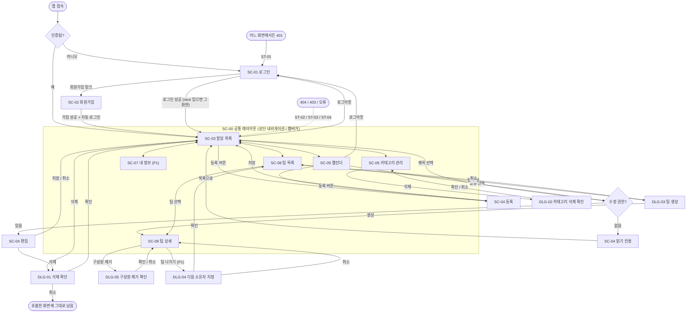
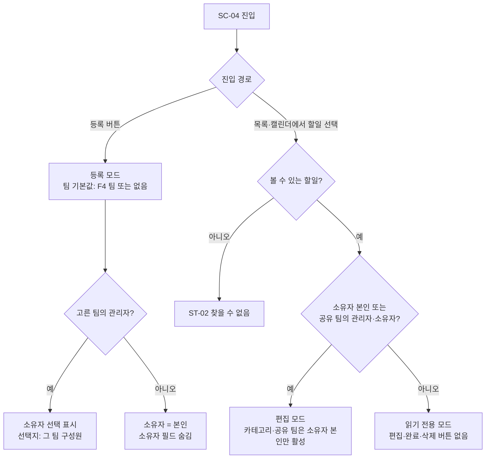

# TodoList 와이어프레임 (화면 설계서)

| 항목 | 내용 |
|------|------|
| 문서 버전 | v0.13 |
| 상태 | 초안 |
| 최종 수정일 | 2026-11-05 |
| 작성자 | hjining |
| 기준 문서 | `docs/1-domain-definition.md` v0.13, `docs/2-prd.md` v0.15, `docs/3-user-scenario.md` v0.14 |

> 표기
> - 기준 문서의 ID를 그대로 쓴다: FR, R, S, F, UC, P(도메인 정의서), SC, M, A, K(PRD), C, US, EX(사용자 시나리오). 수용 기준은 **'FR-xx #n'**(PRD 4.3)으로 참조한다. 이 문서는 화면 보조 ID **DLG-xx**(대화상자), **ST-xx**(공통 상태)와 미결 ID **U-xx**(7장)만 더한다.
> - 화면 ID SC-00–SC-09, 우선순위(P0/P1)는 PRD 7장을 그대로 따른다. 이 문서에서 새로 정하는 것은 레이아웃과 배치뿐이고, 기능은 기준 문서에 있는 것만 담는다.
> - **[제안]** = 기준 문서에 문구·배치가 없어 와이어프레임 작성을 위해 임시로 적은 것. v0.2에서 U-18 결정에 따라 기준안으로 채택했다. 7.1의 문서 간 불일치(U-03, U-04, U-20)는 v0.3에서 해소했다.
> - **[결정, U-xx]** = 7.2에서 확정한 사항(v0.2).
> - 메시지 문구 중 [제안] 표시가 없는 것은 사용자 시나리오 6.2의 오류 메시지이거나 기준 문서에 있는 문구다.
> - ASCII 다이어그램은 한글이 영문보다 넓게 보이므로 오른쪽 테두리를 그리지 않는다. 열 정렬은 대략적이며 실제 크기를 뜻하지 않는다.
> - 다이어그램 기호: `[ 버튼 ]` 버튼, `[__________]` 입력란, `[ 선택 v ]` 드롭다운, `[ ]`/`[x]` 체크박스, `(o)`/`( )` 라디오·세그먼트, `<...>` 상황별 표시, `{P1}` P1 요소.
> - 접근성(WCAG 등)은 PRD 3.2에 따라 고려하지 않는다. 다만 상태는 색에만 의존하지 않고 항상 텍스트 배지로 쓴다(3.3).
> - 변경 이력은 문서 맨 아래(8장)에 있다.

## 1. 개요

### 1.1 목적
PRD 7장의 화면 목록(SC-00–SC-09)을 와이어프레임으로 구체화한다. 각 화면의 레이아웃, 구성 요소, 인터랙션, 상태(빈 상태·로딩·오류·권한 없음), 입력 검증과 메시지를 정해 구현(8.1의 Day 1 저녁–Day 2) 시 화면 단위로 수용 기준을 확인할 수 있게 한다.

### 1.2 전제 (PRD 5.4, 6장)
| 항목 | 내용 |
|------|------|
| 플랫폼 | 웹. 모바일은 반응형 웹(네이티브 앱 없음) |
| 브레이크포인트 | 모바일 < 768px / 데스크톱 ≥ 768px. 태블릿 전용 레이아웃 없음(C-08) |
| 데스크톱 와이어프레임 | 기준 레이아웃. 모바일은 단일 열로 바뀌는 화면(SC-00, SC-03, SC-05)만 따로 그리고, 나머지는 같은 요소를 위에서 아래로 쌓는다 [결정, U-18] |
| UI 컴포넌트 | shadcn/ui 기본 테마(PRD 6장). 버튼·입력·선택·표·배지는 shadcn 컴포넌트, 대화상자(DLG)는 `Dialog`/`AlertDialog`, 모바일 햄버거 메뉴는 `Sheet`로 그린다 |
| 날짜·시각 입력 | 브라우저 기본 `<input type="date">`, `<input type="time">`(A22). shadcn `Input`으로 스타일만 맞춘다 |
| 캘린더 | 오픈소스 캘린더 UI 라이브러리의 기본 스타일 사용(K8). shadcn 테마와 모양이 달라도 허용한다. 주 뷰 일요일 시작(C-07) |
| 언어 | 한국어만(PRD 3.2) |
| 데이터 갱신 | 실시간 동기화 없음. 다른 사용자의 변경은 새로고침·재조회 시 반영(PRD 3.2) |
| 일시 표시 | `User.timezone`(기본 `Asia/Seoul`)으로 변환해 표시(R5) |

## 2. 화면 목록 (Screen inventory)

### 2.1 화면·대화상자·공통 상태
| ID | 구분 | 이름 | 설명 | 우선순위 |
|----|------|------|------|----------|
| SC-00 | 공통 | 공통 레이아웃 | 상단 내비게이션, 로그아웃, 모바일 햄버거 메뉴. SC-03–SC-09를 감싼다 | P0 (내 정보 메뉴는 P1) |
| SC-01 | 페이지 | 로그인 | 이메일·비밀번호 | P0 |
| SC-02 | 페이지 | 회원가입 | 이메일·비밀번호·이름 | P0 |
| SC-03 | 페이지 | 할일 목록 | 필터 바, 할일 행, 완료 체크·삭제, 등록 진입, 페이지네이션 | P0 |
| SC-04 | 페이지 | 할일 등록·편집 | 모드 4가지: ① 등록 ② 편집 ③ 읽기 전용 ④ 변경 이력 탭 {P1} (4.5) | P0 (이력 탭만 P1) |
| SC-05 | 페이지 | 캘린더 | 월·주·일 뷰, 이동, 팀·사용자 필터 | P0 |
| SC-06 | 페이지 | 카테고리 관리 | 목록, 추가, 이름 수정, 삭제 | P0 |
| SC-07 | 페이지 | 내 정보 | 이름·시간대·비밀번호 수정 | P1 |
| SC-08 | 페이지 | 팀 목록 | 내 팀과 내 역할, 팀 생성 | P0 |
| SC-09 | 페이지 | 팀 상세·구성원 관리 | 구성원·역할, 추가·제거, 관리자 지정·해제, 팀 나가기 {P1} | P0 (팀 나가기만 P1) |
| DLG-01 | 대화상자 | 할일 삭제 확인 | SC-03 행, SC-04에서 호출 | P0 |
| DLG-02 | 대화상자 | 카테고리 삭제 확인 | SC-06에서 호출 | P0 |
| DLG-03 | 대화상자 | 팀 생성 | SC-08에서 호출. 생성 후 SC-09로 이동 [결정, U-09] | P0 |
| DLG-04 | 대화상자 | 다음 소유자 지정 후 팀 나가기 | SC-09에서 호출 | P1 |
| DLG-05 | 대화상자 | 구성원 제거 확인 | SC-09에서 호출 [결정, U-10] | P0 |
| ST-01 | 공통 상태 | 인증 필요(401) | 로그인 화면으로 이동 | P0 |
| ST-02 | 공통 상태 | 찾을 수 없음(404) | 볼 수 없거나 없는 할일·팀(존재 비노출) | P0 |
| ST-03 | 공통 상태 | 권한 없음(403) | 볼 수 있으나 변경 권한이 없음 | P0 |
| ST-04 | 공통 상태 | 서버·네트워크 오류(500, 413 등) | 재시도 안내 | P0 |

- 구성 요소 중 카테고리 추가·수정(SC-06), 구성원 추가(SC-09)는 PRD 7장이 화면 요소로 적었으므로 별도 대화상자가 아닌 화면 안 인라인 폼으로 그린다 [결정, U-09].
- 문서에 없는 화면은 만들지 않는다: 비밀번호 찾기, 회원 탈퇴, 팀 삭제, 초대 수락, 휴지통, 통계, 알림(도메인 7장, PRD 3.2).

### 2.2 요구사항 → 화면 매핑 (FR)
| FR | 요구사항 | 우선순위 | 화면 |
|----|----------|----------|------|
| FR-01 | 회원가입·로그인·로그아웃, 인증 가드 | P0 | SC-01, SC-02, SC-00, ST-01 |
| FR-02 | 카테고리별 할일 등록, 카테고리 CRUD | P0 | SC-04(카테고리 필드), SC-06, DLG-02 |
| FR-03 | 내 정보 수정 | P1 | SC-07, SC-00(메뉴) |
| FR-04 | 시작·종료 일시 지정 | P0 | SC-04 |
| FR-05 | 목록 필터링(카테고리·상태·팀/사용자), 상태 표시 | P0 | SC-03 |
| FR-06 | 할일 삭제 | P0 | SC-03, SC-04, DLG-01 |
| FR-07 | 할일 수정·완료·읽기 전용 | P0 | SC-04, SC-03(완료 체크), ST-03 |
| FR-08 | 캘린더(월·주·일) | P0 | SC-05 |
| FR-09 | 팀 조회·관리 권한, 팀 생성·구성원 관리, 소유자 나가기 | P0 (나가기 P1) | SC-08, SC-09, DLG-03, DLG-04, SC-03, SC-04, SC-05 |
| FR-10 | 변경 이력 | P1 | SC-04(이력 탭) |
| FR-11 | 팀 단위 공유 | P0 | SC-04(팀·공유 팀 필드), SC-03·SC-05(F4 필터) |

### 2.3 시나리오 → 화면 매핑
| 시나리오 | 화면·대화상자 |
|----------|---------------|
| US-01 가입 → 첫 할일 | SC-01, SC-02, SC-03, SC-04 |
| US-02 로그인·로그아웃 / EX-05, EX-06 | SC-00, SC-01, ST-01 |
| US-03 카테고리 관리 / EX-15–EX-19 | SC-06, DLG-02, SC-04 |
| US-04 등록 / EX-07–EX-09, EX-37 | SC-04 |
| US-05 수정 | SC-03, SC-05, SC-04 |
| US-06 완료·해제 / EX-12 | SC-03, SC-04 |
| US-07 삭제 | SC-03, SC-04, DLG-01 |
| US-08 목록 필터 / EX-10–EX-14 | SC-03 |
| US-09 캘린더 / EX-39 | SC-05, SC-04 |
| US-10 모바일 | SC-00, SC-03, SC-05 (4.1, 4.4, 4.6의 모바일 와이어프레임) |
| US-11 팀 생성·구성원 관리 / EX-27, EX-28, EX-34, EX-35 | SC-08, DLG-03, SC-09 |
| US-12 팀 공유 할일 / EX-21, EX-22 | SC-03, SC-04 |
| US-13 관리자 대리 등록 / EX-24, EX-26, EX-38 | SC-03, SC-04 |
| US-14 관리자 수정·완료·삭제 / EX-20, EX-23, EX-25 | SC-04, SC-03, DLG-01, ST-03 |
| US-15 관리자 해제·구성원 제거 | SC-09, SC-03, ST-02, ST-03 |
| US-16 내 정보 / EX-30, EX-31 | SC-07 |
| US-17 변경 이력 / EX-32, EX-33 | SC-04(이력 탭) |
| US-18 소유자 나가기 / EX-29, EX-36, EX-40, EX-41 | SC-09, DLG-04, SC-08 |

## 3. 공통 설계

### 3.1 공통 레이아웃 요소
- 상단 내비게이션(SC-00): 목록(SC-03) · 캘린더(SC-05) · 카테고리(SC-06) · 팀(SC-08) · 내 정보(SC-07, P1), 로그아웃 버튼. 현재 위치는 강조 표시한다.
- SC-01, SC-02는 내비게이션 없이 가운데 정렬 폼만 보여준다(미인증 상태).
- 본문 영역은 데스크톱 최대 폭 안에서 화면 폭에 따라 늘고 줄어든다(C-08).

### 3.2 입력·오류 표시 규칙
| 항목 | 규칙 |
|------|------|
| 필수 표시 | 필수 입력란 라벨 옆에 `*` [제안] |
| 길이 제한 | 클라이언트는 `maxlength`로 입력을 제한하고, 서버가 최종 검증한다(시나리오 6.3, EX-37). 앞뒤 공백 제거 후 글자 수로 센다 |
| 필드 오류 | 해당 입력란 아래에 한 줄. 서버의 `fields`(필드별 메시지, 시나리오 6.2)가 있으면 그대로 쓴다 |
| 폼 오류 | 폼 상단에 서버 `error.message`를 그대로 표시한다(PRD 5.2). 코드로 분기하되 문구는 서버 메시지를 쓴다 |
| 제출 중 | 제출 버튼 비활성 + 진행 표시. 중복 제출 방지 [제안] |
| 입력 보존 | 오류가 나도 입력값은 지우지 않는다(비밀번호 입력란 제외 [제안]) |

### 3.3 할일 상태 배지 (S1–S4)
| 상태 | 판정 | 배지 문구 |
|------|------|-----------|
| 완료 | S1 | 완료 |
| 기한 초과 | S2 | 기한 초과 |
| 시작 전 | S3 | 시작 전 |
| 진행 중 | S4 | 진행 중 |

- 상태는 서버가 계산한 값을 그대로 표시한다. 클라이언트 시계로 판정하지 않는다(PRD 5.3).
- 색은 보조 수단이고 항상 문구를 함께 쓴다 [제안].

### 3.4 일시 표시
- 사용자 시간대로 변환한 `YYYY-MM-DD HH:mm` 형식 [결정, U-19]. 기간은 `시작 ~ 종료`로 한 줄에 쓴다. 시작·종료가 같은 날이면 종료의 날짜를 생략한다(예: `2026-11-04 09:00 ~ 18:00`) [결정, U-19].
- 시간대 표기(예: `KST`)는 사용자 시간대가 `Asia/Seoul`이 아닐 때만 덧붙인다 [결정, U-19].
- 시각 없이 저장된 할일(00:00 / 23:59)도 시각을 그대로 표시한다(종일/시간 구분 없음, 도메인 7장).

### 3.5 공통 상태 화면·알림 (ST-01–ST-04)
| ID | 발생 | 표시 | 메시지 |
|----|------|------|--------|
| ST-01 | 어떤 API든 401 `UNAUTHENTICATED`이고 토큰 갱신(`POST /api/auth/refresh`)도 실패 | 인증 가드가 SC-01로 이동. 액세스 토큰만 만료된 401은 갱신 후 같은 요청을 다시 보내므로 화면이 바뀌지 않는다(EX-42). 보호된 화면을 그리지 않는다(R1, FR-01 #6) | 로그인이 필요합니다. |
| ST-02 | 404 `NOT_FOUND` (할일·카테고리·팀) | 본문 영역에 빈 안내 + [ 목록으로 ] 버튼. 있는지 여부를 드러내지 않으므로 '없음'과 '볼 수 없음'을 구분하지 않는다(R2) | 찾을 수 없습니다. |
| ST-03 | 403 `FORBIDDEN` | 화면 상단 알림 막대(화면은 유지). 읽기 전용 화면에서는 버튼이 없어 보통 나타나지 않고, 역할이 바뀐 직후 요청한 경우(US-15 #2)에 나타난다 | 권한이 없습니다. |
| ST-04 | 413, 500, 네트워크 실패 | 상단 알림 막대 + [ 다시 시도 ] [제안] | 500: 일시적인 오류가 발생했습니다. 잠시 후 다시 시도해 주세요. / 413: 요청이 너무 큽니다. |

### 3.6 로딩·빈 상태 공통
- 로딩: 목록·표 자리에 스켈레톤 행 또는 '불러오는 중...' [제안]. 이미 표시한 데이터는 재조회 중에도 유지한다(TanStack Query 캐시) [제안].
- 변경(저장·삭제·완료) 성공 후 관련 목록·캘린더를 재조회한다(PRD 6장 invalidate).
- 빈 상태 문구는 기준 문서에 없어 [제안]으로 적었고, 그대로 기준안으로 채택한다 [결정, U-18].

## 4. 화면별 와이어프레임

### 4.1 SC-00 공통 레이아웃 (P0, UC-03)

**데스크톱 (≥ 768px)**
```
+------------------------------------------------------------------------+
| TodoList   [목록] [캘린더] [카테고리] [팀] [내 정보 {P1}]   홍길동 [로그아웃] |
+------------------------------------------------------------------------+
|                                                                        |
|                      (SC-03 ~ SC-09 본문 영역)                           |
|                                                                        |
+------------------------------------------------------------------------+
```

**모바일 (< 768px)**
```
+----------------------------------+      +----------------------------------+
| [=]  TodoList                    |      | [X]  TodoList                    |
+----------------------------------+      +----------------------------------+
|                                  |      |  목록                            |
|        (본문, 단일 열)             |      |  캘린더                          |
|                                  |      |  카테고리                        |
|                                  |      |  팀                              |
|                                  |      |  내 정보 {P1}                    |
|                                  |      |  ------------------------------  |
|                                  |      |  홍길동        [로그아웃]         |
+----------------------------------+      +----------------------------------+
        (메뉴 닫힘)                                (햄버거 메뉴 열림)
```

**구성 요소**
| 요소 | 설명 |
|------|------|
| 로고 'TodoList' | 선택하면 SC-03(로그인 후 첫 화면, C-01)으로 이동 |
| 메뉴 5개 | 목록 SC-03, 캘린더 SC-05, 카테고리 SC-06, 팀 SC-08, 내 정보 SC-07(P1 전에는 숨김) |
| 사용자 이름 | 로그인한 사용자의 `User.name` 표시(읽기 전용) |
| 로그아웃 버튼 | UC-03 |
| 햄버거 메뉴 | 모바일에서 메뉴·사용자 이름·로그아웃을 접어 둔다(PRD 7장) |

**인터랙션**
- 로그아웃: 서버가 리프레시 토큰을 폐기하고 쿠키를 삭제한 뒤 SC-01로 이동한다(US-02 #3). 확인 절차는 두지 않는다.
- 메뉴 항목 선택: 해당 화면으로 이동. 모바일에서는 이동 후 메뉴를 닫는다 [제안].

**상태**
- 로딩: 사용자 이름을 아직 모르면 이름 자리를 비운다 [제안].
- 인증 만료: 어떤 요청이든 401이고 토큰 갱신도 실패하면 ST-01(EX-42).

### 4.2 SC-01 로그인 (P0, UC-02)

```
+------------------------------------------+
|                TodoList                  |
|                                          |
|   <폼 오류: 이메일 또는 비밀번호가       |
|            올바르지 않습니다.>            |
|                                          |
|   이메일                                 |
|   [______________________________]       |
|   비밀번호                               |
|   [______________________________]       |
|                                          |
|   [            로그인            ]       |
|                                          |
|   계정이 없나요?  회원가입               |
+------------------------------------------+
```

**구성 요소**
| 요소 | 설명 |
|------|------|
| 이메일 | 텍스트(이메일 형식), 최대 254자 |
| 비밀번호 | 마스킹 입력 |
| 로그인 버튼 | 제출. Enter 키로도 제출 |
| 회원가입 링크 | SC-02로 이동 |

**인터랙션**
- 로그인 성공: 인증 쿠키가 발급되고 SC-03으로 이동한다(C-01, FR-01 #8). 이메일 대소문자는 구분하지 않는다(C-02, US-02 #1).
- ST-01로 로그인 화면에 온 경우 원래 가려던 경로를 `?next=`로 받아 로그인 성공 후 그 화면으로 돌아간다. `next`는 앱 내부 경로만 허용하고, 그 밖의 값이면 SC-03으로 간다 [결정, U-15].

**검증·메시지**
| 조건 | 메시지 | 근거 |
|------|--------|------|
| 이메일 또는 비밀번호 비어 있음 | 입력값을 확인해 주세요. (필드별 문구는 [제안]) | `VALIDATION_ERROR` |
| 없는 이메일 / 틀린 비밀번호 | 이메일 또는 비밀번호가 올바르지 않습니다. (두 경우 동일) | `INVALID_CREDENTIALS`, FR-01 #5, EX-04 |
| 서버 오류 | ST-04 | `INTERNAL_ERROR` |

**상태**
- 제출 중: 로그인 버튼 비활성.
- 이 화면의 401 `INVALID_CREDENTIALS`는 ST-01(로그인 화면 이동)로 처리하지 않고 폼 오류로 표시한다 [제안].
- 이미 로그인한 상태로 SC-01·SC-02에 접근하면 SC-03으로 보낸다 [결정, U-15].

### 4.3 SC-02 회원가입 (P0, UC-01)

```
+------------------------------------------+
|                회원가입                  |
|                                          |
|   <폼 오류 영역>                         |
|                                          |
|   이메일 *                               |
|   [______________________________]       |
|   <필드 오류>                            |
|   비밀번호 * (8자 이상, 72바이트 이하)   |
|   [______________________________]       |
|   이름 * (1~50자)                        |
|   [______________________________]       |
|                                          |
|   [             가입             ]       |
|                                          |
|   이미 계정이 있나요?  로그인 [U-15]     |
+------------------------------------------+
```

**구성 요소**
| 요소 | 설명 | 제약 |
|------|------|------|
| 이메일 | 로그인 ID | 필수, 이메일 형식, 최대 254자, 시스템 전체 유일·대소문자 무시(R16) |
| 비밀번호 | 마스킹 입력 | 필수, 8자 이상, UTF-8 72바이트 이하(도메인 3.4) |
| 이름 | 표시 이름 | 필수, 1–50자(도메인 3.4, C-03) |
| 가입 버튼 | 제출 | |
| 로그인 링크 | SC-01로 이동 | [결정, U-15] |

- 비밀번호 확인 입력란은 기준 문서에 없으므로 두지 않는다.

**인터랙션**
- 가입 성공: 계정과 '기본' 카테고리가 한 트랜잭션으로 생성되고(R6) 자동 로그인되어 SC-03으로 이동한다(C-01, FR-01 #8, US-01 #3). 별도 로그인 화면을 거치지 않는다.

**검증·메시지**
| 조건 | 메시지 | 근거 |
|------|--------|------|
| 이메일 형식 오류, 비밀번호 8자 미만 또는 72바이트 초과, 이름 공백만, 길이 초과 | 입력값을 확인해 주세요. + 필드별 안내 [제안] | `VALIDATION_ERROR`, FR-01 #3, EX-03, EX-37 |
| 이미 가입된 이메일(대소문자 무시) | 이미 가입된 이메일입니다. (이메일 입력란 아래) | `EMAIL_TAKEN`, FR-01 #2, EX-02 |
| 가입 처리 실패(기본 카테고리 생성 실패 포함) | 일시적인 오류가 발생했습니다. 잠시 후 다시 시도해 주세요. (계정은 생성되지 않음) | `INTERNAL_ERROR`, EX-01 |

**상태**: 제출 중에는 가입 버튼 비활성.

### 4.4 SC-03 할일 목록 (P0, UC-07, UC-09, UC-10)

**데스크톱**
```
+------------------------------------------------------------------------------+
| (SC-00 상단 내비게이션)                                                       |
+------------------------------------------------------------------------------+
| 할일 목록                                                 [ + 할일 등록 ]     |
|                                                                              |
| 보기 [ 팀 전체 v ]  카테고리 [ 전체 v ]  상태 [ 전체 v ]                     |
|                                                       [ 필터 초기화 ] [제안]  |
|------------------------------------------------------------------------------|
|      제목               기간                       상태     소유자   카테고리  |
|------------------------------------------------------------------------------|
| [x]  주간 보고서        11-04 00:00 ~ 23:59        진행 중   나       기본    [삭제]|
| [ ]  분기 기획안 v2     11-10 09:00 ~ 11-12 18:00  시작 전   나       Work    [삭제]|
| [ ]  캠페인 일정        11-06 14:00 ~ 14:00        시작 전   홍길동   (없음)        |
| [x]  경쟁사 조사        11-02 ~ 11-03              완료      김영희   (없음)  [삭제]|
|------------------------------------------------------------------------------|
|                  < 이전   1 / 3   다음 >      총 120건                       |
+------------------------------------------------------------------------------+
```
- 마지막 두 행은 남의 할일이다. 3번째 행은 일반 팀원이라 수정 권한이 없는 경우(체크·삭제 숨김), 4번째 행은 내가 그 팀의 관리자인 경우다. 소유자 열 [결정, U-06], 카테고리 열은 R2에 따른다.
- '보기' 선택 상자를 펼친 모습 [결정, U-01]:
```
[ 팀 전체        ]  <- 기본값(F4)
[ 내 할일        ]
 ── 팀 ──
[ 마케팅팀       ]
[ 영업팀         ]
 ── 사용자 ──
[ 김영희         ]
[ 이관리         ]
```

**모바일 (< 768px)**
```
+----------------------------------+
| [=] TodoList                     |
+----------------------------------+
| 할일 목록        [ + 등록 ]      |
| [ 필터 v ]  (접힘)               |
|  펼치면:                         |
|  보기 [ 팀 전체 v ]              |
|  카테고리 [ 전체 v ]             |
|  상태 [ 전체 v ]                 |
+----------------------------------+
| [x] 주간 보고서         [진행 중]|
|     11-04 00:00 ~ 23:59   [삭제] |
|----------------------------------|
| [ ] 분기 기획안 v2      [시작 전]|
|     11-10 09:00 ~ 11-12 18:00    |
|----------------------------------|
|        < 이전  1 / 3  다음 >      |
+----------------------------------+
```

**구성 요소**
| 요소 | 설명 | 근거 |
|------|------|------|
| 등록 버튼 | SC-04 등록 모드로 이동. F4에서 팀 하나를 고른 상태면 SC-04의 '팀' 기본값이 그 팀, 그 밖에는 '없음(개인 할일)'(4.5.1) | R21, FR-11 #3, US-12 #1 |
| 보기 필터(F4, 팀·사용자) | 선택 상자 하나에서 하나만 고른다 [결정, U-01]. 선택지: 팀 전체(기본값) / 내 할일 / 내가 속한 팀들 / 내가 속한 팀들의 구성원(본인 제외, '내 할일'로 대신함). 팀을 고르면 그 팀에 공유된 할일, 사용자를 고르면 그 사용자의 할일 중 내가 볼 수 있는 것 | F4, C-06, FR-09 #11 |
| 카테고리 필터(F2) | 선택지: 내 카테고리. 고르면 본인 할일만 남는다 | F2, R2 |
| 상태 필터(F1) | 선택지: 전체 / 시작 전 / 진행 중 / 완료 / 기한 초과 | F1 |
| 완료 체크 | 완료·해제 토글. 수정 권한이 있을 때만 표시(소유자, 그 팀 관리자·소유자) | R14, R19, FR-07 #3·#7 |
| 제목 | 선택하면 SC-04로 이동(권한에 따라 편집 또는 읽기 전용) | FR-07 |
| 기간 | 시작 ~ 종료(3.4) | |
| 상태 배지 | 3.3 | S1–S4 |
| 소유자 | 할일 소유자 이름. 내 할일은 '나' | [결정, U-06] |
| 카테고리 | 내 할일에만 표시. 남의 할일은 표시하지 않는다 | R2 |
| 삭제 버튼 | DLG-01 호출. 수정 권한이 있을 때만 표시 | FR-06, FR-07 #7 |
| 페이지네이션 | '이전/다음 + 현재 쪽/전체 쪽 + 총 건수'. 기본 50건/페이지, 최대 100건, 시작 일시 오름차순. 목록 응답에 `total`(필터 적용 후 전체 건수)이 필요하다 | A16, [결정, U-12] |

- 필터 사이의 관계: 상태·카테고리·보기(팀/사용자)는 AND로 적용한다. 고르지 않으면 볼 수 있는 전체(내 할일 + 내가 속한 모든 팀에 공유된 할일)를 보여준다(F3, F4). 팀과 사용자는 같은 선택 상자이므로 동시에 고를 수 없다 [결정, U-01].
- 필터 값은 Zustand의 클라이언트 UI 상태로 두고, 서버 데이터는 복제하지 않는다(PRD 6장).
- 모바일의 필터 바는 접혀 있고 펼쳐서 쓴다(PRD 5.4, US-10 #2).

**인터랙션**
| 동작 | 결과 |
|------|------|
| 필터 변경 | 1페이지로 돌아가 서버에서 필터(상태는 SQL)를 적용한 뒤 페이지네이션해 다시 조회(FR-05 #6, US-08) |
| 완료 체크 | `completed` 토글 → 상태·배지 즉시 갱신(재조회). 시작 전 할일도 완료 가능(R14). 완료하면 '완료' 필터 결과에만 남는다(EX-12) |
| 삭제 | DLG-01. 확인하면 삭제 후 목록 재조회 |
| 제목 선택 | SC-04로 이동 |
| 등록 | SC-04 등록 모드로 이동 |

**상태**
| 상태 | 표시 |
|------|------|
| 로딩 | 표 자리에 스켈레톤 행 [제안] |
| 빈 상태(할일이 하나도 없음) | "등록된 할일이 없습니다. [ + 할일 등록 ]" [제안] |
| 빈 상태(필터 결과 없음) | "조건에 맞는 할일이 없습니다. [ 필터 초기화 ]" [제안] |
| 오류 | ST-04. 이미 보인 목록은 유지 |
| 완료 체크·삭제 중 403 | ST-03(역할이 바뀐 직후) |
| 완료 체크·삭제 중 404 | ST-02 + 목록 재조회(다른 관리자가 먼저 삭제한 경우 등) |
| 권한 없음 | 수정 권한이 없는 행에서는 완료 체크·삭제 버튼 자체를 그리지 않는다(C-14) |

**검증**: 입력 없음. 필터 선택지는 서버가 준 목록에서만 고른다.

### 4.5 SC-04 할일 등록·편집 (P0, 이력 탭 P1)

UC-06, UC-08, UC-09, UC-10, UC-12 / FR-02, FR-04, FR-06, FR-07, FR-09, FR-10, FR-11

#### 4.5.1 등록 모드

```
+------------------------------------------------------------------+
| (SC-00 상단 내비게이션)                                           |
+------------------------------------------------------------------+
| 할일 등록                                                         |
|                                                                  |
| 팀        [ 없음 (개인 할일) v ]                                  |
| <소유자>  [ 나 (홍길동) v ]   <선택한 팀의 관리자일 때만 표시>     |
|                                                                  |
| 제목 *    [______________________________________]  (0/200)      |
| 설명      [______________________________________]               |
|           [______________________________________]  (0/2000)     |
|                                                                  |
| 시작      [ ---------- ] [ --:-- ]   (비우면 00:00)              |
| 종료      [ ---------- ] [ --:-- ]   (비우면 23:59)              |
|           <필드 오류: 종료 일시는 시작 일시보다 빠를 수 없습니다.> |
|                                                                  |
| 카테고리  [ 기본 v ]                                              |
| 공유 팀   [ ] 마케팅팀   [ ] 영업팀                               |
|                                                                  |
|                                      [ 취소 ]  [ 저장 ]           |
+------------------------------------------------------------------+
```
- 등록 모드의 필드 순서: 팀 → 소유자 → 제목 → 설명 → 시작 → 종료 → 카테고리 → 공유 팀(PRD 7장). 완료 여부는 등록 모드에 두지 않고 `completed = false`로 저장한다 [결정, U-07].
- 시작·종료 날짜 입력란은 비워 둔다(미리 채우지 않음). 비어 있으면 저장 시 서버가 R4 규칙으로 채운다. 시각 입력란은 같은 줄의 날짜를 고른 뒤에만 활성이고, 날짜를 지우면 시각도 함께 비운다. 따라서 '날짜 없이 시각만 있는' 입력은 생기지 않는다 [결정, U-08, U-21].

#### 4.5.2 편집 모드

**소유자 본인이 연 경우**
```
+------------------------------------------------------------------+
| 할일 편집                       [ 상세 ] [ 변경 이력 {P1} ]       |
|                                                                  |
| 제목 *    [ 분기 기획안 v2                    ]  (9/200)         |
| 설명      [______________________________________]               |
| 시작      [ 2026-11-10 ] [ 09:00 ]                               |
| 종료      [ 2026-11-12 ] [ 18:00 ]                               |
| 카테고리  [ Work v ]                                             |
| 완료 여부 [ ] 완료                                  상태: 시작 전 |
| 공유 팀   [x] 마케팅팀   [ ] 영업팀                               |
|                                                                  |
| [ 삭제 ]                              [ 취소 ]  [ 저장 ]          |
+------------------------------------------------------------------+
```

**관리자가 남(구성원)의 할일을 연 경우**
```
+------------------------------------------------------------------+
| 할일 편집                       [ 상세 ] [ 변경 이력 {P1} ]       |
| 소유자: 김영희 (읽기 전용)  [U-05]                                |
|                                                                  |
| 제목 *    [ 경쟁사 조사                       ]                  |
| 설명      [______________________________________]               |
| 시작      [ 2026-11-02 ] [ 00:00 ]                               |
| 종료      [ 2026-11-09 ] [ 23:59 ]                               |
| 카테고리  [ (비공개) v ]  <비활성>                                |
| 완료 여부 [x] 완료                                  상태: 완료    |
| 공유 팀   마케팅팀  <변경 불가, 읽기 전용>                        |
|                                                                  |
| [ 삭제 ]                              [ 취소 ]  [ 저장 ]          |
+------------------------------------------------------------------+
```

#### 4.5.3 읽기 전용 모드 (일반 팀원이 남의 할일을 열 때)

```
+------------------------------------------------------------------+
| 할일 보기 (읽기 전용)           [ 상세 ] [ 변경 이력 {P1} ]       |
| 소유자: 홍길동  [U-05]                                            |
|                                                                  |
| 제목      캠페인 일정                                             |
| 설명      ...                                                    |
| 시작      2026-11-06 14:00                                       |
| 종료      2026-11-06 14:00                                       |
| 완료 여부 미완료                                    상태: 시작 전 |
| 공유 팀   마케팅팀                                                |
|                                                                  |
|                                              [ 목록으로 ]         |
+------------------------------------------------------------------+
```
- 편집·완료·삭제·저장 버튼이 없고, 모든 값은 텍스트로만 보인다(C-14, FR-07 #7). 카테고리 행은 없다(R2).

#### 4.5.4 변경 이력 탭 {P1}

```
+------------------------------------------------------------------+
| 할일 편집                       [ 상세 ] [ 변경 이력 ]            |
|                                                                  |
| 2026-11-05 10:12  홍길동   수정                                  |
|    공유 팀: (없음) -> 마케팅팀                                    |
|    카테고리: 기본 -> Work           <소유자에게만 보임>           |
| 2026-11-05 10:30  이관리   완료                                  |
|    완료 여부: 미완료 -> 완료                                      |
| 2026-11-04 10:05  홍길동   등록                                  |
|    제목: 주간 보고서 / 시작: 2026-11-04 00:00 / 종료: ...         |
+------------------------------------------------------------------+
```
- 표시 형식 [결정, U-16]:
  - 최신순으로 정렬한다.
  - 한 항목은 `일시 · 사용자 · 동작` 줄과 `필드: 이전값 -> 새값` 줄로 쓴다.
  - `action` 라벨은 `CREATED` 등록 / `UPDATED` 수정 / `COMPLETED` 완료 / `UNCOMPLETED` 완료 해제로 쓴다.
  - 필드명은 이 화면의 입력란 라벨(제목·설명·시작·종료·카테고리·완료 여부·공유 팀)을 쓰고, 일시 값은 3.4 형식을 따른다.
  - 한 요청에서 완료 여부와 다른 필드를 함께 바꾼 이력은 1건이며 동작 라벨은 `완료`(또는 `완료 해제`), 함께 바뀐 필드도 그 항목의 `필드: 이전값 -> 새값` 줄에 모두 나온다(R20).
  - 회원 탈퇴와 팀 삭제는 범위 밖이므로 '(탈퇴한 사용자)', '(삭제된 팀)' 같은 표시는 두지 않는다. 변경자와 공유 팀은 항상 존재하는 사용자·팀이다(도메인 3.9).

**구성 요소 (모드별 필드 표시)**
| 필드 | 도메인 속성 | 등록 | 편집(소유자 본인) | 편집(관리자, 남의 할일) | 읽기 전용(일반 팀원) |
|------|-------------|------|-------------------|-------------------------|----------------------|
| 팀 | 등록 시 어느 팀 할일인지(R19, R21) | 입력(기본: F4 팀 또는 '없음') | 표시 안 함 [결정, U-05] | 표시 안 함 [결정, U-05] | 표시 안 함 |
| 소유자 | `ownerId` | 고른 팀의 관리자(소유자 포함)일 때만 표시·선택. 선택지는 그 팀 구성원, 기본값 본인(R19) | 표시 안 함 | 텍스트 [결정, U-05·U-06] | 텍스트 [결정, U-05·U-06] |
| 제목 | `title` | 입력, 필수 1–200자 | 입력 | 입력 | 텍스트 |
| 설명 | `description` | 입력, 최대 2,000자 | 입력 | 입력 | 텍스트 |
| 시작 | `startAt` | 날짜(달력 위젯)+시각(선택) | 입력 | 입력 | 텍스트 |
| 종료 | `endAt` | 날짜(달력 위젯)+시각(선택) | 입력 | 입력 | 텍스트 |
| 카테고리 | `categoryId` | 활성(소유자 본인일 때). 소유자를 남으로 고르면 비활성(R7, C-15) | 활성 | 비활성(값 비노출, R2, FR-07 #6) | 표시 안 함 |
| 완료 여부 | `completed` | 표시 안 함 [결정, U-07] | 체크박스 | 체크박스 | 텍스트 |
| 상태 | 계산값(S1–S4) | 표시 안 함 | 배지(읽기 전용) | 배지 | 배지 |
| 공유 팀 | `TodoShare` | 활성: 선택지는 소유자가 속한 팀(R21). 소유자를 남으로 고르면 고른 팀으로 고정(R19, FR-09 #5) | 활성(내가 속한 팀 중 다중 선택) | 비활성(변경 불가, R21). 보는 사람이 속한 팀만 표시 | 텍스트(보는 사람이 속한 팀만) |
| 변경 이력 탭 | `TodoHistory` | 표시 안 함 | {P1} | {P1} | {P1} |
| 저장 | | 있음 | 있음 | 있음 | 없음 |
| 삭제 | | 없음 | 있음 | 있음 | 없음 |

**구성 요소 설명**
- 팀(등록 전용 첫 항목): 선택지는 '없음(개인 할일)' + 내가 속한 팀들. 기본값은 목록·캘린더에서 F4로 팀 하나를 고르고 들어왔으면 그 팀, 그 밖에는 '없음'이다(R21, C-13, C-16). 고른 팀이 공유 팀 기본값이 된다(R21).
- 소유자: 고른 팀에서 내가 관리자(소유자 포함)일 때만 보인다. 일반 팀원이거나 '없음'이면 숨기고 소유자는 본인이다. 그 팀 구성원이 아닌 사람은 선택지에 없다(R19, EX-26).
- 시작·종료: 날짜는 `<input type="date">`(달력 위젯), 시각은 `<input type="time">`이며 선택 입력이다(FR-04 #1). 비워 둔 값의 안내 문구를 입력란 옆에 둔다: 시각을 비우면 시작 00:00 / 종료 23:59(R5). 날짜를 비우면 R4 규칙(둘 다 없음: 오늘 00:00–23:59, 시작만: 시작 날짜 23:59, 종료만: min(오늘 00:00, 종료))으로 서버가 채우며, '오늘'은 등록을 요청하는 사용자(관리자가 대리 등록하면 그 관리자)의 시간대 기준이다(R4, PRD 5.3).
- 카테고리: 내 카테고리 중 선택. 지정하지 않으면 기본 카테고리(R7). 소유자가 본인이 아니면 비활성이고 값을 보여주지 않는다(R2, C-15).
- 공유 팀: 체크박스 목록(여러 개 선택 가능). 공유 팀 없음 = 소유자 본인만 볼 수 있다(R21). 등록 시 고른 팀이 미리 체크된다.
- 완료 여부(편집): 체크하면 `completedAt` 기록, 해제하면 비운다(FR-07 #4). 시작 전이라도 가능(R14).

**인터랙션**
| 동작 | 결과 |
|------|------|
| 팀 선택 변경(등록) | 소유자 필드 표시 여부와 선택지를 다시 계산하고, 공유 팀의 기본 체크를 그 팀으로 바꾼다(R21 '고른 팀이 공유 팀 기본값') |
| 소유자 선택 변경(등록) | 카테고리 필드를 본인이면 활성, 남이면 비활성으로 전환한다(C-15) |
| 종료 일시 변경 | 시작보다 빠르면 즉시 필드 오류 표시(클라이언트 검증, FR-04 #5) |
| 저장(등록) | 서버가 R4로 일시를 채우고 저장 → SC-03으로 이동(F4 필터 유지 [제안]) |
| 저장(편집) | R3 검증 후 저장 → 이전 화면(SC-03 또는 SC-05)으로 돌아간다 [제안]. FR-10 구현 후 이력 1건 생성 |
| 완료 체크 후 저장 | `COMPLETED`/`UNCOMPLETED` 이력(FR-10 구현 후) |
| 삭제 | DLG-01 → 확인하면 영구 삭제 후 이전 화면으로 이동 |
| 취소 | 저장하지 않고 이전 화면으로 이동. 입력을 바꾼 상태면 "저장하지 않은 변경이 있습니다. 나가시겠어요?"를 묻는다. 바꾼 것이 없으면 바로 이동한다 [결정, U-18] |
| 이력 탭 선택 | 이력 목록 조회(P1). 탭 전환만으로는 폼 입력이 사라지지 않는다 [제안] |

**상태**
| 상태 | 표시 |
|------|------|
| 로딩(편집·읽기 전용) | 폼 자리에 스켈레톤 |
| 할일을 볼 수 없음/없음 | ST-02 (R2) |
| 수정 권한 없음 | 읽기 전용 모드로 렌더링(C-14). 서버는 403 |
| 저장 중 403 | ST-03 (역할이 바뀐 직후 등) |
| 저장 중 404 | ST-02 |
| 오류 | ST-04. 입력값은 보존 |
| 이력 탭 빈 상태 | 보여줄 이력이 없으면 "표시할 변경 이력이 없습니다." [제안]. 카테고리만 바뀐 이력은 비소유자에게 숨긴다(C-17) |
| 이력 탭 로딩 | 스켈레톤 |

**검증 및 메시지**
| 조건 | 메시지 | 근거 |
|------|--------|------|
| 제목 비어 있음/공백만, 제목 201자 이상 | 입력값을 확인해 주세요. + 제목 필드 안내 [제안]. 저장되지 않는다 | `VALIDATION_ERROR`, FR-07 #5, EX-09, EX-37 |
| 설명 2,001자 이상 | 입력 제한(`maxlength` 2000). 서버는 400 | EX-37 |
| 종료 < 시작 | 종료 일시는 시작 일시보다 빠를 수 없습니다. (같은 일시는 허용) | `INVALID_PERIOD`, R3, EX-07 |
| 속하지 않은 팀을 공유 팀으로 지정(API 직접 호출 등) | 속한 팀에만 공유할 수 있습니다. | `INVALID_SHARE_TEAM`, EX-22 |
| 소유자로 비구성원 지정 | 선택한 팀의 구성원만 소유자로 지정할 수 있습니다. | `INVALID_OWNER`, EX-26 |
| 권한 없는 변경, 일반 팀원이 소유자 지정(API 직접 호출) | 권한이 없습니다. | `FORBIDDEN`, EX-20, EX-23, EX-24, EX-38 |
| 볼 수 없는 할일 | 찾을 수 없습니다. | `NOT_FOUND`, EX-21, EX-25 |

- 선택지로 막을 수 있는 오류(`INVALID_SHARE_TEAM`, `INVALID_OWNER`, 카테고리 변경 403)는 화면에서 선택 자체가 안 되게 하고, 위 메시지는 서버가 최종 판정한 경우에만 나타난다(PRD 5.2).
- 날짜 입력란이 비어 있어도 오류가 아니다(R4). 시각 입력란은 날짜를 고른 뒤에만 활성이므로 '시각만 입력'은 생기지 않는다 [결정, U-08].

### 4.6 SC-05 캘린더 (P0, UC-11)

**데스크톱 월 뷰**
```
+------------------------------------------------------------------------------+
| (SC-00 상단 내비게이션)                                                       |
+------------------------------------------------------------------------------+
| [<] [오늘] [>]   2026년 11월      ( ) 월  ( ) 주  ( ) 일     [ + 할일 등록 ]  |
| 보기 [ 팀 전체 v ]                                                            |
| <500건 초과 시: 일부 할일만 표시됩니다. 필터를 좁혀 주세요.>                  |
|------------------------------------------------------------------------------|
|  일     월     화     수     목     금     토                                |
|------------------------------------------------------------------------------|
|  1      2      3      4      5      6      7                                 |
|               [워크숍 준비 ------------------]                               |
|  [10월 정산 ------]  [주간 보고서]                                            |
|                      [회의록 정리]                                            |
|                      [발표 자료]                                              |
|                      +2                                                      |
|------------------------------------------------------------------------------|
|  8      9      10     11     12     13     14                                |
|                      [분기 기획안 v2 ---------]                               |
+------------------------------------------------------------------------------+
```

**데스크톱 주 뷰 / 일 뷰**
```
 주 뷰 (일요일 시작)                           일 뷰
+------+------+------+------+------+------+------+     +------------------------------+
| 일 1 | 월 2 | 화 3 | 수 4 | 목 5 | 금 6 | 토 7 |     | 2026-11-04 (수)              |
+------+------+------+------+------+------+------+     +------------------------------+
|      |      | [워크숍 준비 ----------]    |   |     | 워크숍 준비   11-03 ~ 11-05   |
|      |      |      |[주간 보고서]|      |      |     | 주간 보고서   00:00 ~ 23:59   |
+------+------+------+------+------+------+------+     +------------------------------+
```

**모바일 월 뷰 → 일 뷰 (< 768px)**
```
+----------------------------------+      +----------------------------------+
| [<] [오늘] [>]  2026년 11월      |      | [<] [오늘] [>]  11/04 (수)       |
| ( ) 월  ( ) 주  ( ) 일           |      | ( ) 월  ( ) 주  ( ) 일           |
| [ 필터 v ] (접힘)                |      +----------------------------------+
+----------------------------------+      | 워크숍 준비      11-03 ~ 11-05  |
| 일  월  화  수  목  금  토       |      | 주간 보고서      00:00 ~ 23:59  |
|  1   2   3   4   5   6   7       |      |                                  |
|          2   2   1               |      +----------------------------------+
|  (날짜 칸에 개수만 표시)          |   탭
|  4 칸 탭  ------------------->   |
+----------------------------------+
```

**구성 요소**
| 요소 | 설명 | 근거 |
|------|------|------|
| 이동 | 이전 / 다음 / 오늘. '오늘'은 사용자 시간대 기준 현재 날짜로 복귀 | FR-08 #1, US-09 #4 |
| 뷰 전환 | 월 / 주 / 일 세그먼트 | FR-08 #1 |
| 기준 기간 표시 | 월: `YYYY년 M월`, 주·일: 해당 기간 [제안] | |
| 보기 필터(F4, 팀·사용자) | SC-03과 같은 선택 상자·선택지·기본값(팀 전체). 목록과 캘린더에 모두 적용 | F4, FR-09 #7, [결정, U-01] |
| 할일 막대 | 시작 날짜부터 종료 날짜까지 모든 날짜 칸에 표시. 뷰 범위와 하루라도 겹치면 표시 | R15, FR-08 #2·#3 |
| 막대 라벨 | 굵은 제목만. 시각·상태 배지 등 다른 정보는 쓰지 않는다(아이콘은 기한 초과 ⚠, 여러 팀 `Users`만). 툴팁은 공유 팀 목록만(없으면 툴팁 없음). 상세는 막대를 눌러 SC-04에서 본다 | |
| 막대 색 | 팀 기준(CL-01). 보는 사람 기준 공유 팀 0개 = 기본색, 1개 = 그 팀의 내 색, 2개 이상 = 슬레이트 + `Users` 아이콘. 색은 SC-09에서 정한다 | 6.3 CL-04 |
| 막대 상태 모양 | 진행 중 채움 / 시작 전 연한 배경+색 테두리 / 완료 취소선+흐림 / 기한 초과 채움+왼쪽 빨간 띠+⚠. 색에만 의존하지 않도록 모양으로도 구분 | 6.3 CL-05 |
| 등록 버튼 | 툴바 오른쪽 [ + 할일 등록 ]. 날짜 칸 클릭 등록은 두지 않는다 | R21, [결정, U-02] |
| 칸당 표시 수(월 뷰) | 한 칸에 막대 3개까지, 나머지는 `+N`. `+N`을 누르면 그 날짜의 일 뷰로 전환 | [결정, U-13] |
| 상한 초과 안내 | 결과가 500건 상한에 걸리면 필터 아래에 "일부 할일만 표시됩니다. 필터를 좁혀 주세요." 띠를 표시 | A16, [결정, U-13] |

- 조회 범위는 최대 42일(월 뷰 6주), 결과는 최대 500건이다(A16). 상한에 걸렸는지 알 수 있게 응답에 표시가 필요하다(예: `truncated`) [결정, U-13]. 42일을 넘는 기간은 화면에서 만들어지지 않으며, API로 직접 호출하면 400 `VALIDATION_ERROR`다(EX-39).
- 캘린더에는 F4(보기 필터)만 둔다. 도메인 F4만 '목록과 캘린더에 모두 적용'이고, 상태(F1)·카테고리(F2) 필터는 목록(FR-05) 필터다(PRD 7장 SC-05).
- 일시는 사용자 시간대(MVP는 KST)로 표시한다(FR-08 #4, US-16 #5).

**인터랙션**
| 동작 | 결과 |
|------|------|
| 할일 막대(또는 일 뷰 행) 선택 | 수정 권한이 있으면 SC-04 편집 모드, 없으면 SC-04 읽기 전용 모드(FR-08 #5, C-14) |
| 이전/다음/오늘 | 기간 이동 후 재조회 |
| 뷰 전환 | 같은 기준일로 월/주/일 전환 |
| 보기 필터 변경 | 해당 조건으로 재조회 |
| 데스크톱: 월 뷰 `+N` 선택 | 그 날짜의 일 뷰로 전환 [결정, U-13] |
| 모바일: 월 뷰 날짜 칸 탭 | 그 날짜의 일 뷰로 전환(PRD 5.4, US-10 #4) |
| 등록 | SC-04 등록 모드. F4에서 팀 하나를 골랐다면 그 팀이 '팀' 기본값(R21) [결정, U-02] |

**상태**
| 상태 | 표시 |
|------|------|
| 로딩 | 달력 틀은 먼저 그리고 막대 자리에 로딩 표시 [제안] |
| 빈 상태(기간 내 할일 없음) | 달력은 그대로 보이고, 일 뷰는 "이 날 할일이 없습니다." [제안] |
| 오류 | ST-04 |
| 500건 초과 | 상한 500건까지만 보이고 안내 띠를 표시한다 [결정, U-13] |
| 모바일 월 뷰 | 날짜 칸에는 개수만 보이고 막대는 보이지 않는다 |

**검증**: 입력 없음.

### 4.7 SC-06 카테고리 관리 (P0, UC-05)

```
+------------------------------------------------------------------+
| (SC-00 상단 내비게이션)                                           |
+------------------------------------------------------------------+
| 카테고리                                                          |
|                                                                  |
| 새 카테고리 [______________________] (0/50)  [ 추가 ]            |
| <필드 오류 영역>                                                  |
|------------------------------------------------------------------|
| 기본   (기본 카테고리)               [수정 비활성] [삭제 비활성]  |
| Work                                  [ 수정 ]       [ 삭제 ]     |
| 스터디   -> [ 스터디__________ ]       [ 저장 ] [ 취소 ]  <수정 중>|
+------------------------------------------------------------------+
```

**구성 요소**
| 요소 | 설명 | 근거 |
|------|------|------|
| 카테고리 목록 | 내 카테고리만. 기본 카테고리가 맨 위 [제안] | R2 |
| 추가 입력·버튼 | 이름 1–50자, 필수 | R11, 도메인 3.5 |
| 수정 | 행을 인라인 입력으로 바꿔 이름을 수정 | UC-05 |
| 삭제 | DLG-02 호출 | FR-02 #7 |
| 기본 카테고리 행 | '기본' 표시. 수정·삭제 버튼 비활성 | R8, US-03 #5 |

**인터랙션**
- 추가·수정 성공 시 목록 갱신, 입력란 비움. 삭제는 DLG-02 확인 후 처리하고, 그 안의 할일은 '기본'으로 옮겨진다(R9).
- DLG-02에는 옮겨지는 할일 건수를 표시하지 않는다 [결정, U-14].

**상태**
| 상태 | 표시 |
|------|------|
| 로딩 | 스켈레톤 행 |
| 빈 상태 | 없다(기본 카테고리가 항상 존재). |
| 오류 | ST-04 |
| 기본 카테고리 변경 시도(API) | 기본 카테고리는 삭제하거나 이름을 바꿀 수 없습니다. (`DEFAULT_CATEGORY_PROTECTED`) |

**검증 및 메시지**
| 조건 | 메시지 | 근거 |
|------|--------|------|
| 이름이 비었거나 공백만 | 입력값을 확인해 주세요. + 이름 필드 안내 [제안] | R11, EX-17 |
| 51자 이상 | 입력 제한(`maxlength` 50). 서버는 400 | C-03 |
| 같은 이름(앞뒤 공백 제거, 대소문자 무시) | 같은 이름의 카테고리가 있습니다. | `CATEGORY_NAME_TAKEN`, R10, EX-15 |

### 4.8 SC-07 내 정보 (P1, UC-04)

```
+------------------------------------------------------------------+
| (SC-00 상단 내비게이션)                                           |
+------------------------------------------------------------------+
| 내 정보                                                           |
|                                                                  |
| 이메일     a@example.com   (변경할 수 없습니다) [제안]            |
| 이름 *     [ 홍길동______________ ] (3/50)                        |
| 시간대     [ Asia/Seoul v ]                                       |
|                                                       [ 저장 ]   |
|------------------------------------------------------------------|
| 비밀번호 변경                                                     |
| 현재 비밀번호 [______________]                                    |
| 새 비밀번호   [______________]  (8자 이상, 72바이트 이하)         |
|                                                [ 비밀번호 변경 ]  |
+------------------------------------------------------------------+
```

**구성 요소**
| 요소 | 설명 | 근거 |
|------|------|------|
| 이메일 | 읽기 전용 텍스트. 수정 UI 없음 | R17, FR-03 #1 |
| 이름 | 필수 1–50자 | 도메인 3.4 |
| 시간대 | IANA 이름 전체 목록에서 검색해 고르는 선택 상자. 기본값 `Asia/Seoul` | FR-03 #3, A9, [결정, U-17] |
| 현재·새 비밀번호 | 비밀번호를 바꿀 때만 입력. 새 비밀번호 8자 이상, UTF-8 72바이트 이하 | R17, 도메인 3.4 |

- 이름·시간대 저장과 비밀번호 변경은 별도 폼으로 나누고 각각 따로 저장한다 [결정, U-17].
- 새 비밀번호 확인 입력란은 두지 않는다(문서에 없음).

**인터랙션**
- 시간대를 저장하면 이후 모든 일시 표시와 '오늘' 판정이 새 시간대 기준이 된다(R5, US-16 #4–#6). 캘린더·목록은 다음 조회부터 반영한다.
- 저장 성공: 토스트 "저장했습니다." / 비밀번호 변경 성공: 토스트 "비밀번호를 변경했습니다." [결정, U-17].

**상태**: 로딩(폼 스켈레톤), 오류(ST-04). 다른 사람의 정보는 볼 수도 수정할 수도 없다(R17).

**검증 및 메시지**
| 조건 | 메시지 | 근거 |
|------|--------|------|
| 이름 비어 있음, 50자 초과 | 입력값을 확인해 주세요. + 필드 안내 [제안] | `VALIDATION_ERROR` |
| 새 비밀번호 8자 미만·72바이트 초과 | 입력값을 확인해 주세요. + 필드 안내 [제안] | 도메인 3.4 |
| 현재 비밀번호 불일치 | 현재 비밀번호가 올바르지 않습니다. (현재 비밀번호 입력란 아래. 400이라 로그인 화면으로 이동하지 않는다) | `WRONG_PASSWORD`, EX-30, PRD 5.2 |

### 4.9 SC-08 팀 목록 (P0, UC-13)

```
+------------------------------------------------------------------+
| (SC-00 상단 내비게이션)                                           |
+------------------------------------------------------------------+
| 팀                                              [ + 팀 생성 ]     |
|------------------------------------------------------------------|
| (o) 마케팅팀                                     소유자           |
| (o) 영업팀                                       일반 팀원        |
+------------------------------------------------------------------+
```

**구성 요소**
| 요소 | 설명 |
|------|------|
| 팀 행 | 팀 이름 앞에 내 캘린더 색 점 + 팀 이름 + 내 역할(소유자 / 관리자 / 일반 팀원). 선택하면 SC-09로 이동. 점은 표시만(CL-06) |
| 팀 생성 버튼 | DLG-03 호출 |

**DLG-03 팀 생성**
```
+----------------------------------------+
| 팀 생성                                |
|                                        |
| 팀 이름 * [____________________] (0/50)|
| <필드 오류>                            |
|                      [ 취소 ] [ 생성 ] |
+----------------------------------------+
```
- 생성하면 만든 사용자가 소유자(`OWNER`)가 된다(UC-13, R18). 성공 시 대화상자를 닫고 새 팀의 SC-09로 이동한다 [결정, U-09].

**상태**
| 상태 | 표시 |
|------|------|
| 로딩 | 스켈레톤 행 |
| 빈 상태(속한 팀 없음) | "속한 팀이 없습니다. 팀을 만들어 보세요." [제안]. 구성원 추가는 소유자만 하므로 다른 팀의 구성원이 되려면 소유자가 추가해야 한다(초대 수락 없음) |
| 오류 | ST-04 |

**검증 및 메시지**
| 조건 | 메시지 | 근거 |
|------|--------|------|
| 팀 이름 비었거나 공백만, 51자 이상 | 입력값을 확인해 주세요. + 필드 안내 [제안] | 도메인 3.2, C-09 |
| 시스템 전체에서 같은 이름(앞뒤 공백 제거, 대소문자 무시) | 같은 이름의 팀이 있습니다. | `TEAM_NAME_TAKEN`, R18, EX-35 |

### 4.10 SC-09 팀 상세·구성원 관리 (P0, 팀 나가기 P1, UC-14)

**소유자가 본 화면**
```
+------------------------------------------------------------------------+
| (SC-00 상단 내비게이션)                                                 |
+------------------------------------------------------------------------+
| < 팀 목록       마케팅팀                       내 역할: 소유자          |
|                                              [ 팀 나가기 {P1} ]         |
| 내 캘린더 색상  (o)( )( )( )( )( )( )( )  나에게만 적용됩니다          |
|------------------------------------------------------------------------|
| 구성원 추가                                                             |
| 이메일 * [__________________]  역할 [ 일반 팀원 v ]  [ 추가 ]          |
| <필드·폼 오류 영역>                                                     |
|------------------------------------------------------------------------|
| 구성원                                                                  |
|  이름     이메일 [U-11]          역할                                    |
|  홍길동   a@example.com          소유자                                 |
|  이관리   b@example.com          관리자     [ 관리자 해제 ]  [ 제거 ]    |
|  김영희   c@example.com          일반 팀원  [ 관리자 지정 ]  [ 제거 ]    |
+------------------------------------------------------------------------+
```

**관리자·일반 팀원이 본 화면**
```
+------------------------------------------------------------------------+
| < 팀 목록       마케팅팀                       내 역할: 관리자          |
| 내 캘린더 색상  (o)( )( )( )( )( )( )( )  나에게만 적용됩니다          |
|------------------------------------------------------------------------|
| 구성원                                                                  |
|  이름     이메일                 역할                                    |
|  홍길동   a@example.com          소유자                                 |
|  이관리   b@example.com          관리자                                 |
|  김영희   c@example.com          일반 팀원                              |
+------------------------------------------------------------------------+
```
- 구성원 추가 폼, 제거·관리자 지정·해제, 팀 나가기 버튼은 소유자에게만 보인다. 소유자가 아닌 구성원에게는 팀 나가기 버튼을 숨기며, API로 직접 요청하면 403이다(PRD 7장, US-11 #4, EX-28, EX-40).

**구성 요소**
| 요소 | 설명 | 근거 |
|------|------|------|
| 팀 이름·내 역할 | 읽기 전용 | |
| 내 캘린더 색상 | 머리 아래 한 줄. 색 견본 8개(라디오), 누르면 즉시 저장, 현재 색 체크. '나에게만 적용됩니다' 안내. 역할과 관계없이 모든 구성원에게 보인다. 저장 실패는 작은 오류 문구 | 6.3 CL-02·CL-06 |
| 이메일 입력 | 구성원으로 추가할 사용자의 이메일. 초대·수락 절차 없이 바로 추가된다 | R18, FR-09 #2 |
| 역할 선택 | 관리자 / 일반 팀원. 기본값은 일반 팀원 | R18, C-10 |
| 추가 버튼 | 제출 | |
| 구성원 표 | 이름, 이메일, 역할. 이메일은 같은 팀 구성원에게 역할과 관계없이 보인다 | [결정, U-11] |
| 관리자 지정·해제 | `MEMBER` ↔ `MANAGER` 전환. 소유자 행에는 없다 | R18 |
| 제거 | 구성원을 팀에서 제거. 소유자 행에는 없다(소유자는 '팀 나가기'로만 나간다) | R18 |
| 팀 나가기 {P1} | DLG-04 호출 | C-11, FR-09 #12 |

**인터랙션**
| 동작 | 결과 |
|------|------|
| 구성원 추가 | 즉시 구성원이 된다(R18). 성공하면 표 갱신, 입력란 비움 |
| 관리자 지정·해제 | 역할 변경. 요청마다 DB로 확인하므로 즉시 반영된다(PRD 5.2) |
| 제거 | DLG-05로 확인한 뒤 제거한다. 그 사람 할일의 이 팀 공유가 해제된다(R21, US-15 #3) [결정, U-10] |
| 관리자 지정·해제 확인 | 다시 바꿀 수 있으므로 확인 대화상자 없이 바로 처리한다 [결정, U-10] |
| 팀 나가기 | DLG-04 |

**DLG-04 다음 소유자 지정 후 팀 나가기 {P1}**
```
+----------------------------------------------+
| 팀 나가기                                    |
|                                              |
| 다음 소유자를 지정해야 팀을 나갈 수 있습니다. |
| 다음 소유자 * [ 이관리 v ]                   |
|                                              |
|            [ 취소 ]  [ 지정하고 나가기 ]      |
+----------------------------------------------+
```
- 선택지는 나를 뺀 구성원이다(US-18 #1). 확인하면 소유자 지정·나를 제거·내 할일의 이 팀 공유 해제가 한 번에 처리되고, SC-08로 이동한다(R18, R21, US-18 #2·#3).
- 다른 구성원이 없으면 선택지가 비어 있다. 이때는 [ 지정하고 나가기 ]를 비활성으로 하고 "다음 소유자로 지정할 구성원이 없습니다."를 보여준다 [제안, 서버는 409 `NO_NEXT_OWNER`].

**DLG-05 구성원 제거 확인** [결정, U-10]
```
+--------------------------------------------------+
| 구성원 제거                                      |
|                                                  |
| 김영희님을 마케팅팀에서 제거할까요?              |
| 김영희님의 할일 중 이 팀에 공유된 항목의         |
| 공유가 해제됩니다.                               |
|                                                  |
|                            [ 취소 ]  [ 제거 ]    |
+--------------------------------------------------+
```
- 취소하면 아무것도 바뀌지 않는다. 확인하면 구성원 제거와 공유 해제가 함께 처리되고 구성원 표를 갱신한다(R21).

**상태**
| 상태 | 표시 |
|------|------|
| 로딩 | 구성원 표 스켈레톤 |
| 속하지 않은 팀 접근 | ST-02 |
| 빈 상태 | 구성원이 항상 최소 1명(소유자)이므로 없다 |
| 오류 | ST-04 |
| 소유자가 아닌 사람의 변경 요청 | ST-03 (버튼이 없어 보통 나타나지 않음) |
| 팀 나가기 후 | 목록(SC-08)에서 그 팀이 사라진다 |

**검증 및 메시지**
| 조건 | 메시지 | 근거 |
|------|--------|------|
| 이메일 비었거나 형식 오류, 254자 초과 | 입력값을 확인해 주세요. + 필드 안내 [제안] | `VALIDATION_ERROR` |
| 가입하지 않은 이메일 | 가입되지 않은 이메일입니다. | `USER_NOT_FOUND`, EX-27 |
| 이미 구성원인 이메일 | 이미 팀 구성원입니다. | `ALREADY_MEMBER`, EX-34 |
| 소유자가 아닌 사람의 변경 | 권한이 없습니다. | `FORBIDDEN`, EX-28 |
| 다음 소유자 없이 나가기(API). 다른 구성원이 있을 때 | 다음 소유자를 지정한 뒤 나갈 수 있습니다. | `OWNER_MUST_TRANSFER`, EX-29 |
| 구성원이 없는데 나가기(가장 먼저 검사) | 다음 소유자로 지정할 구성원이 없습니다. | `NO_NEXT_OWNER`, EX-36 |
| 다음 소유자로 지정한 사람이 그 팀의 다른 구성원이 아님(API) | 선택한 팀의 구성원만 소유자로 지정할 수 있습니다. | `INVALID_OWNER`, EX-41 |
| 소유자가 아닌 구성원의 팀 나가기(API. 화면에서는 버튼이 없음) | 권한이 없습니다. | `FORBIDDEN`, EX-40 |
| 구성원 제거 요청으로 자기 자신 지정(API. 소유자 행에는 제거 버튼이 없음) | 입력값을 확인해 주세요. | `VALIDATION_ERROR`, EX-29 |

### 4.11 대화상자 DLG-01, DLG-02

**DLG-01 할일 삭제 확인** (SC-03 행·SC-04에서 호출, A10, FR-06 #1)
```
+----------------------------------------+
| 할일 삭제                              |
|                                        |
| '분기 기획안 v2' 할일을 삭제할까요?    |
| 삭제하면 복구할 수 없습니다.           |
|                                        |
|                  [ 취소 ]  [ 삭제 ]    |
+----------------------------------------+
```
- 문구는 [제안]이다. 삭제는 영구 삭제이며 공유와 이력(FR-10 구현 후)도 함께 삭제된다(R12, R20). 취소하면 아무것도 바뀌지 않는다(US-07 #2).
- 삭제 후 404(이미 삭제됨)면 ST-02 처리 후 목록을 재조회한다.

**DLG-02 카테고리 삭제 확인** (SC-06에서 호출, C-04, FR-02 #7)
```
+------------------------------------------------+
| 카테고리 삭제                                  |
|                                                |
| '스터디' 카테고리를 삭제할까요?                |
| 이 카테고리의 할일은 '기본'으로 옮겨집니다.    |
|                                                |
|                          [ 취소 ]  [ 삭제 ]    |
+------------------------------------------------+
```
- 건수는 표시하지 않는다. 건수를 얻으려면 API를 추가해야 하고, 건수 없이도 삭제 여부를 판단할 수 있다 [결정, U-14]. 사용자 시나리오 US-03 #4도 같은 문구로 맞췄다(v0.6). 취소하면 아무것도 바뀌지 않는다. 확인하면 카테고리 삭제와 할일 이동이 한 트랜잭션으로 처리된다(R9).

## 5. 화면 흐름도 (Screen flow)

### 5.1 전체 흐름


### 5.2 SC-04 모드 결정


### 5.3 모바일 캘린더 흐름 (US-10)
```
SC-05 월 뷰 (날짜 칸에 개수) --날짜 칸 탭--> SC-05 일 뷰 (그 날 할일 목록) --할일 선택--> SC-04
```

## 6. 요구사항 반영 점검

| 점검 항목 | 반영 위치 |
|-----------|-----------|
| 모든 FR(FR-01–FR-11)이 1개 이상 화면에 매핑됨 | 2.2 |
| PRD 7장의 화면 SC-00–SC-09 전부 포함 | 2.1, 4장 |
| PRD 수용 기준 중 화면에서 확인할 항목 | 각 화면의 '근거' 열(FR-xx #n). 예: FR-01 #5, #6, #8 → 4.2, 4.3 / FR-02 #7 → 4.11 / FR-04 #1–#5 → 4.5 / FR-05 #6 → 4.4 / FR-06 #1 → 4.11 / FR-07 #5–#7 → 4.5 / FR-08 #1–#6 → 4.6 / FR-09 #2, #7–#12 → 4.4, 4.9, 4.10 / FR-10 #4, #6 → 4.5.4 / FR-11 #1–#6 → 4.5 |
| 오류 코드 19개(시나리오 6.2) 중 화면에서 보이는 것 | 4장의 '검증 및 메시지' 표. `PAYLOAD_TOO_LARGE`, `INTERNAL_ERROR`는 ST-04 |
| 권한 규칙(시나리오 4장)의 화면 표현 | 4.4(버튼 숨김), 4.5(모드별 필드), 4.10(소유자 전용 버튼) |
| 문서에 없는 기능 추가 여부 | 없음. [제안] 표시된 것은 배치·문구뿐이며 7장에서 확인한다 |

## 7. 미결 사항 / 확인 필요

와이어프레임 작성 중 기준 문서만으로 정할 수 없거나 문서 간 표현이 어긋나는 항목이다. 7.1(문서 간 불일치)은 모두 해소했다(U-03·U-04·U-20은 v0.3, U-21은 v0.4). 7.2는 v0.2에서 확정했다.

### 7.1 문서 간 불일치·표현 차이
| ID | 내용 | 관련 문서·위치 | 영향 화면 | 상태 |
|----|------|----------------|-----------|------|
| U-03 | 남의 할일에서 카테고리 필드의 표현이 문서마다 달랐다(PRD FR-07 #6 '비활성' / US-14 #1 '필드 없음' / R2 '비노출'). 상위 기준(R2, FR-07 #6, C-15)대로 **비활성 + 값 비노출**로 정하고 US-14 #1을 고쳤다 | 도메인 R2 / PRD FR-07 #6, 5.2 / 시나리오 US-13, US-14 | SC-04 | **반영 완료**(사용자 시나리오 v0.6) |
| U-04 | 등록 화면의 '팀'과 '공유 팀'의 관계. ① 팀을 바꾸면 공유 팀 기본값도 그 팀으로 바뀐다(R21 '고른 팀이 공유 팀 기본값'). ② 관리자가 남을 소유자로 고르면 공유 팀은 고른 팀으로 고정된다(R19 '그 팀에 공유된다', FR-09 #5, R21 '소유자만 바꿀 수 있다'). 기준 문서로 정해지므로 불일치가 아니다 | 도메인 R19·R21 / PRD FR-09 #5, FR-11 #3·#4 | SC-04 | **해소**(기준 문서대로, v0.3) |
| U-20 | 캘린더에 적용하는 필터 범위. 도메인 F4만 '목록과 캘린더에 모두 적용'이고 F1·F2는 목록(FR-05) 필터이므로 PRD SC-05(팀·사용자 필터만)와 모순되지 않는다. 캘린더에는 F4만 둔다 | 도메인 F3·F4 / PRD 7장 SC-05 | SC-05 | **해소**(기준 문서대로, v0.3) |
| U-21 | U-08 결정(날짜 입력란을 오늘로 미리 채움)과 R4 부분 입력 흐름이 충돌한다. 시작만 11/10으로 바꾸면 종료가 오늘(11/04)로 남아 `INVALID_PERIOD`가 되고(US-04 #1은 종료 = 11/10 23:59를 기대), 종료만 11/01로 고르면 시작이 오늘로 남아 역시 거부된다(EX-08은 시작 = 11/01 23:59, 기한 초과를 기대). 사용자가 입력란을 직접 지워야만 R4가 동작한다. 결정: 날짜 입력란을 **미리 채우지 않고 비워 둔다**. R4가 그대로 동작하므로 기준 문서는 바꾸지 않는다 | 도메인 R4 / PRD FR-04 #3·#4 / 시나리오 US-04, EX-08 / 이 문서 U-08, 4.5.1 | SC-04 | **반영 완료**(v0.4) |

### 7.2 와이어프레임 결정 사항 (v0.2 확정)
와이어프레임 작성 중 정해야 했던 항목이다. v0.2에서 아래와 같이 확정했고, 본문에는 [결정, U-xx]로 반영했다.

| ID | 질문 | 결정 | 영향 화면 |
|----|------|------|-----------|
| U-01 | F4 팀 필터와 사용자 필터를 동시에 쓸 수 있는가. 사용자 선택지에 본인이 포함되는가 | 선택 상자 하나('보기')로 묶어 하나만 고른다. 선택지: 팀 전체(기본값) / 내 할일 / 내가 속한 팀들 / 내가 속한 팀들의 구성원. 본인은 '내 할일'로 포함한다 | SC-03, SC-05 |
| U-02 | 캘린더에서 등록하는 진입점(PRD 7장 SC-05 요소에 등록 버튼 없음) | 툴바에 [ + 할일 등록 ] 버튼을 둔다. F4로 팀을 골랐으면 그 팀이 기본값이다. 날짜 칸 클릭 등록은 두지 않는다. PRD v0.8 반영 완료(SC-05) | SC-05, SC-04 |
| U-05 | 편집 모드에서 '팀'·'소유자' 필드를 보여주는가 | 팀 필드는 숨긴다. 남의 할일일 때만 소유자를 텍스트로 보인다 | SC-04 |
| U-06 | 목록·캘린더·상세에 소유자 이름을 표시하는가 | 목록에 '소유자' 열(내 할일은 '나'), 상세(SC-04)에 소유자 텍스트를 둔다. 캘린더 막대에는 넣지 않는다 | SC-03, SC-04, SC-05 |
| U-07 | 등록 모드에 '완료 여부'를 두는가 | 두지 않는다. `completed = false`로 저장한다 | SC-04 |
| U-08 | 날짜 없이 시각만 입력한 경우의 규칙, 날짜 기본값 | 날짜 입력란은 비워 둔다(v0.4에서 변경, U-21). 시각 입력란은 날짜를 고른 뒤에만 활성이고, 날짜를 지우면 시각도 비운다. 시각만 있는 입력은 생기지 않으므로 새 규칙이 필요 없다 | SC-04 |
| U-09 | 팀 생성 UI 형태, 생성 후 이동 위치 | 대화상자(DLG-03). 생성 후 새 팀의 SC-09로 이동한다. 카테고리 추가·구성원 추가는 인라인 폼 | SC-08, SC-06, SC-09 |
| U-10 | 구성원 제거, 관리자 해제 시 확인 대화상자 여부 | 구성원 제거는 확인 대화상자(DLG-05)를 둔다. 관리자 지정·해제는 확인 없이 처리한다 | SC-09 |
| U-11 | 구성원 목록에 이메일을 보여주는가 | 같은 팀 구성원에게 역할과 관계없이 보인다(이메일로 추가하므로 동명이인 구분에 필요) | SC-09 |
| U-12 | 목록 페이지네이션 UI 형태와 총 건수 표시 | '이전/다음 + 현재 쪽/전체 쪽 + 총 N건'. 목록 응답 `total`: PRD v0.8 반영 완료(5.1) | SC-03 |
| U-13 | 캘린더 한 칸 최대 막대 수, '+N', 500건 상한 초과 안내 | 월 뷰 한 칸에 3개까지, 나머지는 `+N`(누르면 일 뷰). 상한에 걸리면 "일부 할일만 표시됩니다. 필터를 좁혀 주세요." 띠를 표시. 상한 도달 표시: PRD v0.8 반영 완료(5.1) | SC-05 |
| U-14 | 카테고리 삭제 대화상자의 '할일 N건' 표시 | 건수를 표시하지 않는다. 문구는 "이 카테고리의 할일은 '기본'으로 옮겨집니다."(사용자 시나리오 v0.6 US-03 #4 반영 완료) | SC-06, DLG-02 |
| U-15 | 로그인 후 원래 화면 복귀, 로그인 상태에서 SC-01·SC-02 접근, SC-02의 로그인 링크 | ① `?next=`로 원래 화면에 복귀(앱 내부 경로만 허용). ② 로그인 상태면 SC-03으로 보낸다. ③ SC-02에 로그인 링크를 둔다. PRD v0.8 반영 완료(SC-01, SC-02) | SC-01, SC-02 |
| U-16 | 변경 이력 표시 형식 | 최신순. `일시 · 사용자 · 동작` + `필드: 이전값 -> 새값`. 동작 라벨: 등록/수정/완료/완료 해제. '(탈퇴한 사용자)', '(삭제된 팀)' 표시는 두지 않는다(회원 탈퇴·팀 삭제는 범위 밖, v0.7에서 삭제) | SC-04 이력 탭 |
| U-17 | 내 정보 저장 단위, 시간대 선택 UI, 성공 알림 | 프로필 저장과 비밀번호 변경은 별도 폼. 시간대는 IANA 전체 목록을 검색하는 선택 상자(기본 `Asia/Seoul`). 성공은 토스트 | SC-07 |
| U-18 | 로딩·빈 상태·성공 문구, 모바일 세부 레이아웃, 편집 취소 시 확인 | [제안] 문구와 배치를 기준안으로 채택한다. 편집 중 변경이 있을 때만 "저장하지 않은 변경이 있습니다. 나가시겠어요?"를 묻는다 | 전체 |
| U-19 | 일시 표시 형식, 시간대 표기, 같은 날 기간 축약 | `YYYY-MM-DD HH:mm`. 시간대 표기는 사용자 시간대가 `Asia/Seoul`이 아닐 때만 덧붙인다. 같은 날 기간은 `2026-11-04 09:00 ~ 18:00`으로 줄인다 | SC-03, SC-04, SC-05 |

- 접근성(키보드·스크린리더·명암비)은 PRD 3.2에 따라 범위 밖이다. 이후 범위가 바뀌면 이 문서의 상태 배지·폼 오류 표시 규칙(3.2, 3.3)부터 다시 검토해야 한다.

## 8. 변경 이력

| 버전 | 일자 | 작성자 | 변경 내용 |
|------|------|--------|-----------|
| v0.1 | 2026-11-04 | hjining | 최초 작성 (도메인 정의서 v0.11, PRD v0.7, 사용자 시나리오 v0.5 기반). 화면 SC-00–SC-09, 대화상자 DLG-01–DLG-04, 공통 상태 ST-01–ST-04, 화면 흐름도, 미결 사항 U-01–U-20 |
| v0.2 | 2026-11-04 | hjining | 7.2 결정 사항 U-01, U-02, U-05–U-19 확정 및 본문 반영: 보기 필터 단일 선택(U-01), 캘린더 등록 버튼(U-02), 목록 소유자 열(U-06), 날짜 기본값 오늘(U-08), 팀 생성 후 SC-09 이동(U-09), 구성원 제거 확인 DLG-05 추가(U-10), 페이지네이션 총 건수(U-12), 캘린더 +N·상한 안내(U-13), 카테고리 삭제 건수 미표시(U-14), 로그인 next 복귀(U-15), 이력·일시 표시 형식(U-16, U-19) 등. 7.1(U-03, U-04, U-20)은 미결 유지 |
| v0.3 | 2026-11-04 | hjining | 문서 정합성 검토: 기준 문서 버전 갱신(PRD v0.8, 사용자 시나리오 v0.6). 7.1 U-03·U-04·U-20을 기준 문서로 해소(반영 완료 표시), 7.2의 PRD 반영 항목 반영 완료 표시. U-08 결정이 R4 부분 입력 흐름과 충돌하는 문제를 U-21로 추가(미결) |
| v0.4 | 2026-11-04 | hjining | U-21 결정: 등록 화면의 날짜 입력란을 미리 채우지 않음(U-08 변경). 시각은 날짜를 고른 뒤에만 입력 가능. 4.5.1 그림·설명, 7.1, 7.2 갱신 |
| v0.5 | 2026-11-04 | hjining | PRD v0.9 동기화: 1.2 전제에 UI 컴포넌트(shadcn/ui) 추가, 날짜 입력은 shadcn `Input` 스타일만 적용, 캘린더 기본 스타일과 테마 차이 허용. 기준 문서 버전 갱신(PRD v0.9, 사용자 시나리오 v0.7) |
| v0.6 | 2026-11-04 | hjining | 문서 정합성 검토: 기준 문서 버전 갱신(PRD v0.10, 사용자 시나리오 v0.8). 6장 오류 코드 개수 정정(20개 → 19개, 시나리오 6.2 표 기준) |
| v0.7 | 2026-11-04 | hjining | 기준 문서 버전 갱신(도메인 v0.12, PRD v0.11, 사용자 시나리오 v0.9). 기술 아키텍처(`docs/6-arch-diagram.md`) 확인 필요 T-01–T-06 결정 반영: 4.5.4·U-16에서 '(탈퇴한 사용자)', '(삭제된 팀)' 표시 삭제와 요청 1건 = 이력 1건 표기(T-04), 비밀번호 '8자 이상, 72바이트 이하'(4.3, 4.8), 대리 등록 '오늘'은 요청자 시간대(4.5.1), 4.5 검증 표에 EX-38, 4.6 42일 초과 400, 4.10 팀 나가기·자기 제거 오류와 검사 순서. 문서 내 절 번호 참조 정정(2.1 SC-04 모드 '4.4' → '4.5', 2.3 US-10 모바일 와이어프레임 '4.1, 4.5, 4.7' → '4.1, 4.4, 4.6') |
| v0.8 | 2026-11-04 | hjining | 기준 문서 버전 갱신(사용자 시나리오 v0.10, C-23 비밀번호 공백 미제거). 화면 내용 변경 없음 |
| v0.9 | 2026-11-04 | hjining | 기준 문서 버전 갱신(도메인 v0.13, PRD v0.12, 사용자 시나리오 v0.11). 화면 내용 변경 없음. 4.5.4 이력 탭의 카테고리 이름 표시는 ERD E-13(미결)과 관련 |
| v0.10 | 2026-11-04 | hjining | 기준 문서 버전 갱신(PRD v0.13, 사용자 시나리오 v0.12, 리프레시 토큰 A25). ST-01을 '토큰 갱신도 실패한 401'로 한정(EX-42), 4.1 로그아웃 인터랙션에 리프레시 토큰 폐기 추가. 화면 배치 변경 없음 |
| v0.11 | 2026-11-04 | hjining | 기준 문서 버전 갱신(PRD v0.14, 사용자 시나리오 v0.13). 4.1 SC-00 상태의 '인증 만료'를 ST-01 정의(토큰 갱신도 실패한 401, v0.10)와 맞춤. 화면 배치 변경 없음 |
| v0.12 | 2026-11-05 | hjining | 기준 문서 버전 갱신(PRD v0.15, 사용자 시나리오 v0.14). 화면 변경 없음 |
| v0.13 | 2026-11-05 | hjining | 캘린더 팀 색상(6.3 CL-01–CL-06) 반영: 4.6 막대 색·상태 모양 규칙, 4.9 팀 행 색 점, 4.10 '내 캘린더 색상' 줄 |
