# TodoList 기술 아키텍처 다이어그램

| 항목 | 내용 |
|------|------|
| 문서 버전 | v0.11 |
| 상태 | 초안 |
| 최종 수정일 | 2026-11-06 |
| 작성자 | hjining |
| 기준 문서 | `docs/1-domain-definition.md` v0.15, `docs/2-prd.md` v0.17, `docs/3-user-scenario.md` v0.16, `docs/4-wireframe.md` v0.15, `docs/5-project-principle.md` v0.17 |

> 표기
> - 근거는 기준 문서의 ID와 절로 쓴다. 도메인 규칙 `R`·`S`·`F`·`UC`, 도메인 절 `도메인 §n`, PRD 절 `PRD §n`과 PRD ID(`A`, `B`, `K`, `M`), 시나리오 `US-xx`·`EX-xx`·`C-xx`(시나리오 6장은 `시나리오 §6`), 와이어프레임 `SC`·`ST`·`DLG`·`U-xx`, 프로젝트 원칙 `P-xx`·`BE-xx`·`FE-xx`·`SEC-xx`·`OPS-xx`·`G-xx`.
> - 이 문서는 기준 문서에 있는 기술 스택·구조·규칙만 그린다. 새 기술, 인프라, 기능을 더하지 않는다. 기준 문서에 없어서 그림에서 정할 수 없었던 부분은 6장 '확인 필요 사항'에 모았다.
> - 모든 다이어그램은 Mermaid이며 GitHub에서 렌더링된다.
> - 변경 이력은 문서 맨 아래(7장)에 있다.

## 1. 개요

### 1.1 목적
구현 전에 시스템 구성, 레이어 의존 방향, 데이터 관계, 비즈니스 로직이 복잡한 흐름을 한눈에 볼 수 있게 한다. 코드 이름과 레이어 이름은 프로젝트 구조 설계 원칙(`docs/5-project-principle.md`)을 그대로 쓴다.

### 1.2 다이어그램 목록
| 절 | 제목 | 종류 |
|----|------|------|
| 2 | 시스템 전체 기술 아키텍처 | flowchart |
| 3.1 | 요청 처리 계층 흐름 (UI → 훅 → API 클라이언트 → routes → services → repositories → DB) | flowchart |
| 3.2 | 프론트엔드 레이어 의존 구조 | flowchart |
| 3.3 | 백엔드 레이어 의존 구조 | flowchart |
| 4 | 도메인 엔티티 관계 | → `docs/7-erd.md`로 분리 |
| 5.1 | 공통 요청 처리: 인증·권한 판정·에러 변환 | sequenceDiagram |
| 5.2 | 회원가입: 계정과 기본 카테고리 동시 생성 | sequenceDiagram |
| 5.3 | 할일 등록: 팀·소유자·공유 팀·일시 채움 | sequenceDiagram |
| 5.4 | 할일 수정·완료·삭제: 권한 판정과 이력 | sequenceDiagram |
| 5.5 | 목록·캘린더 조회: 권한·필터·상태 계산 | sequenceDiagram |
| 5.6 | 카테고리 삭제: 할일을 기본 카테고리로 이동 | sequenceDiagram |
| 5.7 | 팀 구성원 추가·제거와 공유 해제 | sequenceDiagram |
| 5.8 | 소유자의 팀 나가기: 다음 소유자 지정 (P1) | sequenceDiagram |
| 5.9 | 변경 이력 조회: 보는 사람별 필터링 (P1) | sequenceDiagram |
| 5.10 | 토큰 갱신·로그아웃: 리프레시 토큰 회전과 폐기 | sequenceDiagram |
| 5.11 | Google 소셜 로그인: state 검증과 계정 결정 | sequenceDiagram |

## 2. 시스템 전체 기술 아키텍처

- 배포는 Vercel이고, 프론트엔드 정적 빌드와 Express API(Vercel Functions, `/api/*`)를 배포한다. 프론트는 `VITE_API_BASE_URL`의 API 출처를 CORS로 호출한다(PRD §5.1·§5.2, SEC-07, OPS-19). 프로젝트를 하나로 둘지 나눌지는 미결이다(실행 계획 W-09).
- PostgreSQL 17은 Supabase를 DB로만 쓴다. Supabase Auth와 자동 생성 API는 쓰지 않는다(B1). 인증은 앱이 직접 발급하는 액세스 토큰(`HS384` JWT, 15분)과 리프레시 토큰(7일, DB에 해시) 쿠키다(PRD §5.2). 예외로 만료 리프레시 토큰 정리에 `pg_cron`을 쓴다(PRD A27, OPS-24).
- 외부 인증 서비스는 Google OAuth(소셜 로그인) 하나다. 앱 서버가 Google 인가·토큰·프로필 엔드포인트를 서버 `fetch`로 직접 호출하고(PRD §5.2 소셜 로그인, SEC-13), Supabase Auth는 쓰지 않는다. Google 외 소셜 로그인, 알림, 외부 캘린더 연동은 범위 밖이다(도메인 §7).
- 언어(`react-i18next`)와 테마(`next-themes`)는 브라우저 안에서만 동작하고 서버·DB에 저장하지 않는다(PRD A30, A31). 번역 파일은 정적 번들에 포함된다.
- 프론트엔드는 개발 모드(`import.meta.env.DEV`)에서만 `shared/lib/logger.ts`로 브라우저 콘솔에 로그를 남기고 운영 빌드는 출력하지 않는다. 서버·외부로 로그를 보내지 않으며, 운영 로그는 Vercel 함수 로그뿐이다(프로젝트 원칙 OPS-04, OPS-25).

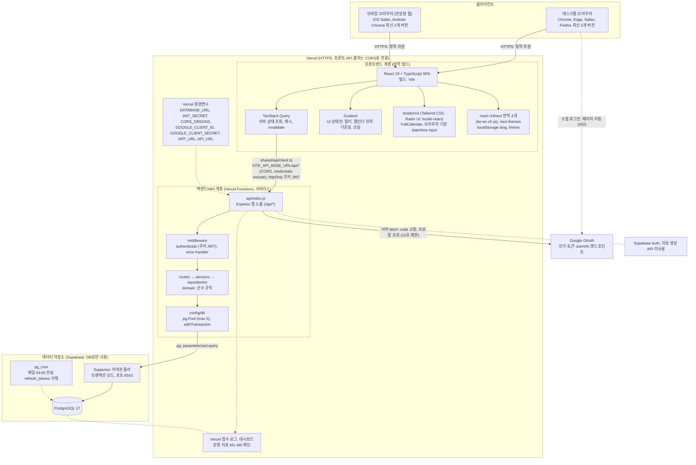

## 3. 계층·모듈 구조

### 3.1 요청 처리 계층 흐름

화면에서 DB까지 한 방향으로만 흐른다. 각 칸의 이름은 `docs/5-project-principle.md` 2장의 레이어 이름이다.

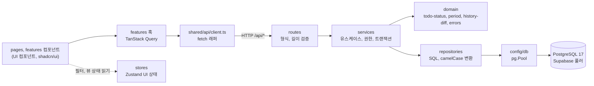

### 3.2 프론트엔드 레이어 의존 구조

의존 방향은 `app → pages → features → shared`이고 `stores`는 아무것도 import하지 않는다(PRD §6, FE-01–FE-05).

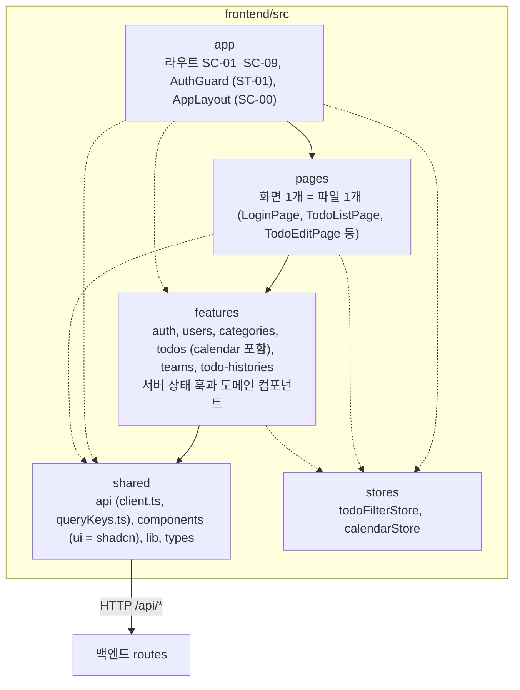

| 금지 규칙 (요약) | 근거 |
|------------------|------|
| pages끼리 import 금지. features는 pages·app을 import하지 않음. shared는 features·pages·stores를 import하지 않음 | FE-01–FE-03 |
| HTTP는 `shared/api/client.ts`만 호출. 컴포넌트에서 `fetch` 직접 호출 금지 | FE-04 |
| 서버 응답 데이터를 Zustand에 복사 금지(이중 소스 방지) | FE-05, PRD §6 |
| 상태(S1–S4)·'오늘' 판정에 클라이언트 시계 사용 금지(캘린더 화면 이동 예외) | FE-06 |
| 편집·삭제 버튼과 카테고리 필드 활성 여부는 서버가 준 `canEdit`, `isOwner`로만 결정 | FE-07 |

### 3.3 백엔드 레이어 의존 구조

의존 방향은 `routes → services → repositories → config/db`이고 `domain`은 아무것도 import하지 않는다(BE-01–BE-09).

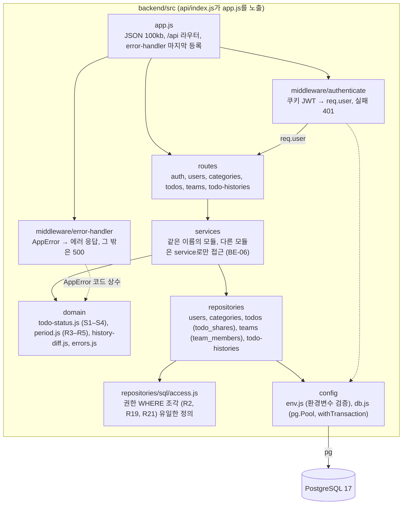

| 금지 규칙 (요약) | 근거 |
|------------------|------|
| routes는 repositories와 `pg`를 import하지 않는다 | BE-01 |
| services는 `req`, `res`, HTTP 상태 코드를 다루지 않고 `AppError`로 던진다 | BE-02, OPS-08 |
| `pg`는 `config/db.js`와 `repositories/`에서만 import한다 | BE-04 |
| 권한 WHERE 조건은 `access.js` 조각으로만 쓴다 | BE-05, P-03 |
| 여러 쓰기는 service에서 `withTransaction`으로 묶는다(가입, 카테고리 삭제와 할일 이동, 구성원 제거와 공유 해제, 팀 나가기, 할일 변경과 이력) | BE-08 |

## 4. 도메인 엔티티 관계

ERD는 `docs/7-erd.md`로 분리했다. 엔티티 관계, 컬럼 타입, FK `ON DELETE`, 유일 제약·인덱스는 그 문서를 본다.

## 5. 복잡한 비즈니스 로직 상세 흐름

### 5.0 선별 기준
단순 CRUD(카테고리 이름 수정, 프로필 수정, 팀 생성, 내 캘린더 팀 색 변경 `PATCH /api/teams/:teamId/color` 등)는 그리지 않았다. 아래 중 하나 이상에 해당하는 흐름만 골랐다: 여러 쓰기를 한 트랜잭션으로 묶음, 역할별 권한 분기(404/403 구분), 입력에 따라 값이 바뀌는 기본값 규칙, 보는 사람에 따라 응답이 달라지는 규칙.

| 절 | 흐름 | 복잡한 이유 | 근거 |
|----|------|-------------|------|
| 5.1 | 공통 요청 처리 | 401·403·404·5xx를 한 곳에서 변환하고 프론트가 코드로 분기. 다른 모든 흐름의 전제 | R1, R2, P-05, OPS-07, OPS-08, OPS-10 |
| 5.2 | 회원가입 | 계정·기본 카테고리 원자성, 이메일 유일성(대소문자 무시), 가입 후 자동 로그인 | FR-01 #1·#2·#8, R6, R16, EX-01, C-01 |
| 5.3 | 할일 등록 | 팀 선택에 따른 소유자·공유 팀·카테고리 규칙, R4 일시 채움, 이력과 같은 트랜잭션 | FR-09 #5·#10, FR-11, R4, R7, R19, R21, EX-22, EX-26 |
| 5.4 | 할일 수정·완료·삭제 | 소유자·관리자·일반 팀원별 권한 분기, 카테고리·공유 팀은 소유자만, 완료 시각 처리 | FR-06, FR-07, R13, R14, R19, EX-20–EX-25, EX-33 |
| 5.5 | 목록·캘린더 조회 | 권한 WHERE, 필터 AND, 상태를 SQL로 계산한 뒤 페이지네이션, 카테고리 비노출 | FR-05 #6, R2, R15, F1–F4, S1–S4, OPS-15–OPS-17 |
| 5.6 | 카테고리 삭제 | 기본 카테고리 보호와 할일 이동·삭제의 원자성 | FR-02 #4·#5, R8, R9 |
| 5.7 | 구성원 추가·제거 | 소유자 전용, 중복·미가입 검사, 자기 제거 거부, 제거와 공유 해제의 원자성, 역할 변경 즉시 반영 | FR-09 #2·#8, FR-11 #5, R18, R21, EX-27, EX-28, EX-34, US-15 |
| 5.8 | 팀 나가기 (P1) | 소유자 위임·제거·공유 해제를 한 번에 처리, 위임 불가 조건과 검사 순서, 기존 소유자 삭제 → 새 소유자 승격 순서 | FR-09 #12, R18, R21, C-11, EX-29, EX-36, EX-40, EX-41 |
| 5.9 | 이력 조회 (P1) | 보는 사람에 따라 카테고리·공유 팀 변경을 걸러내고 빈 이력은 숨김 | FR-10 #4·#6, R20, C-17 |
| 5.10 | 토큰 갱신·로그아웃 | 401 후 자동 갱신·재시도, 회전의 원자성, 재사용 감지, 로그아웃 폐기 | FR-01 #7·#10, PRD A25, SEC-02, OPS-10, EX-42, EX-43 |
| 5.11 | Google 소셜 로그인 | 외부 제공자와의 리다이렉트·서버 간 호출, state 검증, 이메일 자동 연결·신규 가입을 한 트랜잭션으로, 실패 코드를 쿼리로 전달 | FR-12, R22, SEC-13, EX-45–EX-49 |

### 5.1 공통 요청 처리: 인증·권한 판정·에러 변환

근거: R1(인증 필수), R2·P-05(볼 수 없음은 404, 볼 수 있으나 권한 없음은 403), SEC-03(JWT에는 사용자 ID만, 권한은 요청마다 DB 확인), OPS-07·OPS-08·OPS-10(에러 변환과 프론트 분기). 이후 모든 흐름이 이 파이프라인 위에서 동작한다.

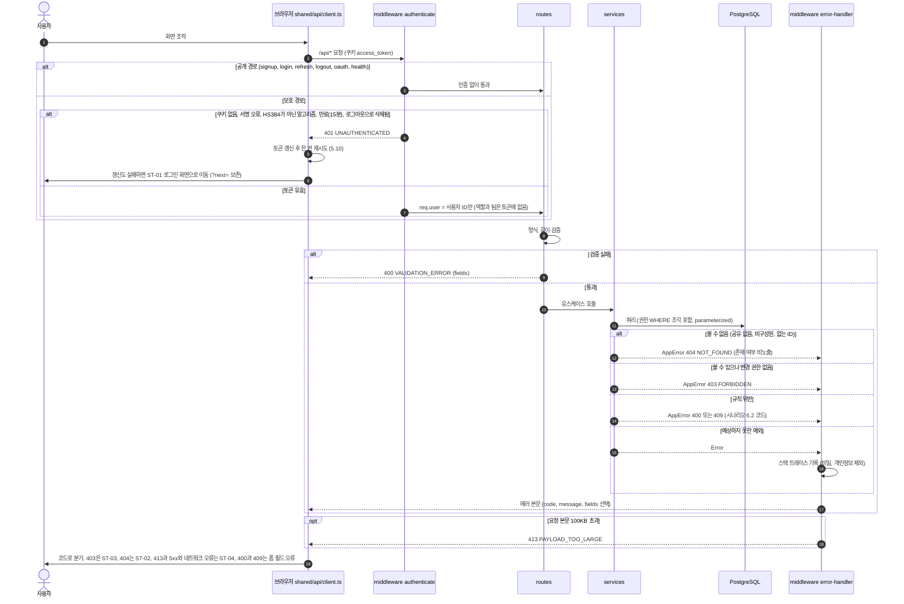

### 5.2 회원가입: 계정과 기본 카테고리 동시 생성

근거: FR-01 #1(둘 중 하나라도 실패하면 둘 다 만들지 않음), R6(기본 카테고리 자동 생성), R16(이메일 유일, 대소문자 무시), C-01(가입 후 자동 로그인), SEC-01(bcryptjs cost 10), EX-01·EX-02.

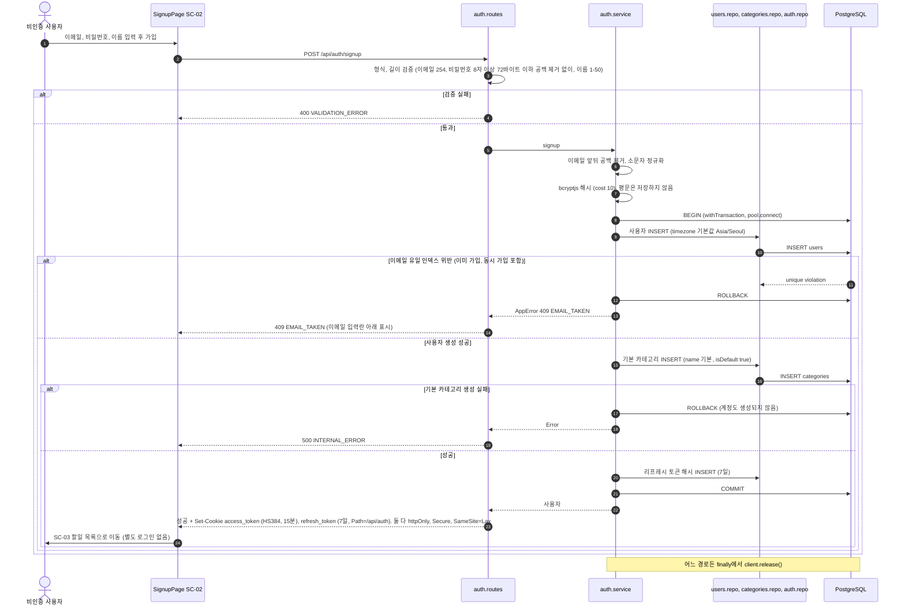

### 5.3 할일 등록: 팀·소유자·공유 팀·일시 채움

근거: 등록 화면에서 먼저 팀을 고르고(C-16), 그 팀의 관리자일 때만 소유자를 구성원 중에서 고른다(R19, FR-09 #10). 소유자가 본인이 아니면 카테고리는 소유자의 기본 카테고리, 공유 팀은 고른 팀으로 고정된다(R7, R19, FR-09 #5). 일시는 R4로 채우고(이때 '오늘'은 관리자가 대리 등록해도 요청자의 `User.timezone` 기준, PRD §5.3) R3을 검증하며, FR-10 구현 후에는 `CREATED` 이력이 같은 트랜잭션에 들어간다(A13).

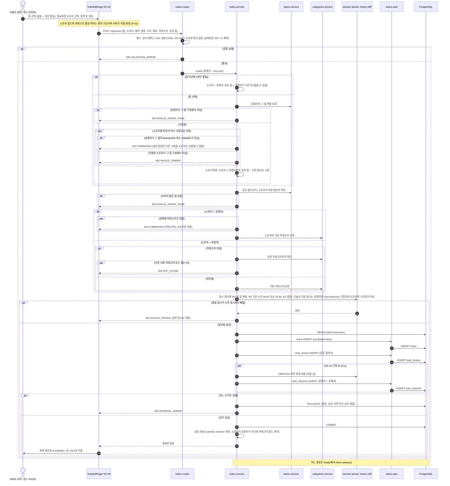

### 5.4 할일 수정·완료·삭제: 권한 판정과 이력

근거: 같은 할일이라도 소유자, 그 팀의 관리자(소유자 포함), 일반 팀원, 비구성원에 따라 결과가 다르다(시나리오 4.1 권한 매트릭스, R13, R19, EX-20–EX-25). 카테고리와 공유 팀 변경은 소유자만 가능하다(R7, R21, EX-23, EX-24). 완료는 별도 경로 없이 `completed` 필드로 처리하고 `completedAt`은 서버가 설정한다(N-12, R14). 삭제는 영구 삭제이며 공유와 이력도 함께 삭제한다(R12, R20). 이력은 요청 1건에 1건이고, 완료 여부가 바뀌면 `COMPLETED`/`UNCOMPLETED`, 아니면 `UPDATED`이며 함께 바뀐 필드도 모두 `changes`에 담는다(R20, FR-10 #1).

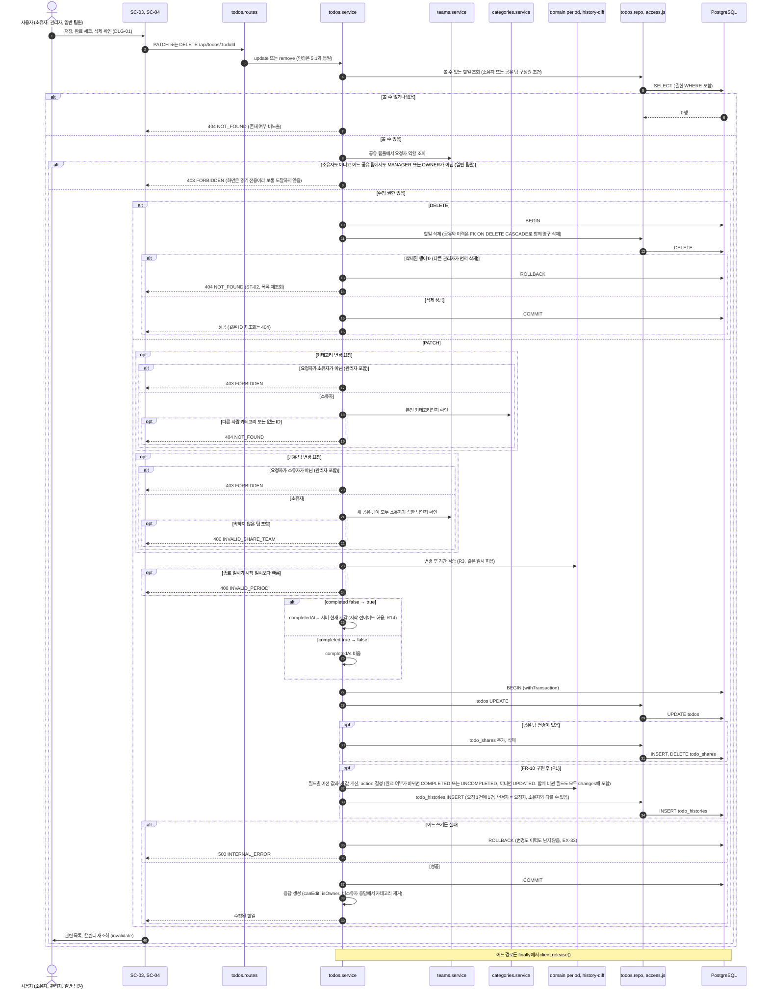

### 5.5 목록·캘린더 조회: 권한·필터·상태 계산

근거: 상태(S1–S4)는 저장하지 않고 조회 시 SQL로 계산해 필터와 정렬에 쓰고, 그 뒤에 페이지네이션한다(FR-05 #6, 도메인 §5.1, OPS-17). 권한 조건(R2, R21)은 처음부터 쿼리에 넣고, 다른 사람 할일 응답에서는 카테고리를 제거한다(SEC-06). 현재 시각은 서버 시각을 분 단위로 자른다(R5, OPS-14). 캘린더는 최대 42일, 500건 상한과 `truncated` 표시가 있다(OPS-16).

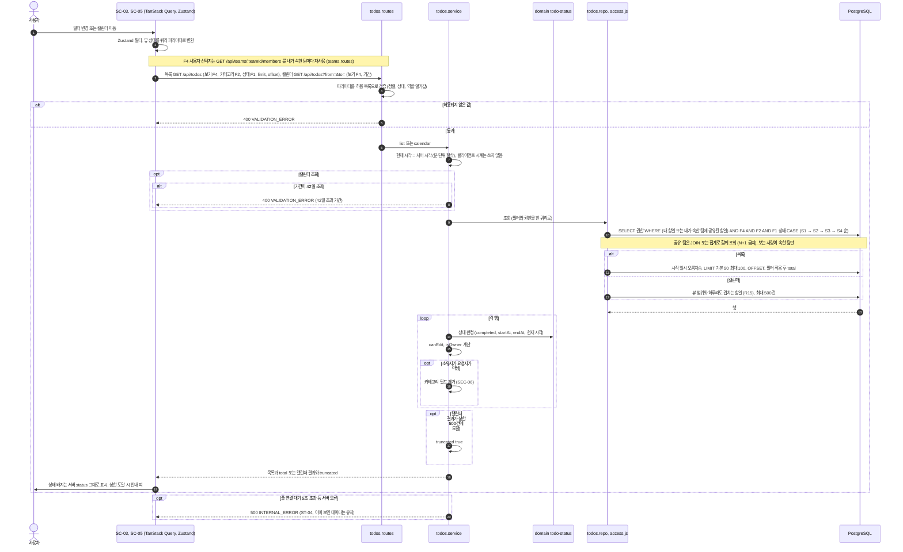

### 5.6 카테고리 삭제: 할일을 기본 카테고리로 이동

근거: 기본 카테고리는 삭제할 수 없고(R8, FR-02 #4), 삭제하는 카테고리의 할일은 삭제하지 않고 기본 카테고리로 옮긴다. 할일 수는 변하지 않아야 하므로 이동과 삭제는 한 트랜잭션이다(R9, FR-02 #5, BE-08). 확인 대화상자에서 취소하면 아무것도 바뀌지 않는다(C-04, DLG-02).

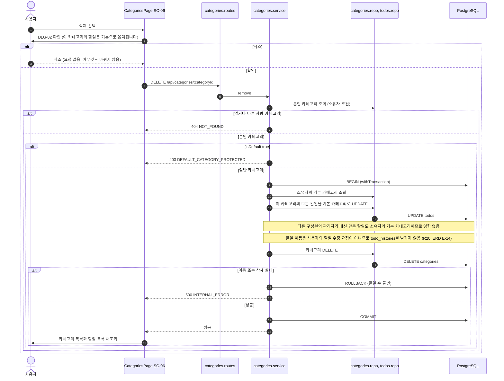

### 5.7 팀 구성원 추가·제거와 공유 해제

근거: 구성원 추가·제거와 관리자 지정·해제는 소유자만 하며(R18, EX-28), 추가는 이메일로 즉시 이뤄지고 역할을 고르지 않으면 `MEMBER`다(C-10). 구성원을 제거하면 그 사람 할일의 그 팀 공유가 함께 해제되어야 하므로 한 트랜잭션이다(R21, FR-11 #5, BE-08). 역할은 JWT가 아니라 요청마다 DB로 확인하므로 변경이 바로 반영된다(SEC-03, US-15 #2). 소유자의 자기 제거는 구성원 제거 경로가 아니라 5.8의 팀 나가기로만 처리하므로 제거 경로에 자기 자신을 지정하면 400 `VALIDATION_ERROR`다(EX-29, N-11). `todo_shares` 정리는 FK 연쇄가 아니라 service가 같은 트랜잭션에서 직접 `DELETE`한다(OPS-23).

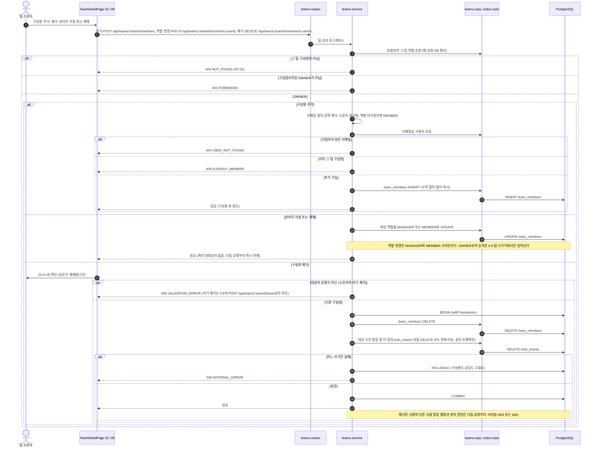

### 5.8 소유자의 팀 나가기: 다음 소유자 지정 (P1)

근거: 팀당 소유자는 정확히 1명이라 소유자는 다음 소유자를 지정해야만 나갈 수 있고, 소유자 지정·나가기·공유 해제는 한 번에 처리한다(R18, R21, FR-09 #12, C-11). 다른 구성원이 없으면 나갈 수 없다(EX-36). 검사 순서는 구성원 아님(404) → 소유자 아님(403) → 다른 구성원 없음(`NO_NEXT_OWNER`) → 다음 소유자 미지정(`OWNER_MUST_TRANSFER`) → 지정한 사람이 그 팀의 다른 구성원이 아님(400 `INVALID_OWNER`)이다(EX-29, EX-36, EX-40, EX-41). 소유자가 아닌 구성원의 팀 나가기는 범위 밖이라 화면에는 버튼이 없고, API로 요청하면 403이다(도메인 §7). 팀당 `OWNER`는 부분 유니크 인덱스로 1명만 허용되므로 기존 소유자를 먼저 삭제한 뒤 새 소유자를 승격한다(도메인 §3.9, OPS-23).

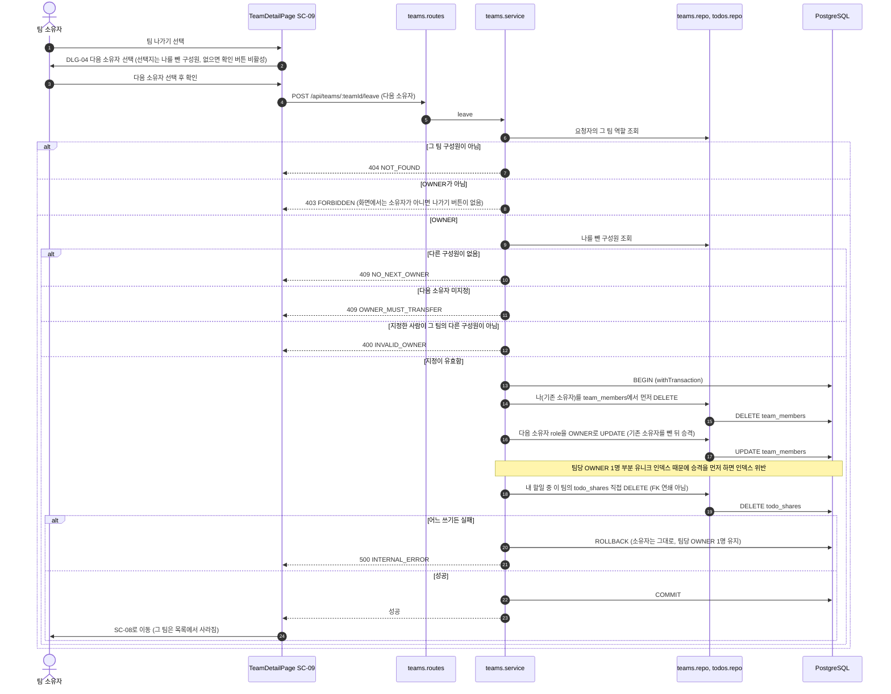

### 5.9 변경 이력 조회: 보는 사람별 필터링 (P1)

근거: 이력은 그 할일을 볼 수 있는 사용자가 볼 수 있지만, 카테고리 변경은 소유자에게만, 공유 팀 변경은 보는 사람이 속한 팀만 보인다. 이렇게 걸러서 남는 변경이 없는 이력은 숨긴다(R20, R21, C-17, FR-10 #4·#6, US-17). 이력의 수정·삭제 API는 없다(FR-10 #3).

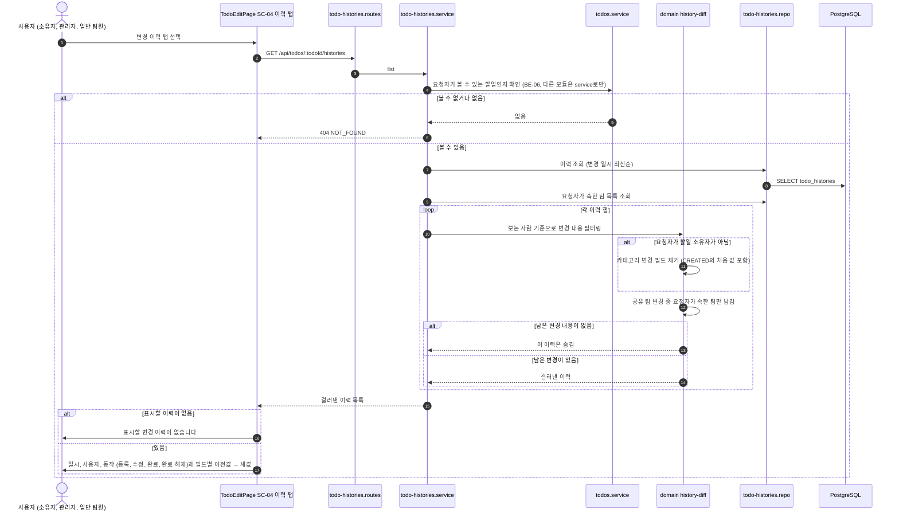

### 5.10 토큰 갱신·로그아웃: 리프레시 토큰 회전과 폐기

근거: 액세스 토큰은 15분, 리프레시 토큰은 7일 절대 만료이고 DB에는 해시만 저장한다(PRD §5.2 A25). 보호 API가 401을 주면 클라이언트가 한 번 갱신한 뒤 원래 요청을 다시 보낸다(OPS-10, EX-42). 갱신마다 쓴 토큰을 폐기하고 새 토큰을 주며(회전), 폐기된 토큰이 다시 오면 그 사용자의 리프레시 토큰을 모두 폐기한다(SEC-02, EX-43). 폐기와 발급은 한 트랜잭션이고, 조건부 `UPDATE … RETURNING`으로 같은 토큰의 동시 갱신 중 하나만 성공한다. 만료 행 정리는 앱이 아니라 `pg_cron`이 한다(OPS-24).

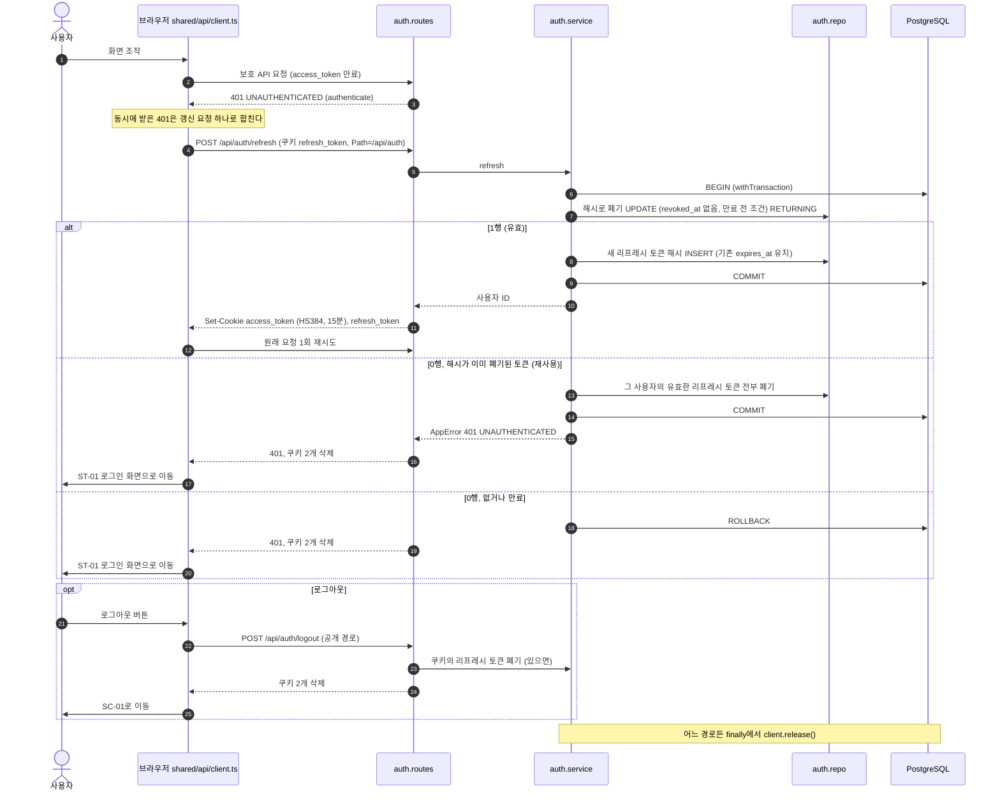

### 5.11 Google 소셜 로그인: state 검증과 계정 결정

근거: 백엔드 주도 Authorization Code + state 흐름이고 제공자 설정은 `oauth.providers.js` 하나다(PRD §5.2 소셜 로그인, SEC-13). 계정 결정은 `oauthLogin` 한 곳이다(도메인 R22). 시작·콜백은 브라우저가 이동하는 공개 경로라 JSON이 아니라 302로 응답한다(N-11).

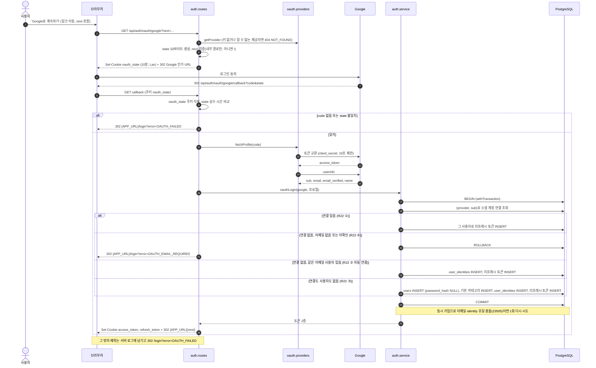

## 6. 확인 필요 사항

T-01–T-08은 모두 이해관계자 확인(2026-11-04)으로 결정해 기준 문서에 반영했다. 남은 확인 필요 사항은 없다. 각 항목의 원래 문제 뒤에 결정 내용을 적었다.

### 6.1 문서 간 불일치

| ID | 내용 | 관련 문서·위치 |
|----|------|----------------|
| T-01 | **결정됨 — 반영 문서 도메인 v0.12, 와이어프레임 v0.7.** 와이어프레임 이력 탭이 '(탈퇴한 사용자)', '(삭제된 팀)' 표시를 정의하는데, 회원 탈퇴와 팀 삭제는 범위 밖이라 그 상태가 생기지 않는다. 사용자·팀 삭제 시 `TodoHistory`의 `actorId`, `TodoShare`의 `teamId` 참조 처리도 정해져 있지 않다. 결정: 두 표시를 삭제한다. 사용자·팀을 참조하는 FK는 `ON DELETE RESTRICT`다 | 와이어프레임 §4.5.4(U-16) / 도메인 §7, PRD §3.2 / 도메인 §3.9, 프로젝트 원칙 OPS-23 |
| T-02 | **결정됨 — 반영 문서 도메인 v0.12, PRD v0.11, 사용자 시나리오 v0.9, 와이어프레임 v0.7, 프로젝트 원칙 v0.7, 이 문서 v0.2.** 비밀번호 상한 표현이 달랐다(도메인 3.4와 PRD '8–72자', 시나리오 6.3과 SEC-09는 바이트 기준). 결정: '8자 이상, UTF-8 72바이트 이하'로 통일한다 | 도메인 §3.4 / PRD FR-01 #3, §5.2 / 시나리오 §6.3 / 프로젝트 원칙 SEC-01, SEC-09 |

### 6.2 문서에 없어 그림에서 정하지 못한 항목

| ID | 내용 | 영향 흐름 |
|----|------|-----------|
| T-03 | **결정됨 — 반영 문서 도메인 v0.12, PRD v0.11, 사용자 시나리오 v0.9, 와이어프레임 v0.7, 이 문서 v0.2.** 관리자가 구성원 할일을 대리 등록할 때 R4의 '오늘'과 일시 기본값에 쓰는 시간대. 결정: 요청자(인증된 사용자)의 `User.timezone` 기준이다(소유자의 시간대가 아님) | 5.3 |
| T-04 | **결정됨 — 반영 문서 도메인 v0.12, PRD v0.11, 사용자 시나리오 v0.9, 프로젝트 원칙 v0.7, 이 문서 v0.2.** 완료 여부와 다른 필드를 한 번에 바꾼 요청의 이력 `action`과 건수. 결정: 요청 1건 = 이력 1건이다. 완료 여부가 바뀌면 `COMPLETED`/`UNCOMPLETED`, 아니면 `UPDATED`이고, 함께 바뀐 필드는 모두 `changes`에 포함한다 | 5.4 |
| T-05 | **결정됨 — 반영 문서 PRD v0.11, 사용자 시나리오 v0.9, 와이어프레임 v0.7, 프로젝트 원칙 v0.7, 이 문서 v0.2.** 오류 코드가 시나리오 6.2에 없던 거부 사례. 결정: ① 일반 팀원(관리자 아님)이 다른 사람을 소유자로 지정 → 403 `FORBIDDEN` ② 42일을 넘는 캘린더 기간 → 400 `VALIDATION_ERROR` ③ 소유자가 아닌 구성원의 팀 나가기 → 403 `FORBIDDEN`(UI는 비소유자에게 나가기 버튼을 숨김) ④ 다음 소유자로 지정한 사람이 그 팀의 다른 구성원이 아님 → 400 `INVALID_OWNER` | 5.3, 5.5, 5.8 |
| T-06 | **결정됨 — 반영 문서 도메인 v0.12, PRD v0.11, 사용자 시나리오 v0.9, 와이어프레임 v0.7, 프로젝트 원칙 v0.7, 이 문서 v0.2.** 팀 나가기 검사 순서와 EX-29의 '자기 자신 제거' 경로. 결정: 검사 순서는 `NO_NEXT_OWNER`(다른 구성원 없음) → `OWNER_MUST_TRANSFER`(다음 소유자 미지정)이다. 자기 제거는 `POST /api/teams/:teamId/leave`로만 처리하고, 구성원 제거 API로 자기 자신을 지정하면 400 `VALIDATION_ERROR`다. 5.7의 `OWNER_MUST_TRANSFER` 분기는 이 규칙으로 바꿨다 | 5.7, 5.8 |
| T-07 | **결정됨 — 반영 문서 프로젝트 원칙 v0.7, 이 문서 v0.2.** API 경로 미정의. 결정: 프로젝트 원칙 N-11에 캘린더 조회 `GET /api/todos?from=&to=`(목록 API의 기간 필터), F4 사용자 선택지 `GET /api/teams/:teamId/members`(기존 재사용), `/api/categories`, `/api/categories/:categoryId`, 구성원 제거 `DELETE /api/teams/:teamId/members/:userId`, 역할 변경 `PATCH /api/teams/:teamId/members/:userId`를 추가했다. 이 문서의 서술형·유추 경로를 이 경로로 교체했다 | 5.4–5.8 |
| T-08 | **결정됨 — 반영 문서 도메인 v0.12, 프로젝트 원칙 v0.7, 이 문서 v0.2.** 삭제 방식과 팀당 OWNER 1명 보장 방식. 결정: 할일 삭제 시 이력·공유는 FK `ON DELETE CASCADE`, 구성원 제거 시 공유 해제는 service가 같은 트랜잭션에서 직접 `DELETE`, 팀당 OWNER 1명은 부분 유니크 인덱스 `UNIQUE (team_id) WHERE role = 'OWNER'`다. 그래서 소유권 이전은 기존 소유자 삭제(강등) → 새 소유자 승격 순서이며 5.8을 고쳤다 | 5.4, 5.7, 5.8 |

## 7. 변경 이력

| 버전 | 일자 | 작성자 | 변경 내용 |
|------|------|--------|-----------|
| v0.1 | 2026-11-04 | hjining | 최초 작성 (도메인 정의서 v0.11, PRD v0.10, 사용자 시나리오 v0.8, 와이어프레임 v0.6, 프로젝트 구조 설계 원칙 v0.6 기반). 시스템 아키텍처, 계층·모듈 구조(3종), 엔티티 관계, 복잡한 비즈니스 로직 시퀀스 9종, 확인 필요 사항 T-01–T-08 |
| v0.2 | 2026-11-04 | hjining | 확인 필요 T-01–T-08 결정 반영(6장을 '결정됨'으로 갱신, 기준 문서 버전 갱신). 시퀀스 수정: 5.3 일반 팀원의 소유자 지정 403·대리 등록 시간대, 5.4 이력 action 결정·CASCADE, 5.5 경로(`GET /api/todos?from=&to=`)·42일 초과 400, 5.7 경로 구체화·자기 제거 400·공유 직접 삭제·역할 변경 범위, 5.8 비소유자 403·INVALID_OWNER·기존 소유자 삭제 후 승격 순서. 4장 ER 주석에 FK RESTRICT/CASCADE·부분 유니크 인덱스 추가, 5.2 비밀번호 길이 표기 |
| v0.3 | 2026-11-04 | hjining | 기준 문서 버전 갱신(사용자 시나리오 v0.10, 와이어프레임 v0.8, 프로젝트 원칙 v0.8). 5.2 비밀번호는 공백 제거 없이 검사(시나리오 C-23) |
| v0.4 | 2026-11-04 | hjining | 기준 문서 버전 갱신(도메인 v0.13, PRD v0.12, 사용자 시나리오 v0.11, 와이어프레임 v0.9, 프로젝트 원칙 v0.9). 5.6에 카테고리 삭제 이동은 이력을 남기지 않는다는 Note 추가(ERD E-14). 4장의 erDiagram과 FK·인덱스 주석을 `docs/7-erd.md`로 분리하고 4장은 링크만 남김. 1.2 다이어그램 목록 4행 수정 |
| v0.5 | 2026-11-04 | hjining | 기준 문서 버전 갱신(PRD v0.13, 사용자 시나리오 v0.12, 와이어프레임 v0.10, 프로젝트 원칙 v0.10). PRD A25–A27 반영: 2장 인증 설명과 `pg_cron` 노드, 5.1 401 분기에 갱신·재시도와 `HS384`·15분, 5.2 가입 응답 쿠키 2종과 리프레시 토큰 INSERT, 5.10 토큰 갱신·로그아웃 시퀀스 추가(1.2, 5.0 목록) |
| v0.6 | 2026-11-04 | hjining | 기준 문서 버전 갱신(PRD v0.14, 사용자 시나리오 v0.13, 와이어프레임 v0.11, 프로젝트 원칙 v0.11). 5.1 공개 경로를 SEC-04와 맞춤(refresh, logout, health 추가). 5.3 등록 시퀀스의 일시 형식 검증에 날짜만 보낸 값 예외(SEC-11) 표시 |
| v0.7 | 2026-11-05 | hjining | 기준 문서 버전 갱신(프로젝트 원칙 v0.12). 다이어그램 변경 없음 |
| v0.8 | 2026-11-05 | hjining | 기준 문서 버전 갱신(프로젝트 원칙 v0.13). 다이어그램 변경 없음. 기준 문서 버전 갱신(PRD v0.15, 사용자 시나리오 v0.14, 와이어프레임 v0.12). 2장 다이어그램: 프론트 → API 호출을 CORS(`VITE_API_BASE_URL`, `credentials: include`)로, 환경변수에 `CORS_ORIGINS` |
| v0.9 | 2026-11-05 | hjining | 문서 정합성 검토: 기준 문서 버전 갱신(도메인 v0.14, PRD v0.16, 사용자 시나리오 v0.15, 와이어프레임 v0.14, 프로젝트 원칙 v0.15). 제목 줄에 잘못 들어간 문구 제거(내용은 v0.8 이력에 있음). 5.0 단순 CRUD 목록에 내 캘린더 팀 색 변경(PRD A29) 추가. 다이어그램 변경 없음 |
| v0.10 | 2026-11-05 | hjining | 다국어·테마·Google 소셜 로그인 반영(DOC-01), 기준 문서 버전 갱신(도메인 v0.14, PRD v0.16, 사용자 시나리오 v0.15, 와이어프레임 v0.14, 프로젝트 원칙 v0.16): 2장 외부 인증 서비스를 Google OAuth로 정정(소셜 로그인 범위 밖 문구 수정)하고 다이어그램에 Google 노드·i18n/테마 노드·환경변수 추가, 5.1 공개 경로에 oauth, 5.11 Google 소셜 로그인 시퀀스 추가(1.2, 5.0 목록). 2장에 프론트 개발 모드 전용 콘솔 로깅 설명 추가(프로젝트 원칙 OPS-25). 다이어그램 변경 없음 |
| v0.11 | 2026-11-06 | hjining | 문서 정합성 검토: 기준 문서 버전 갱신(도메인 v0.15, PRD v0.17, 사용자 시나리오 v0.16, 와이어프레임 v0.15, 프로젝트 원칙 v0.17). 내용·다이어그램 변경 없음 |
