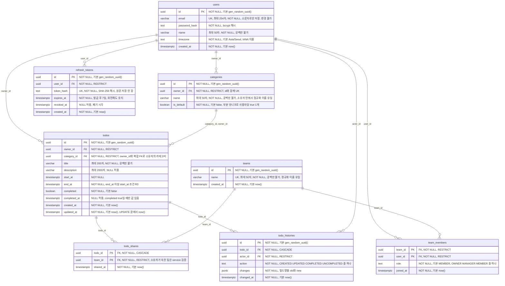

# TodoList ERD (엔티티 관계 다이어그램)

| 항목 | 내용 |
|------|------|
| 문서 버전 | v0.6 |
| 상태 | 초안 |
| 최종 수정일 | 2026-11-05 |
| 작성자 | hjining |
| 기준 문서 | `docs/1-domain-definition.md` v0.13, `docs/2-prd.md` v0.15, `docs/4-wireframe.md` v0.12, `docs/5-project-principle.md` v0.13, `docs/6-arch-diagram.md` v0.8 |

> 표기
> - 근거는 기준 문서의 ID와 절로 쓴다. 도메인 규칙 `R`, 도메인 절 `도메인 §n`, PRD 절 `PRD §n`, 프로젝트 원칙 `N-xx`·`G-xx`·`OPS-xx`·`P-xx`.
> - 이름은 프로젝트 원칙 N-17·N-18·G-07의 DB 명명 규칙(snake_case 복수형 테이블, `<엔티티>_id` 참조, `*_at` 시각)을 따른 물리 이름이다. 코드와 API는 camelCase이고 변환은 repositories에서만 한다(N-20).
> - 이 문서는 기준 문서에 있는 엔티티·제약만 그린다. 새 테이블과 기능을 더하지 않는다. 기준 문서에 없어서 이 문서에서 정한 부분은 5장 '확인 필요 사항'에 모았고, 본문에는 `E-xx`로 표시했다.
> - 다이어그램은 Mermaid `erDiagram`이며 GitHub에서 렌더링된다. 다이어그램 속성 주석에는 부등호와 큰따옴표를 쓰지 않았다(제약의 정확한 식은 2·3장 표에 있다).
> - 구버전 Mermaid(9.x) 미리보기에서도 그려지도록 키 자리에는 `PK`, `FK`만 쓴다. 복합 PK의 FK와 `UK`는 주석 앞에, 문자열 길이는 `varchar` 대신 주석의 '최대 n자'로 적었다(정확한 타입은 3장 표).
> - 변경 이력은 문서 맨 아래(6장)에 있다.

## 1. 개요

### 1.1 범위
도메인 정의서 3장의 엔티티 7개와 인증용 기술 테이블 `refresh_tokens` 1개(PRD §5.2 A25, 도메인 엔티티 아님)를 PostgreSQL 17 테이블로 옮긴 논리·물리 혼합 모델이다. P1 테이블(`todo_histories`)도 Day 1에 한 번에 만든다(P-08). DDL은 `backend/src/db/migrations/`의 순번 SQL 파일로 쓴다(OPS-18, G-07). 이 문서는 DDL이 아니다. 마이그레이션 실행 스크립트가 만드는 적용 기록 테이블 `schema_migrations`(파일 이름, 적용 시각)는 도구 테이블이라 이 문서의 테이블 수에 넣지 않는다(OPS-18).

### 1.2 공통 결정

| 항목 | 결정 | 근거 |
|------|------|------|
| 식별자 | `uuid`, 기본값 `gen_random_uuid()`. 연결 테이블(`team_members`, `todo_shares`)은 복합 PK | G-07, 도메인 §3.3, §3.7 |
| 일시 | 모든 일시 컬럼은 `timestamptz`, DB 세션 시간대는 `Asia/Seoul` | PRD §5.3, OPS-14, R5 |
| 상태 | `status` 컬럼은 만들지 않는다. 저장하는 값은 `completed`, `start_at`, `end_at`뿐이다 | 도메인 §5.1, N-18, P-04 |
| 비밀번호 | 평문을 저장하지 않고 bcrypt 해시만 저장한다 | 도메인 §3.4, PRD §5.2 |
| 삭제 | 사용자·팀·카테고리는 삭제 시 참조되면 막고(RESTRICT), 할일 삭제만 이력·공유를 함께 지운다. `refresh_tokens`의 만료 행은 `pg_cron`이 매일 지운다(3.6) | 도메인 §3.9, OPS-23, OPS-24 |
| 시간대 | DB 기본 시간대는 `ALTER DATABASE … SET timezone TO 'Asia/Seoul'`로 고정한다. 풀러 트랜잭션 모드라 연결별 `SET`은 쓰지 않는다 | PRD §5.3 A28, OPS-14 |

## 2. ERD



- 관계 10개는 모두 부모 1(필수) 대 자식 0개 이상이다. `todos`는 `categories` 정확히 1개와 `users`(소유자) 정확히 1개에 속하고, `todo_shares`와 `todo_histories`는 0개 이상이다(도메인 §3.1, R7, R21).
- `users`와 `teams`는 `team_members`로, `todos`와 `teams`는 `todo_shares`로 N 대 M 연결된다(도메인 §3.1).
- 컬럼 이름은 도메인 속성명의 snake_case 변환이다(N-18). 예외로 도메인 `User.password`는 평문이 아님을 드러내도록 `password_hash`로 한다(E-07). `todo_histories.changes`는 도메인 속성명 그대로다.

## 3. 제약과 인덱스

### 3.1 외래 키 (FK)

| FK | 참조 | ON DELETE | 근거 |
|----|------|-----------|------|
| `categories.owner_id` | `users.id` | RESTRICT | 도메인 §3.9, OPS-23 ① |
| `todos.owner_id` | `users.id` | RESTRICT | 도메인 §3.9, OPS-23 ① |
| `todos (category_id, owner_id)` | `categories (id, owner_id)` | RESTRICT | R7, R9, 도메인 §3.9 (E-01, E-04) |
| `team_members.team_id` | `teams.id` | RESTRICT | 도메인 §3.9, OPS-23 ① |
| `team_members.user_id` | `users.id` | RESTRICT | 도메인 §3.9, OPS-23 ① |
| `todo_shares.todo_id` | `todos.id` | CASCADE | R12, R20, 도메인 §3.9, OPS-23 ② |
| `todo_shares.team_id` | `teams.id` | RESTRICT | 도메인 §3.9, OPS-23 ① |
| `todo_histories.todo_id` | `todos.id` | CASCADE | R12, R20, 도메인 §3.9, OPS-23 ② |
| `todo_histories.actor_id` | `users.id` | RESTRICT | 도메인 §3.9, OPS-23 ① |
| `refresh_tokens.user_id` | `users.id` | RESTRICT | OPS-23 ①, PRD A25 (E-15) |

- 회원 탈퇴와 팀 삭제는 범위 밖이라 `users`·`teams` 행이 삭제되는 경우는 없다(도메인 §7).
- 구성원 제거 때의 `todo_shares` 정리는 FK 연쇄가 아니다. service가 같은 트랜잭션에서 직접 `DELETE`한다(R21, OPS-23 ③, BE-08).
- 카테고리 삭제는 service가 한 트랜잭션에서 그 카테고리의 할일을 기본 카테고리로 `UPDATE`한 뒤 `DELETE`한다(R9, BE-08). `todos.category_id`가 RESTRICT라 이동을 빠뜨리면 삭제가 실패한다(할일이 조용히 사라지지 않음).
- `todos`의 카테고리 FK는 `(category_id, owner_id)` 복합 FK라 다른 사람의 카테고리를 가리킬 수 없다(R7). 할일 소유자는 등록 후 바뀌지 않는다(바꾸는 API가 없음).
- `todo_shares.team_id`가 소유자가 속한 팀이라는 조건(R21)은 구성원 변화에 따라 달라져 FK로 표현할 수 없다. service가 등록·수정 때 검증하고(400 `INVALID_SHARE_TEAM`) 구성원 제거 때 공유를 지운다. 트리거는 쓰지 않는다(E-04).
- `ON UPDATE`는 기준 문서에 없다. 식별자는 바뀌지 않으므로 기본 동작을 쓴다.

### 3.2 유일 제약과 인덱스

이름은 `uq_<테이블>_<컬럼>`, `idx_<테이블>_<컬럼>` 규칙(N-19)을 따르고, 컬럼이 여럿이면 `_`로 잇는다. 표현식 인덱스는 `_lower`, 부분 인덱스는 조건을 뜻하는 접미사를 붙인다. PK·FK·CHECK는 이름을 붙이지 않고 PostgreSQL 기본 이름을 쓴다(E-09).

| 대상 | 종류 | 정의 | 근거 |
|------|------|------|------|
| `users` 이메일 | 유일 | `uq_users_email`: `UNIQUE (email)`. 소문자로만 저장하므로 표현식이 필요 없다 | R16, PRD §5.1, N-19 (E-10) |
| `categories` 소유자 안 이름 | 유일 (복합 표현식) | `uq_categories_owner_id_name_lower`: `UNIQUE (owner_id, lower(btrim(name)))` | R10, PRD §5.1 |
| `categories` 복합 FK 대상 | 유일 | `uq_categories_id_owner_id`: `UNIQUE (id, owner_id)` | R7 (E-04) |
| `teams` 이름 | 유일 (표현식) | `uq_teams_name_lower`: `UNIQUE (lower(btrim(name)))` | 도메인 §3.2, R18, PRD §5.1 |
| `team_members` | PK | `PRIMARY KEY (team_id, user_id)` | 도메인 §3.3 |
| `todo_shares` | PK | `PRIMARY KEY (todo_id, team_id)` | 도메인 §3.7 |
| 팀당 OWNER 1명 | 부분 유니크 | `uq_team_members_team_id_owner`: `UNIQUE (team_id) WHERE role = 'OWNER'` | R18, 도메인 §3.9, OPS-18, OPS-23 ④ |
| `todos` 소유자 일정 | 일반 | `idx_todos_owner_id_start_at_end_at`: `(owner_id, start_at, end_at)` | PRD §5.1, OPS-18 |
| `todo_shares` 팀별 조회 | 일반 | `idx_todo_shares_team_id_todo_id`: `(team_id, todo_id)` | PRD §5.1, OPS-18 |
| `team_members` 사용자별 조회 | 일반 | `idx_team_members_user_id`: `(user_id)` | PRD §5.1, OPS-18 |
| `todo_histories` 이력 조회 | 일반 | `idx_todo_histories_todo_id_changed_at`: `(todo_id, changed_at)` | PRD §5.1, OPS-18 |
| 사용자당 `is_default` true 1개 | 부분 유니크 | `uq_categories_owner_id_default`: `UNIQUE (owner_id) WHERE is_default` | 도메인 §3.5, R6, R8 (E-02) |
| 카테고리별 할일 | 일반 | `idx_todos_category_id`: `(category_id)`. 카테고리 삭제 때 할일 이동 `UPDATE`(R9)가 쓴다 | R9 (E-12) |
| 리프레시 토큰 조회 | 유일 | `uq_refresh_tokens_token_hash`: `UNIQUE (token_hash)`. 갱신·로그아웃 때 해시로 찾는다 | PRD A25, SEC-02 (E-15) |
| 사용자별 리프레시 토큰 | 일반 | `idx_refresh_tokens_user_id`: `(user_id)`. 재사용 감지·비밀번호 변경 때 전체 폐기가 쓴다 | PRD A25, SEC-02 (E-15) |

- 소유권 이전은 위 부분 유니크 인덱스 때문에 기존 소유자를 삭제(또는 강등)한 뒤 새 소유자를 승격하는 순서로만 처리한다(OPS-23 ⑤, 도메인 §3.9).
- 사용자당 기본 카테고리 '최대 1개'는 부분 유니크 인덱스가, '최소 1개'는 가입 트랜잭션(R6)과 기본 카테고리 삭제 금지(R8)가 보장한다.
- 위 목록 밖의 FK 인덱스는 만들지 않는다. `todo_histories.actor_id`는 사용자 삭제가 없어 쓰이지 않고, `todo_shares.todo_id`와 `categories.owner_id`는 PK·복합 유일 인덱스의 앞 컬럼이 처리한다(E-12).

### 3.3 CHECK 제약과 길이

| 대상 | 규칙 | 근거 |
|------|------|------|
| `todos` | `CHECK (end_at >= start_at)`. 같은 일시 허용 | R3 |
| `team_members.role` | `CHECK (role IN ('OWNER', 'MANAGER', 'MEMBER'))`, 기본값 `'MEMBER'` | 도메인 §3.3, R18, N-09 (E-08) |
| `todo_histories.action` | `CHECK (action IN ('CREATED', 'UPDATED', 'COMPLETED', 'UNCOMPLETED'))` | 도메인 §3.8, N-09 (E-08) |
| `users.name`, `teams.name`, `categories.name`, `todos.title` | `CHECK (char_length(btrim(x)) >= 1)`. 공백만 있는 값 거부 | R11, 도메인 §3.2–3.6 (E-06) |
| `users.email` | `CHECK (email = lower(email))`. 소문자로만 저장 | R16 (E-10) |
| `todos` 완료 일관성 | `CHECK (completed = (completed_at IS NOT NULL))` | 도메인 §3.6, R14 (E-05) |
| 문자열 길이 | `users.email` `varchar(254)`, `users.name`·`teams.name`·`categories.name` `varchar(50)`, `todos.title` `varchar(200)`, `todos.description` `varchar(2000)` | 도메인 §3.2–3.6, PRD §5.2 |
| `users.password_hash` | `text`, 길이는 DB에서 제한하지 않는다. 8자 이상·UTF-8 72바이트 이하는 평문 입력 규칙이고 저장 값은 해시다 | 도메인 §3.4, PRD §5.2 |
| `users.timezone` | `text NOT NULL DEFAULT 'Asia/Seoul'`. IANA 이름 여부는 DB가 아니라 routes가 `Intl.supportedValuesOf('timeZone')`로 검증한다 | 도메인 §3.4, PRD FR-03 (E-07) |
| `role`, `action` 저장 형식 | PostgreSQL `enum` 타입이 아니라 `text` + CHECK. 값을 바꿀 때 CHECK만 다시 만들면 된다 | N-09 (E-08) |
| `categories.is_default`, `todos.completed` | `boolean NOT NULL`, 기본값 각각 `false` | 도메인 §3.5, §3.6 |
| `*_at` 기본값 | `created_at`, `joined_at`, `shared_at`, `changed_at`, `updated_at`은 `NOT NULL DEFAULT now()`. `updated_at`은 트리거 없이 repository의 `UPDATE` 문에 `updated_at = now()`를 넣는다 | PRD §5.3, BE-04 (E-11) |

- 이름·제목 문자열은 앞뒤 공백을 제거한 값을 저장하고, 길이도 제거한 값으로 센다. 1차 검증은 routes(PRD §5.2), DB CHECK는 최후 방어다(E-06). 비밀번호는 공백을 제거하지 않는다(SEC-09).
- 설명(`description`)은 선택 입력이라 공백 CHECK를 두지 않는다.

### 3.4 정규화 비교

| 대상 | 비교 방식 | 근거 |
|------|-----------|------|
| 이메일 | service가 앞뒤 공백을 제거하고 소문자로 바꿔 저장·비교한다. 로그인도 같은 방식이다. 저장 값이 항상 소문자라(CHECK) 유일 인덱스는 일반 `UNIQUE (email)`이다 | R16, SEC-01, N-19 (E-10) |
| 카테고리 이름 | 앞뒤 공백 제거 후 대소문자 무시, 같은 사용자 안에서만 비교한다. 다른 사용자와는 같아도 된다 | R10 |
| 팀 이름 | 카테고리와 같은 방식(`lower(btrim(name))`)으로 시스템 전체에서 비교한다 | 도메인 §3.2, R18 |

- 인덱스 식과 service의 비교 식(`lower(btrim(...))`)은 같아야 한다. 다르면 service 검사와 DB 위반이 어긋난다.
- 이메일 유일 위반(동시 가입 포함)은 service가 409 `EMAIL_TAKEN`으로 변환한다(시나리오 §6.2, OPS-08).

### 3.5 `todo_histories.changes` 구조

`jsonb NOT NULL`이다. 키는 API 필드 이름(camelCase, N-20)이고 값은 `{ "old": 이전 값, "new": 새 값 }`이다(E-03).

```json
{
  "title": { "old": "보고서 초안", "new": "보고서 최종본" },
  "completed": { "old": false, "new": true },
  "category": { "old": { "id": "<카테고리 uuid>", "name": "기본" }, "new": { "id": "<카테고리 uuid>", "name": "Work" } },
  "sharedTeamIds": { "old": ["<팀 uuid>"], "new": ["<팀 uuid>", "<팀 uuid>"] }
}
```

| 항목 | 규칙 | 근거 |
|------|------|------|
| 담는 필드 | `title`, `description`, `startAt`, `endAt`, `completed`, `category`, `sharedTeamIds` 중 바뀐 것만. `completedAt`은 `completed`에서 따라 나오므로 담지 않는다 | R20, N-12 |
| `CREATED` | 모든 필드를 `old: null`, `new: 처음 값`으로 담는다 | 도메인 §3.8 |
| 일시 값 | ISO 8601 + 오프셋 문자열 | PRD §5.3 |
| 공유 팀 | 팀 ID 배열. 조회 때 보는 사람이 속한 팀 ID만 남기고, 남은 차이가 없으면 그 필드를 뺀다 | R20, R21, 6-arch 5.9 |
| 카테고리 | 키는 `category`이고 값은 그 시점의 `{ "id", "name" }`이다. 카테고리가 나중에 이름이 바뀌거나 삭제돼도 이력에는 기록 당시 이름이 남는다(E-13). 할일 소유자가 아닌 사람의 조회 응답에서는 `category`를 뺀다. 필드가 하나도 남지 않은 이력은 숨긴다 | R2, R20 |

### 3.6 `refresh_tokens` 보존 규칙

| 항목 | 규칙 | 근거 |
|------|------|------|
| 저장 값 | 토큰 원문은 저장하지 않고 SHA-256 해시만 저장한다 | PRD §5.2, P-06 |
| 회전 | 갱신 때 쓴 행에 `revoked_at`을 채우고 새 행을 INSERT한다. 새 행의 `expires_at`은 쓴 행의 값을 그대로 쓴다(7일 절대 만료) | PRD A25, SEC-02 |
| 폐기 행 | 만료 전까지 남긴다. 다시 오면 재사용으로 판정해 그 사용자의 유효 행을 모두 폐기한다 | SEC-02 |
| 비밀번호 변경 | 그 사용자의 행을 모두 **삭제**하고 새 행 1개를 INSERT한다. 폐기 행으로 남기면 다른 브라우저의 옛 토큰이 재사용으로 판정되어 새 행까지 폐기되므로 삭제한다 | PRD FR-03 #5, SEC-02, EX-44 |
| 정리 | `pg_cron`이 매일 04:00 `expires_at < now()` 행을 삭제한다. 마이그레이션이 아니라 운영 작업 SQL(`backend/src/db/ops/`)이다. `expires_at` 인덱스는 두지 않는다(느려지면 추가) | PRD A27, OPS-24, K12 |
| 사용자 삭제 | 회원 탈퇴가 범위 밖이라 생기지 않는다. FK는 RESTRICT | 도메인 §7, OPS-23 ① |

## 4. 코드·문서 대응

| 도메인 엔티티 (도메인 §3) | 테이블 | 모듈 위치 (N-01, 6-arch 3.3) |
|---------------------------|--------|------------------------------|
| User | `users` | `users` |
| Team | `teams` | `teams` |
| TeamMember | `team_members` | `teams` (상위 모듈) |
| Category | `categories` | `categories` |
| Todo | `todos` | `todos` |
| TodoShare | `todo_shares` | `todos` (상위 모듈) |
| TodoHistory | `todo_histories` | `todo-histories` |
| (도메인 엔티티 아님, 인증) | `refresh_tokens` | `auth` (`auth.repo.js`) |

## 5. 확인 필요 사항

E-01–E-12는 이해관계자 확인(2026-11-04)으로 결정해 본문에 반영했다. E-13, E-14는 문서 정합성 검토에서 찾아 이해관계자 확인(2026-11-04)으로 결정했다. E-15는 PRD v0.13의 리프레시 토큰 결정(A25)을 반영한 것이다. 남은 확인 필요 사항은 없다.

| ID | 원래 문제 | 결정 | 반영 위치 |
|----|-----------|------|-----------|
| E-01 | `todos.category_id` FK의 ON DELETE가 기준 문서에 없었다 | **RESTRICT**. 카테고리 삭제는 할일을 기본 카테고리로 옮긴 뒤 지우고(R9), 이동을 빠뜨리면 삭제가 실패한다 | 3.1, 도메인 §3.9, OPS-23 |
| E-02 | 사용자당 기본 카테고리 1개의 보장 방법이 없었다 | **부분 유니크 인덱스** `UNIQUE (owner_id) WHERE is_default`. 최소 1개는 R6·R8이 보장 | 3.2, 도메인 §3.9, OPS-18 |
| E-03 | `changes` 타입과 구조가 없었다 | **`jsonb NOT NULL`, 필드명별 `{ old, new }`**. 공유 팀은 ID 배열, `CREATED`는 `old: null` | 3.5 |
| E-04 | 행 사이 불변식(R7, R21)을 DB가 보장할지 | **카테고리는 복합 FK** `(category_id, owner_id)` → `categories (id, owner_id)`. **공유 팀은 service 검증**(트리거 없음) | 2장, 3.1, 3.2, 도메인 §3.9, OPS-23 |
| E-05 | `completed`·`completed_at` 일관성 CHECK 여부 | **CHECK `completed = (completed_at IS NOT NULL)`** | 3.3, 도메인 §3.9 |
| E-06 | trim 저장 여부, 길이 기준, 공백 CHECK 범위 | **앞뒤 공백 제거 후 저장, 길이도 제거한 값으로 셈**. 사용자 이름·팀 이름·카테고리 이름·할일 제목에 `CHECK (char_length(btrim(x)) >= 1)` | 3.3, 도메인 §3.9 |
| E-07 | 비밀번호 컬럼명, timezone 검증 | **`password_hash`**, `timezone`은 `text`이고 IANA 이름은 routes에서 검증 | 2장, 3.3, N-18 |
| E-08 | `role`·`action` 저장 형식 | **`text` + CHECK** (PostgreSQL `enum` 미사용) | 3.3 |
| E-09 | 제약·인덱스 이름 규칙 범위 | **`uq_`·`idx_`만 이름을 붙이고** PK·FK·CHECK는 PostgreSQL 기본 이름. 복합은 `_`로 잇고 표현식은 `_lower` 접미사 | 3.2, N-19 |
| E-10 | 이메일 소문자 저장을 DB가 강제할지 | **CHECK `email = lower(email)`**, 유일 제약은 일반 `UNIQUE (email)` | 3.2–3.4, N-19 |
| E-11 | `updated_at` 갱신 방식 | **기본값 `now()`, repository의 `UPDATE` 문에서 `updated_at = now()`** (트리거 없음) | 3.3 |
| E-12 | PRD 목록 밖 FK 인덱스 | **`idx_todos_category_id`만 추가** | 3.2, OPS-18 |
| E-15 | 리프레시 토큰 저장 테이블이 없었다(PRD A25로 도입) | **`refresh_tokens` 추가**: 해시 유일, `user_id` RESTRICT·인덱스, 만료 행은 `pg_cron` 정리, 폐기 행은 만료까지 보존 | 1.1, 2장, 3.1, 3.2, 3.6, 4장, OPS-18, OPS-24 |

| ID | 원래 문제 | 관련 문서·위치 | 상태 |
|----|-----------|----------------|------|
| E-13 | 이력 `changes`는 `categoryId`(ID)만 담는데(3.5), 와이어프레임 이력 탭은 `카테고리: 기본 -> Work`처럼 이름을 보여준다(4.5.4, U-16). 카테고리는 삭제할 수 있으므로(UC-05, R9) 삭제된 카테고리의 이름을 보여줄 방법이 없다. 사용자·팀은 삭제가 없어 같은 문제가 없다 | 3.5 / 와이어프레임 4.5.4, U-16 / 도메인 R9, R20 | **반영 완료(문서 v0.2)**: 이력의 카테고리 변경은 그 시점의 `{ id, name }`을 담는다(3.5, 도메인 §3.8) |
| E-14 | 카테고리 삭제로 할일이 기본 카테고리로 옮겨질 때(R9) 그 할일마다 `UPDATED` 이력을 남기는지. R20은 '등록·수정·완료·완료 해제할 때마다'만 말하고, 카테고리 삭제는 할일 수정 요청이 아니다 | 도메인 R9, R20 / 6-arch 5.6 / PRD FR-10 #1 | **반영 완료(문서 v0.2)**: 이력을 남기지 않는다. 사용자의 할일 수정 요청이 아니고, 카테고리 변경 이력은 소유자에게만 보이는데 소유자 본인이 삭제했다(도메인 R20, 6-arch 5.6) |

## 6. 변경 이력

| 버전 | 일자 | 작성자 | 변경 내용 |
|------|------|--------|-----------|
| v0.1 | 2026-11-04 | hjining | 최초 작성. `docs/6-arch-diagram.md` v0.3 4장의 erDiagram을 분리해 물리 이름(snake_case)·타입·NOT NULL·기본값으로 구체화(도메인 정의서 v0.12, PRD v0.11, 프로젝트 구조 설계 원칙 v0.8 기반). FK ON DELETE, 유일 제약·인덱스, CHECK, 정규화 비교 표, 확인 필요 사항 E-01–E-12 |
| v0.2 | 2026-11-04 | hjining | 기준 문서 버전 갱신(PRD v0.12, 와이어프레임 v0.9 추가). 문서 정합성 검토로 찾은 E-13·E-14 결정 반영: 이력의 카테고리 변경은 그 시점 `{ id, name }`(3.5), 카테고리 삭제로 인한 할일 이동은 이력을 남기지 않음. 구버전 Mermaid(9.x) 호환: 키는 `PK`·`FK`만, `UK`·복합 PK의 FK·문자열 길이는 주석으로 이동. 확인 필요 E-01–E-12 결정 반영(도메인 v0.13, 프로젝트 원칙 v0.9에도 반영): 카테고리 복합 FK·RESTRICT, 기본 카테고리 부분 유니크, `changes` 구조(3.5 신설), 완료 일관성·공백·이메일 소문자 CHECK, `password_hash`, `text`+CHECK, 인덱스 이름, `updated_at` 갱신, `idx_todos_category_id` |
| v0.3 | 2026-11-04 | hjining | 기준 문서 버전 갱신(PRD v0.13, 와이어프레임 v0.10, 프로젝트 원칙 v0.10, 기술 아키텍처 v0.5). PRD A25·A27·A28 반영(E-15): `refresh_tokens` 테이블(1.1, 2장 다이어그램, 관계 10개), FK `user_id` RESTRICT(3.1), `uq_refresh_tokens_token_hash`·`idx_refresh_tokens_user_id`(3.2), 보존 규칙 3.6 신설, 4장 모듈 `auth`, 1.2 삭제·시간대 행 |
| v0.4 | 2026-11-04 | hjining | 기준 문서 버전 갱신(PRD v0.14, 와이어프레임 v0.11, 프로젝트 원칙 v0.11, 기술 아키텍처 v0.6). 프로젝트 원칙 v0.10·기술 아키텍처 v0.5를 가리키던 낡은 참조 정정. 테이블·제약 변경 없음 |
| v0.5 | 2026-11-05 | hjining | 기준 문서 버전 갱신(프로젝트 원칙 v0.12, 기술 아키텍처 v0.7). 백엔드 구현 결과 반영: 1장에 적용 기록 테이블 `schema_migrations`는 ERD 밖이라는 설명, 3.6에 비밀번호 변경 시 행 삭제 규칙. 도메인 테이블·제약 변경 없음 |
| v0.6 | 2026-11-05 | hjining | 기준 문서 버전 갱신(프로젝트 원칙 v0.13, 기술 아키텍처 v0.8). 테이블·제약 변경 없음. 기준 문서 버전 갱신(PRD v0.15, 와이어프레임 v0.12) |
